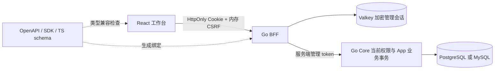
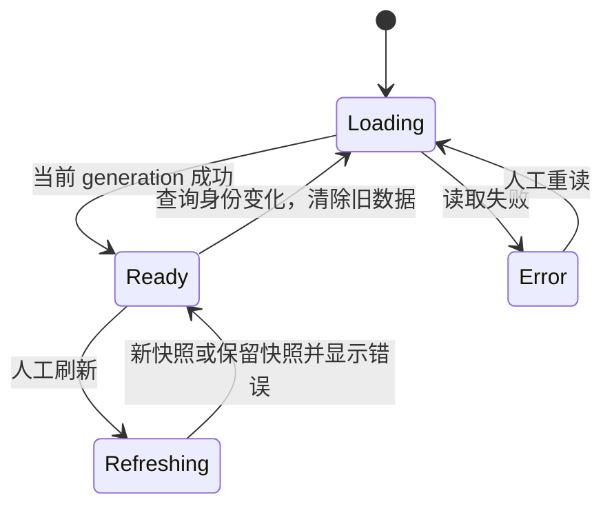
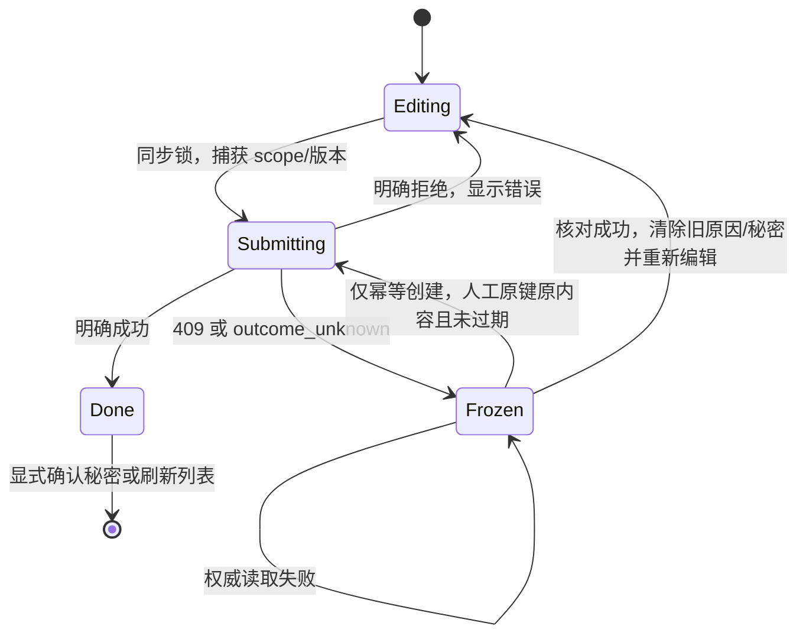

# Authova Console 架构与维护约定

更新：2026-10-15。本文描述已实现的结构；安全细节见 [BFF 安全边界](console-bff-security.md)，证据见 [验收矩阵](console-redesign-acceptance.md)。

## 1. 职责与系统边界

Console 是正式管理产品的前端与独立 Go BFF。Core 拥有身份、权限和数据库；Contracts 拥有 API 契约和 SDK。Console 没有业务数据库连接，也不定义组织或自定义业务 RBAC。



浏览器只调用同源 `/bff`。管理 token、refresh token 留在服务端；`/bff/me` 返回 operator 与 CSRF，不返回管理 token。Email/SMS 部署秘密继续由 Core 环境配置或密钥系统管理。

## 2. 信息架构

默认中文。平台入口与当前 App 分开；App 页面始终显示名称、状态、面包屑，Slug/App Key/Issuer 等技术信息折叠展示。

| 路由 | 用户任务 |
| --- | --- |
| `/login` | 平台邮箱、密码、TOTP 登录；或 App Key 跳转本 App OIDC + PKCE 登录 |
| `/apps` | 应用列表、分页、创建 |
| `/platform/operators` | 平台账号、一次性 TOTP、固定角色与状态变更 |
| `/apps/:appId` | 接入准备、真实登录配置摘要、暂停/恢复、签名密钥轮换 |
| `/apps/:appId/settings` | 名称、用户 MFA 策略、版本化保存 |
| `/apps/:appId/clients` | 回调/作用域/受众/授权类型、一次性密钥、停启用 |
| `/apps/:appId/users` | 服务端精确邮箱/手机号查询、游标列表 |
| `/apps/:appId/users/:userId` | 脱敏资料、固定管理员角色、禁用、会话撤销 |
| `/apps/:appId/connections` | OIDC、GitHub、微信网站扫码、QQ 网站登录配置与版本化编辑 |
| `/apps/:appId/audit` | 原始 action 与中文说明、原因、操作者、对象、游标浏览 |

`createHashRouter` 提供路由级阻拦，具体路由集中在 `app/App.tsx`；Hash URL 无需服务端 SPA fallback。当前 BFF、Vite proxy 和 `/bff` 为 **origin 根路径部署**，未验收任意子路径托管。

概览只显示真实读取的数据。客户端摘要区分系统与业务客户端；连接计数针对后端限定的最多 100 个连接。Email/SMS 的“已配置”表示部署配置存在，不表示真实供应商已联调。应用选择器的筛选明确仅针对已加载记录，不冒充服务端全局搜索。

## 3. 模块与依赖

```text
web/src/
  main.tsx              data router、Provider、全局错误边界
  app/                  App.tsx、navigation、appContext、ProtectionProvider
  api/                  client、endpoints、DTO、schema-compatibility、generated/
  layout/               ConsoleShell、AppSwitcher、theme
  features/
    session/            会话恢复、当前主体、唯一能力矩阵
    auth/               两种登录入口
    apps/               列表、AppLayout、概览、配置
    clients/            列表、表单、表单模型
    connections/        列表、创建/编辑、供应商配置
    users/              查询、详情、固定管理员角色
    operators/          平台账号列表、创建/编辑、角色词汇
    audit/              列表、详情、动作字典
  shared/
    components/         字段、按钮、Dialog/Drawer、状态、秘密面板、错误边界
    hooks/              useAsync、usePagedList
    utils/              格式化、供应商词汇、幂等窗口、导航辅助
  styles/               tokens → base → shell → components
```

- 只有 `api/` 发起网络请求；页面调用 endpoint 函数，不拼装任意 URL。
- Feature 的表单、校验和领域词汇就近维护，不 import 其他 feature 的页面或私有表单。
- 公开会话接口 `features/session/useSession` 是跨 feature 的明确例外；App 上下文在 `app/`，共享纯工具在 `shared/`。
- 基础组件只依赖 `app/protectionState` 最小注册接口，不依赖页面或 Core 业务规则。
- `generated/` 禁止手改。契约变更后重新生成，检查 DTO 兼容断言与实际 JSON。
- 样式使用 tokens、按层拆分。Prettier 固定格式，oxlint 与 strict TypeScript 作为维护门禁。
- Go BFF 将配置/入口、OIDC、安全头、代理、拒绝会话处理拆开，职责见安全文档。

## 4. 当前能力矩阵

| 操作 | 平台 owner | 平台 admin | 平台 auditor | App owner | App admin | App auditor |
| --- | --- | --- | --- | --- | --- | --- |
| 范围内读取 | 全部 | 全部 | 全部 | 本 App | 本 App | 本 App |
| 创建、暂停、恢复 App | 是 | 是 | 否 | 否 | 否 | 否 |
| 范围内 Client/用户/连接写入（含密钥轮换、用户恢复） | 是 | 是 | 否 | 是 | 是 | 否 |
| 登录策略修改、签名密钥轮换/紧急吊销 | 是 | 是 | 否 | 本 App | 否 | 否 |
| 设置 App 固定管理员角色 | 是 | 否 | 否 | 本 App | 否 | 否 |
| 查看平台账号 | 是 | 是 | 是 | 否 | 否 | 否 |
| 创建/变更平台账号 | 是 | 否 | 否 | 否 | 否 | 否 |

唯一前端事实来源为 `features/session/capabilities.ts`。未知角色只读；App 范围必须与路由一致。Core 逐请求重新授权；隐藏按钮只是交互。最后可用 owner 保护由 Core 执行。

## 5. 查询与会话生命周期

`useAsync` 处理单资源，`usePagedList` 处理游标列表；key 包含 App、对象、筛选条件。



key 变化同步清除旧 scope 数据；effect cleanup 和 generation 拒绝旧请求、卸载后响应。loadMore 使用同步 ref 互斥与游标去重，失败不抹去已加载数据。`reload()` 返回 Promise<boolean>，写表单可以判断核对是否成功。AppLayout 刷新失败保留原快照并显示错误；401/403 清除受保护内容。

认证 generation 保证旧请求的迟到 401 不注销新登录，旧 bootstrap 不覆盖新登录。有效 Core 401 使匹配的 BFF 会话 generation 失效，近期 MFA 策略保持。共享 Valkey 的密文 CAS fencing 见安全文档。

## 6. 写操作与不确定结果



### 共同规则

提交前用同步 ref 阻止同批次双提交；提交中禁用输入、关闭和取消。ProtectionProvider 阻止链接、Back、hash 导航绕过保护；整页刷新/关闭触发 beforeUnload。会话失效允许重新登录，不将保护变成登录死锁。

409/未知结果后冻结；读回失败保持冻结。成功核对后清除旧原因、密钥和版本，由操作者重新编辑。Client/连接使用 config_version；无版本前提的角色写入只核对当前状态，不宣称拥有配置锁。

### 创建与秘密

- App/Client 支持契约规定的幂等键。未确认 `{payload,key,at}` 只存内存，回放必须原键、相同内容，且在 **提交时再次检查** 10 分钟窗口。超时或内容变化阻止提交；操作者先核对再显式确认未生效。未处理记录阻拦普通导航。
- 连接与平台账号无幂等创建。未知结果不能自动重试。平台账号锁定后单次列表不存在也不能证明原请求不会迟到；TOTP 若已创建但响应丢失，使用 Core 本地恢复流程，Console 不增加秘密读取 API。
- Client secret/TOTP 仅进入内存秘密面板，不因 Esc、遮罩、计时关闭，明确确认后清除。期间阻止内部导航，提示整页离开；不进 URL、日志、local/sessionStorage 或自动截图。

beforeUnload 只能提示，浏览器/操作者仍能强制关闭。刷新后不持久化恢复未确认表单，须人工核对服务端；不能称为“刷新绝不会丢失秘密”。写操作没有自动重试循环。

## 7. 扩展与验收

新增领域先确定 Core/Contracts 的权限、App 范围、版本和错误语义，再添加 endpoint、feature、`app/App.tsx` 路由、`navigation.ts` 导航。新增供应商同步 provider 元信息与真实后端能力，不仅添加下拉选项。

按具体风险验收：布局检查真实截图/小屏；读取检查空/错/旧响应；写入检查重复提交、权限、409/未知结果、核对失败；秘密操作检查一次性展示与存储；契约检查实际 HTTP JSON。组件故障注入验证异常，真实 Chrome/BFF/Core 验证成功链路与授权边界。

首版没有组织、业务权限策略引擎、假统计或空模块。应用切换器无服务端模糊检索，审计无全局过滤；实际需要时通过契约演进实现，不能用当前页过滤伪装。

## 9. 安全生命周期管理

登录策略为 App 配置的六个完整开关，携带 `config_version` 和原因；部署就绪信息独立显示。系统管理客户端保留密码 + MFA 管理入口。用户恢复仅适用于 disabled，使用 `session_epoch` 比较并使旧会话保持撤销。

机密非系统 Client 提供密钥轮换与旧密钥提前撤销；打开即读取权威版本，读取失败禁用提交，新密钥仅本次展示。空宽限期不等于零秒。成功 HTTP 响应缺少关键确认字段也按结果未知处理：冻结、读回、重新决定，禁止自动重放。签名密钥展示元数据，常规轮换和紧急吊销分开；外部离线 JWT 验证方需要刷新 JWKS 或主动拒绝旧 kid。

认证器更换/恢复码再生成在 Core 自助安全页完成，无管理端绕过 MFA 入口。结构化安全事件由 Core 日志 sink 输出，Console 审计页说明其与持久化管理审计的区别；不提供虚构的安全事件查询 API。
