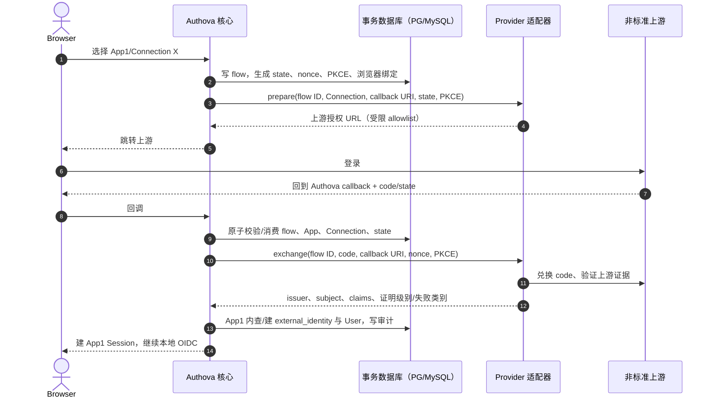

# 第三方身份与消息适配器协议 v1 草案

状态：设计草案，未实现。适配器是 Authova 核心之外的进程/服务，用于非标准第三方身份和邮件/短信供应商。标准 OIDC IdP 由核心通用实现接入，无需每家都写适配器。适配器协议不能让第三方进程直接签发 Authova token、访问用户库或修改权限。

## 1. 两类边界

| 类型 | 适配器负责 | 核心负责 |
| --- | --- | --- |
| `identity` | 与非标准上游 OAuth/API 交互，校验上游响应，返回稳定 `issuer + subject` 与已验证 claim 证据 | App/Connection/flow/state 绑定、User 关联、会话、审计、Authova token 签发 |
| `delivery` | 按指定模板/参数将邮件或短信提交供应商，分类返回接受、明确拒绝和结果不确定 | OTP 生成/摘要/尝试/有效期、限速、outbox、重试预算、用户实际验证 |

一个适配器进程可以处理多个 App，但每次调用都带经过核心鉴权的 `app_id + connection_id`，适配器必须从受限配置库取得该 Connection 的凭据。为了控制被攻破时的影响，部署可以按 App/供应商隔离适配器实例与供应商凭据；高安全画像应这样做。适配器返回的邮件地址或手机号只是声明，不自动证明本地账号所有权。

## 2. 传输、认证与版本

- 核心与适配器在私有网络通信，使用 mTLS 或等效的服务身份认证；请求包含 `protocol_version: "1"`、`request_id`、`app_id`、`connection_id`、`deadline` 和幂等键。适配器要验证调用源，限制允许的 App/Connection。
- URI 可是 HTTP/JSON 或 gRPC；首版建议 HTTP/JSON 以便部署方二开，身份/投递调用与在线内省使用独立超时和并发预算。固定 `Content-Type`、最大请求/响应体、超时和 TLS 校验。不要把未经验证的外部 URL 任意传入适配器。
- 协议向后兼容原则：同主版本只加可选字段，不改变 `status`、`issuer`、`subject` 含义；未知安全相关枚举需拒绝。核心与适配器握手时确认支持的版本，版本不匹配禁用该 Connection，不跳过验证。
- 秘钥经 KeyProvider 或 Secret Broker 以引用/受限短期凭据提供；普通请求不携带全部署主密钥、签名私钥或 App 全量配置。适配器日志不能有验证码、token、明文供应商 Secret、完整联系方式。

## 3. 非标准第三方身份流程



`prepare` 请求示例：

```json
{
  "protocol_version":"1",
  "request_id":"req_1",
  "app_id":"11111111-1111-4111-8111-111111111111",
  "connection_id":"22222222-2222-4222-8222-222222222222",
  "flow_id":"33333333-3333-4333-8333-333333333333",
  "callback_uri":"https://identity.example.com/a/a1b2c3d4e5f6/federation/callback",
  "state":"<high-entropy-value>",
  "pkce_challenge":"<S256-challenge>"
}
```

`exchange` 成功返回示例：

```json
{
  "protocol_version":"1",
  "status":"verified",
  "upstream_issuer":"https://provider.example",
  "upstream_subject":"opaque-user-id",
  "email":"user@example.com",
  "email_verified":true,
  "evidence":{"method":"signed_id_token","validated_at":"2026-09-28T10:00:00Z"}
}
```

上例只是结构示意，实际 `exchange` 成功条件由每个适配器的上游协议确定。`evidence.method` 不能由适配器自报后就视为核心能独立验签：对于非标准 Provider，核心必须把该适配器进程视为可代替这一 Connection 证明上游身份的受信组件，因此要限制其 App/Connection 权限、审计版本和配置；适配器被攻破仍会造成该范围内账号接管风险。错误结构区分 `invalid_upstream_response`、`expired_flow`、`upstream_unavailable`、`rate_limited`、`adapter_misconfigured`，核心对浏览器只给安全的统一错误。

核心在回调前自己校验 state、App、Connection 与浏览器绑定，适配器不能提交“已登录 User ID”。若上游返回邮箱与本地 User 冲突，不自动合并；必须走双方控制权证明。上游 `issuer + subject` 精确值加 Connection 形成外部身份唯一键，同一 Provider 在 App2 独立绑定。

## 4. 邮件/短信投递协议

核心先写挑战和持久 outbox，再由 worker 调适配器。消息请求至少有：`event_id`（供应商幂等键）、`app_id`、`provider_connection_id`、`channel=email|sms`、目的地址、批准的 `template_id`、模板参数、deadline。OTP 值只在该次受限投递请求中出现，不写出站事件明文或普通日志；worker 从加密 outbox 引用/受控密文读取并在发送后清除内存引用。适配器不得重新决定 OTP、有效期或用户验证结果。

```json
{
  "protocol_version":"1",
  "event_id":"44444444-4444-4444-8444-444444444444",
  "app_id":"11111111-1111-4111-8111-111111111111",
  "connection_id":"55555555-5555-4555-8555-555555555555",
  "channel":"sms",
  "destination":"+8613800000000",
  "template_id":"login_code_v1",
  "parameters":{"code":"<one-time-code>"}
}
```

返回状态：`accepted`（供应商接收，不等于到达或用户验证）、`rejected`（明确失败，不应盲重试）、`unknown`（超时或连接断开，可能已发出）。`unknown` 优先供应商查询/对账，之后按重试预算处理。每个 Adapter 给出是否支持供应商幂等键、回执查询、发送限额和费用指标。即使适配器返回 `accepted`，用户仍必须提交正确验证码才能通过挑战。`event_id` 去重保留时间至少覆盖 worker 重试期。

## 5. 配置、故障与验收

- Provider connection 包含 App、适配器类型/版本、上游 issuer/地址 allowlist、Secret reference、超时、状态与模板映射。`draft` 时先做连接测试，`active` 才可使用；禁用后新流程拒绝，已开始流程回调也要重新检查状态。
- SSRF 防护在核心和适配器双层进行：HTTPS、域名/IP 约束、DNS 重新解析策略、重定向上限、禁止 link-local/元数据地址、响应大小与时间限制。部署方可对专网 IdP 明确配置例外，不通过任意 URL 参数放开。
- 超时不产生认证成功。上游供应商限流不能放开本地验证码重试限制。适配器多版本滚动升级要有兼容矩阵和流量切换/回退机制。
- 验收包含 App1 配置不能取 App2 Secret、伪造 App/Connection 请求拒绝、state 重放拒绝、错误上游 issuer/subject 拒绝、用户绑定并发唯一、供应商超时未知结果对账、日志无 PII/Secret、适配器进程宕机不影响本地密码登录。

Go 内部使用面向用例的 `IdentityAdapter`/`DeliveryAdapter` 接口包住网络调用，但第三方二开依赖的是本协议与测试向量，不依赖 `internal/` Go 类型或数据库 schema。协议字段、错误码和 mTLS 身份配置在实现前进入版本化契约与 conformance 用例。
