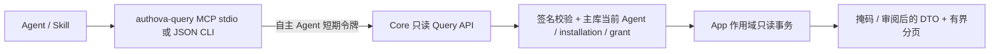

# Authova 只读查询 MCP、CLI 与 Skill

本组件查询 Authova 自身的身份与授权事实。`examples/agent-resource` 仍是业务 MCP 鉴权示例，两者的 audience 与用途独立。

## 结构



- 二进制与 SDK 位于 Contracts，运行只依赖配置中的 Core，不依赖相邻 checkout 或 Console。
- 每份配置固定一个 App、issuer、client 和 installation。工具参数没有 App、origin、URL、令牌或任意管理路径。
- Core 复用现有自主 Agent 注册、owner 审批、短令牌、撤销、配置版本和恢复隔离机制。**不新增数据库表，不增加独立查询表；统一纳入当前 schema v1 基线，不放开管理 API。**
- 仅接收 `autonomous` Agent；普通机器 token、普通用户 token、Console token、平台会话和用户委托 token 均不能替代查询身份。

## 授权

固定 audience：`urn:authova:query:APP_ID`。不把该 audience 配给其他业务资源。

| scope | 能力 | 租户级身份 |
|---|---|---|
| `authova.query.context` | 当前查询身份和权限边界 | 可以 |
| `authova.query.configuration` | App、认证策略、渠道就绪、限额和连接摘要 | 拒绝 |
| `authova.query.users` | 用户列表与详情，默认掩码联系方式 | 拒绝 |
| `authova.query.contacts` | 额外允许上述用户结果返回完整邮箱/手机 | 拒绝，且单独不能读取用户 |
| `authova.query.sessions` | 用户会话元数据，不含 Cookie/handle | 拒绝 |
| `authova.query.agents` | App 的 Agent 元数据 | 拒绝 |
| `authova.query.installations` | 接入记录 | 只限该 tenant |
| `authova.query.grants` | 授权和撤销状态 | 只限该 tenant |
| `authova.query.audit` | 审计元数据，不含自由文本 reason | 拒绝 |

租户 ID 是外部业务事实。Authova 不拥有组织/成员目录，也不能用用户资料推断租户归属。因此租户级身份即使错误地获批全局 scope，Core 仍拒绝用户、会话、配置、全局 Agent 和审计查询。接入/授权列表强制使用凭证绑定的 tenant；对象读取也逐项校验。App 级身份的 `tenant_id` 为空，明确表示管理员批准的 App 全局查询能力。

### 创建查询身份

现有 Console 的“Agent 访问”或管理 API 由 owner 执行下列操作；不是运行时 Agent 自助注册，也不需要把 owner 凭据留给 MCP。

1. `POST /api/v1/apps/APP_ID/agents`：confidential、仅 autonomous，资源为上述 query audience，scopes 只选所需只读能力，token TTL 30–300 秒。
2. `POST /api/v1/apps/APP_ID/agent-installations`：绑定该 Agent、相同资源和 scope 子集、明确负责方、有效期和审批 reason。需要 App 级查询时 tenant 为空；租户查询则固定 tenant，推荐只给 context/installations/grants。
3. 把首次展示的 Agent client secret 与返回的 installation ID 写入运行身份专用的0600配置文件。未知创建结果先查询原有创建回执，不能自动重放创建/轮换。

请求示例（使用现有管理身份与 `Idempotency-Key`，`APP_ID`/`AGENT_ID`/期限由部署方填写）：

```json
{
  "name": "Authova diagnostics",
  "description": "Approved read-only identity diagnostics",
  "kind": "confidential",
  "allowed_modes": ["autonomous"],
  "allowed_scopes": ["authova.query.context", "authova.query.configuration", "authova.query.grants"],
  "allowed_resources": ["urn:authova:query:APP_ID"],
  "redirect_uris": [],
  "token_ttl_seconds": 120,
  "grant_ttl_seconds": 3600
}
```

```json
{
  "agent_id": "AGENT_ID",
  "tenant_id": "",
  "user_id": "",
  "responsible_party": "Approved operations team",
  "resource": "urn:authova:query:APP_ID",
  "allowed_scopes": ["authova.query.context", "authova.query.configuration", "authova.query.grants"],
  "allowed_modes": ["autonomous"],
  "expires_at": 1900000000,
  "reason": "Owner approved bounded read-only diagnostics"
}
```

`expires_at` 只是格式示例，必须替换为创建时未来五分钟至一年内的时间。创建者应检查管理 API 的确认结果，不把上述示例期限直接用于生产。

## 构建与配置

```sh
go build -trimpath -o bin/authova-query ./cmd/authova-query
chmod 600 /secure/authova-query.json
```

配置示例：

```json
{
  "base_url": "https://identity.example.com",
  "issuer": "https://identity.example.com/a/APP_KEY_32_CHARACTERS",
  "app_id": "APP_ID",
  "client_id": "AGENT_OAUTH_CLIENT_ID",
  "client_secret": "PRIVATE_AGENT_SECRET",
  "installation_id": "INSTALLATION_ID",
  "scopes": ["authova.query.context", "authova.query.configuration", "authova.query.grants"]
}
```

用实际 App issuer、36字符 App UUID 和32字符 App key 替换占位值。issuer 与 base_url 必须同源，base_url 不带路径/末尾斜杠。默认 HTTPS，验证系统信任链；只有本地测试可显式设置 `allow_loopback_http: true` 使用 localhost/127.0.0.1/::1 的 HTTP。配置文件中不含人类管理员凭据；CLI 不打印短令牌，不跟随凭据请求重定向，不回传上游错误正文。

CLI：

```sh
bin/authova-query -config /secure/authova-query.json -operation context
bin/authova-query -config /secure/authova-query.json -operation configuration
bin/authova-query -config /secure/authova-query.json -operation grants -limit 20
bin/authova-query -config /secure/authova-query.json -operation user -id USER_ID
bin/authova-query -config /secure/authova-query.json -operation sessions -user-id USER_ID -limit 20
```

输出 `{ "data": ..., "request_id": "..." }`。列表使用 `next_cursor`，配置中的连接摘要使用 `connections_next_cursor`；CLI 下一页都传 `-cursor`。默认20、最大100，没有自动全量导出。scope 不允许的操作在客户端拒绝；Core 还会独立核验，客户端过滤不构成安全授权。

### MCP

以 stdio 启动，stdout 只用于协议：

```sh
/absolute/path/authova-query -mcp -config /secure/authova-query.json
```

可在支持 stdio 的 MCP 客户端中配置该 command 和 args。例如支持 `mcpServers` 的客户端可使用如下片段；具体配置位置按客户端说明：

```json
{
  "mcpServers": {
    "authova-queries": {
      "command": "/absolute/path/authova-query",
      "args": ["-mcp", "-config", "/secure/authova-query.json"]
    }
  }
}
```

工具列表按配置请求的 scopes 固定裁剪，最多12个；全部声明只读。真正的只读保证来自 Core 的封闭 GET 路由、只读事务和当前授权检查。客户端可能看到已经撤销身份的旧工具列表，但执行会被 Core 拒绝。不是新的匿名 HTTP MCP 入口，不自动注册客户端，不声明所有厂商 OAuth 互操作已验收。

### Skill

仓库提供 `skills/authova-query/SKILL.md`，可复制到目标 Agent 的 skill 目录，配合已经配置好的 MCP 使用；或设置 `AUTHOVA_QUERY_CONFIG` 后由 Skill 调用 CLI。打包文件不包含秘密，也不自动安装或覆盖用户本机配置。Skill 不代替服务端权限。

## API、错误与运维

机器契约：[query.yaml](../openapi/v1/query.yaml)。GET 前缀 `/api/v1/apps/{app_id}/query`；包含 context、configuration、users、users/{id}、users/{id}/sessions、agents、agents/{id}、installations、installations/{id}、grants、grants/{id}、audit。

每次查询从主库验证当前 token、App、client、Agent、installation、grant、期限与版本，核对签名、单一 query audience、autonomous 模式及操作 scope。复用普通内省的 principal/binding 比对；没有 token 有效性 allow 缓存。MCP 仅在内存复用未过期的短期凭证；旧凭证的每次调用仍经过 Core 验证。撤销提交前已经开始的请求可能完成，不宣称回滚在途读取。

401/403 不降级为管理员调用；404 不证明对象在其他 App/tenant 不存在；429 停止批量请求；503 明确保留依赖故障，不能伪装“查无记录”。客户端在401后清除本地旧 token，下一次显式查询才重新取短令牌，不自动重放失败查询。认证/查询错误带有 request ID，原始错误正文不输出。

Core 的有界安全事件记录查询类别、App、client 和目标摘要；HTTP/DB 预算和有界 `agent.query` 指标继续生效，不给原始 App/用户 ID 增加指标标签。日志不是无限保留的业务审计库，需按部署要求接入已有安全事件 sink。查询不会写业务对象或更改授权。

参考：[官方 MCP Go SDK](https://github.com/modelcontextprotocol/go-sdk)、[MCP tools](https://modelcontextprotocol.io/specification/latest/server/tools)。当前沿用仓库固定的 Go SDK 版本；真实外部客户端互操作、持续容量和客户部署验收分别记录。
