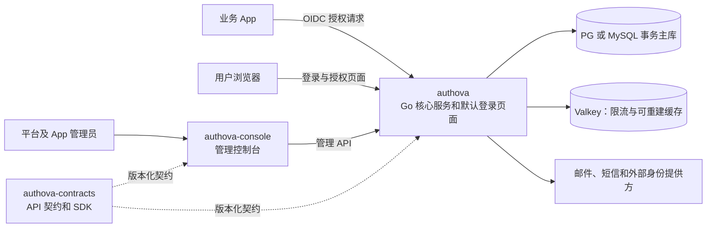

# Authova 总体设计草案 v0

状态：历史概览，已由 [技术方案 v0.4](technical-design/README.md) 取代；本页的组件选择和未决问题以 v0.4 为准。不代表已经实现、验证或达到性能指标。

## 1. 产品目标与范围

Authova 供其他团队自行部署，提供用户注册与登录、第三方身份接入、OAuth 2.0 / OpenID Connect、会话和令牌管理，以及必要的固定管理权限。服务端以 Go 为主。

一个 Authova 部署包含多个**数据隔离的 App**。App1 与 App2 是不同业务系统，即使使用同一个手机号或邮箱，也分别建立用户、凭据、外部身份绑定、会话、协议授权和管理范围。默认没有跨 App 的全局用户、自动账号合并或共享登录。一个 App 可以注册多个 Web、移动端和服务端 Client。

目标容量是超过 1000 万用户、鉴权相关请求超过 5000 QPS。这是验收目标，不是当前能力声明。压测必须分别统计本地令牌校验、在线令牌内省、令牌刷新和交互式登录；这些负载的成本与瓶颈不同。

## 2. 边界和项目划分



| 项目 | 所有权与交付物 | 可替换边界 |
| --- | --- | --- |
| `authova` | Go 核心服务与默认登录页面；拥有 App、用户、认证、会话、令牌、固定管理授权及数据库迁移 | 对外提供稳定的 HTTP/OIDC/API 契约。默认页面可定制；内部模块不承诺热插拔 |
| `authova-console` | 平台和 App 管理界面；独立构建和部署 | 通过管理 API 替换，不直接访问核心数据库 |
| `authova-contracts` | OpenAPI、错误码、兼容性规则、Go SDK；后续按需要增加其他 SDK | 契约先于具体客户端发布；生成物与服务器版本有兼容范围 |

默认登录界面是 `authova` 仓库内的 UI 模块，提供登录、注册、找回密码、第三方登录入口和授权确认页面。它随核心服务发布，减少首版的部署组件与版本组合。其他团队可定制主题；若确需完全自建页面，再通过受限、版本化的认证流程 API 接入。凭据校验、会话状态、授权码和令牌始终由 Go 核心服务管理。

例如 App1 将用户浏览器引导到 Authova 的授权端点；核心服务确认 App1 和 Client 后展示 App1 的登录页面。用户完成手机、邮箱或第三方登录，核心服务建立 App1 会话，再按协议向 App1 返回授权码并签发令牌。访问 App2 时使用 App2 的用户和会话，不沿用 App1 的登录状态。

核心按 `platform/client/identity/authn/session/protocol/audit` 分模块，一个核心运行时和事务边界；crypto/storage/transport 是技术支撑模块。管理接口由固定平台/App 角色保护。核心数据替换涉及迁移和安全语义，不承诺热插拔；首版范围见 [范围说明](technical-design/13-v1-scope.md)。

## 3. 关键领域模型

```text
Deployment
  └─ App  ← 数据隔离和配置的基本单位
       ├─ Client  ← Web、移动端、服务端调用者
       ├─ User ─ Credential / ExternalIdentity / Session
       ├─ OAuthConsent / AuthCode / RefreshFamily
       └─ AppAdminGrant  ← 固定管理权限
```

- `App` 持有标识、状态、允许的登录方式、密码和 MFA 策略、邮件/短信模板、外部身份连接器配置、令牌策略与管理员授权。
- `Client` 持有客户端类型、回调地址、授权方式、凭据及允许的 scope；不是用户池隔离单位。
- `User` 的稳定标识只在 App 内有效；邮箱和手机号的唯一性以 App 为范围。先定义规范化、验证状态和变更流程，再建立唯一约束。注销、合并和迁移必须保留审计链。
- 平台管理员和 App 管理员是两类权限主体。平台管理员的跨 App 操作必须走专用管理接口并记录审计。

## 4. App 隔离约束

1. 所有 App 所有的数据行、唯一约束、索引、缓存键、后台任务和审计事件都显式携带 `app_id`。跨表关联校验双方 `app_id` 一致。
2. App 上下文由可信入口确定：已注册 Client、已验证的 issuer/token 或管理员授权范围。不得仅信任请求体或 URL 中自报的 `app_id`。
3. 每个 App 使用独立的 OIDC issuer、签名密钥集合和发现元数据。验签同时检查 `iss`、`aud`、`exp`、签名、算法与 App 范围；其他 App 的有效令牌也必须拒绝。
4. 核心服务的数据访问 API 显式传入 App 上下文；不提供隐式全局 User 查询。数据库层可用行级安全策略作第二道隔离，落地前需评估连接池、迁移和性能影响。
5. 同一邮箱或手机号在不同 App 可分别注册。跨 App 账号关联若将来需要，必须是独立、显式、经授权的产品能力。

## 5. 对外能力与安全基线

| 领域 | 首版能力 |
| --- | --- |
| 本地身份 | Email/Phone 注册与验证、密码/验证码、MFA、账号找回 |
| 第三方身份 | 标准 OIDC/OAuth 接入、App 内绑定与解绑、必要提供方适配 |
| 协议 | Code+PKCE、Discovery/JWKS、Token、刷新/撤销/内省、Client 管理 |
| 会话 | 会话列表、退出、封号、撤销和安全审计 |
| 管理 | App 配置、固定管理员授权、Client/用户/会话管理和审计查询 |

安全设计以 [OAuth 2.0 Security BCP（RFC 9700）](https://www.rfc-editor.org/info/rfc9700/) 和 [OpenID Connect Core / Discovery](https://openid.net/specs/openid-connect-core-1_0-22.html) 为基线。回调地址精确匹配，授权码绑定 Client 与 PKCE，浏览器流程保护 `state` / `nonce`，刷新令牌轮换并可检测重用。密码使用成熟的带盐慢哈希实现；密钥和第三方 Client Secret 经密钥管理接口保存、轮换并限制读取。登录、验证码、找回和管理接口分别限流，并避免泄露账号是否存在。外部提供方失败时有明确错误、重试和降级策略，不允许绕过认证。

外部身份、邮件与短信适配器使用版本化接口。优先采用标准协议和独立进程/HTTP 适配，避免依赖 Go 运行时插件 ABI。适配器不能直接访问用户库或签名密钥；绑定结果由核心服务校验并提交。

## 6. 存储、扩容与可运维性

- 通过领域 Repository/UoW 适配 PostgreSQL 或 MySQL 事务数据源；按实际查询建立 `(app_id, ...)` 复合索引与唯一约束。先用 1000 万以上用户的真实形态数据压测单库和热点 App，再决定分区、分片或独立数据库。不能仅凭用户总量决定分片键。
- Valkey 用于限流、短期状态与热点缓存，不能作为用户、会话或凭据的唯一真相源。缓存键含 App；管理授权和内省查主库新快照，不使用旧 allow/active 放行。
- 同步链路只保留签发或决策必须完成的步骤。邮件、短信投递、Webhook 与审计投递走持久 outbox 和幂等 worker；验证码发送结果与登录成功不能混为一谈。
- Go 服务无本地持久状态，可水平扩展；数据库连接池、热点 App、公钥分发、外部短信/邮件供应商和密码哈希 CPU 成本分别压测。
- 自部署交付包括版本化数据库迁移、升级/回滚说明、备份与恢复演练、健康检查、指标、结构化日志和审计导出。日志不得含密码、验证码、令牌和第三方密钥。

## 7. 核心难点

| 难点 | 具体风险 | 设计和验证重点 |
| --- | --- | --- |
| App 隔离 | 一个遗漏的查询条件、缓存键或回调校验就可能泄露其他 App 的身份数据 | 显式 App 上下文、复合约束、跨 App 攻击用例、审计与数据库第二道防线 |
| 协议正确性 | OIDC/OAuth 实现细节错误会直接导致账户接管或令牌串用 | 复用成熟密码库、基于标准的兼容性测试、独立安全评审和密钥轮换演练 |
| 千万用户与热点 App | 总量达标不代表单个大 App 或登录高峰可承受 | 用倾斜数据集测索引、连接池、密码哈希 CPU、缓存击穿与故障恢复 |
| 撤权时效 | 自包含令牌、内省结果缓存和长会话可能延迟封号或会话撤销 | 分场景定义可接受时限，并用短期令牌、在线内省和会话状态验证 |
| 可二次开发 | 随意替换核心模块会破坏数据语义和升级路径 | 稳定公开 API 与适配器契约，数据库迁移由核心拥有，升级测试覆盖兼容性 |
| 外部依赖 | 第三方登录、短信和邮件供应商的错误、超时或限流会放大登录故障 | 每个依赖有超时、隔离、重试上限、错误分类和可观测指标 |

## 8. 首版交付顺序与验收

这是正式产品的增量交付顺序，每个阶段都需要可运行、可回滚和安全验收；不是演示实现。

1. **协议与隔离基础**：冻结 App / Client / User 的语义、OIDC issuer 和 API 契约；建立迁移、密钥管理、审计和跨 App 隔离测试。
2. **身份和登录闭环**：邮箱/手机身份、密码或验证码、托管登录、会话、授权码 + PKCE、刷新与撤销、管理控制台的最小可用功能。
3. **管理与接入闭环**：固定管理员权限、管理 Console、用户/会话管理、在线内省及审计；验证管理越权、最后 owner 和撤销。
4. **生产验收**：故障注入、升级/回滚和恢复演练、安全评审、协议兼容测试、规定负载下的容量与延迟测试。

最低验收场景：App1 与 App2 使用相同邮箱分别注册且互不可见；App1 令牌、会话、外部身份回调和管理员权限均不能用于 App2；数据库查询、缓存、任务和审计中不存在跨 App 泄漏。性能报告必须分别列出 5000 QPS 的请求类别、App 分布、用户总量、读写比例、P50/P95/P99、错误率、CPU/内存/数据库占用和故障恢复时间。未通过这些测试前不宣称达标。

## 9. 需要在实现前定稿的决定

1. 首版是否同时支持密码、邮箱验证码和手机验证码；哪些能力为安装必备，哪些依赖部署方配置供应商。
2. App 级 OIDC issuer 的 URL 规则、密钥轮换周期、访问令牌是短期自包含 JWT 还是特定场景使用在线 introspection。
3. 在线内省的调用范围、访问令牌 TTL、封号/会话撤销与管理角色撤销的可见性。
4. 部署最低依赖、PG/MySQL 版本范围、Valkey 是否可选，以及首次压测采用的硬件、数据分布和 QPS 分类。
5. 开源协议、商标与贡献规则。仓库可先私有开发；公开前须明确协议、第三方依赖合规和安全漏洞处理方式。

## 参考规范

- [RFC 9700：OAuth 2.0 Security Best Current Practice](https://www.rfc-editor.org/info/rfc9700/)
- [OpenID Connect Core 1.0](https://openid.net/specs/openid-connect-core-1_0-22.html)
- [OpenID Connect Discovery 1.0](https://openid.net/specs/openid-connect-discovery-1_0-22.html)
