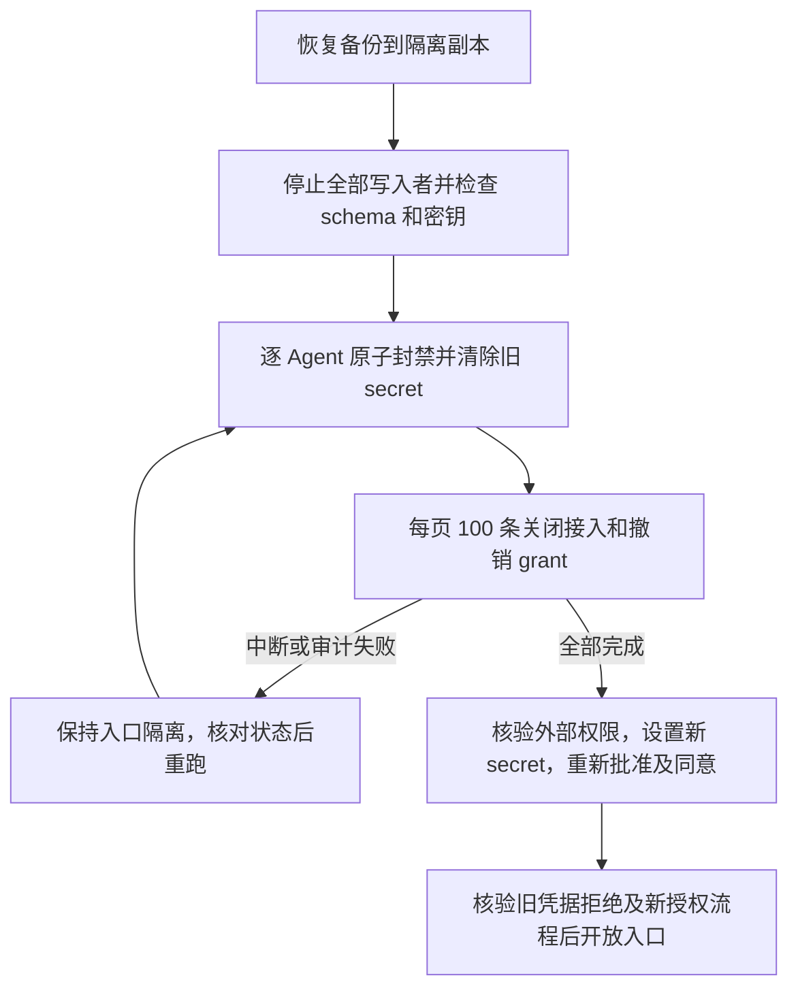

# Agent 并发、持续负载与恢复验收

执行日期：2026-10-16 至 2026-10-17，Asia/Shanghai。

<!-- FINAL_RESULTS -->
本轮本地执行已结束。**并发隔离、两库长测、1200 万用户恢复及恢复隔离通过；持续 5000 QPS 容量门禁未通过。** 没有 push。

| 验收 | PostgreSQL | MySQL |
| --- | --- | --- |
| Agent 连续混合负载 | 1 小时，通过 | 1 小时，通过 |
| 委托核验 / 实际刷新 | 106,049 / 89 | 102,938 / 88 |
| grant、接入、Agent 撤销轮次 | 164 | 161 |
| 并发窗口中签发并检查撤销的凭证 | 9,890 | 5,701 |
| 持续机器签发并严格核验 | 178,548 | 149,086 |
| 实际到期核验 | 87 | 86 |
| 普通 OAuth 连续负载 | 1 小时，32,461 次检查，14 次刷新 | 1 小时，32,435 次检查，14 次刷新 |
| 恢复后用户 / 标识 COUNT | 12,000,000 / 12,000,000 | 12,000,000 / 12,000,000 |
| 精确解密 User 与标识绑定抽样 | 1,000，通过 | 1,000，通过 |
| 全量备份 / 导入耗时 | 111.42 / 373.64 秒 | 294.09 / 1,131.14 秒 |
| 实际恢复 CLI 隔离、重跑、旧凭据拒绝 | 通过 | 通过 |

正式完整 Core race 门禁为 104 个顶层、307 个叶子测试通过、0 失败，另有 10 个显式 opt-in 场景跳过。上表专项由独立实际运行验证，不能把常规门禁的 skip 当作通过；容量专项失败保留。真实 Core/Contracts 组合门禁也通过。

机器可读的 [总结果](evidence/agent-endurance-2026-10-16/summary.json)、[长测](evidence/agent-endurance-2026-10-16/soak.json)、[恢复](evidence/agent-endurance-2026-10-16/recovery.json)、[代码与私有日志校验清单](evidence/agent-endurance-2026-10-16/manifest.json) 已保存。dump、主密钥、DSN、fixture 凭据仍只在 gitignored 私有目录。
<!-- /FINAL_RESULTS -->

## 场景与判据

| 场景 | 必须观察到的行为 |
| --- | --- |
| 同一 refresh 的 24 个并发调用 | 恰有一个旋转成功；重复使用使该 family 失效；独立同意不受影响 |
| 并发签发/刷新与 grant 撤销 | 重叠请求可在线性化边界前成功，提交后的新请求必须拒绝；所有受影响旧 token 内省 inactive；另一租户不受影响 |
| installation 禁用 / Agent 禁用 | 接入级只影响该接入；Agent 级影响它的全部接入；不扩大授权到其他 App、租户或用户 |
| 16 个相同版本撤销 | 一个 HTTP 200，其余 409，不重复执行同一 CAS |
| 业务资源耗尽 | 拒绝超预算业务请求；管理预留仍可撤销；预留不能绕过认证和 App 隔离 |
| 一小时 Agent 混合负载 | 8 个并发机器签发/核验循环，正常 120 秒 TTL；逐用户委托持续旋转、错误替换不消耗有效 refresh；反复 grant/installation/Agent 撤销；实际过期检查 |
| 一小时普通 OAuth | 正常 5 分钟 token、真实 HTTP refresh，跨过实际生命周期；不使用拉长 TTL 的 fixture 代替 |
| 1200 万用户恢复 | 每后端实际用户及标识 COUNT；每后端 1000 解密 User 精确比对、标识到用户的映射检查；恢复签名私钥可解析 |
| 恢复授权事实 | 快照中有效委托可刷新；快照前已撤销/已重放/已消费事实保留；资源内省跨 App 仍拒绝；错误主密钥不能解密授权 |
| 快照之后撤销 | 明确证明旧备份不能包含后来的撤销；恢复副本在重新开放之前必须隔离 Agent |
| 隔离命令与失败恢复 | 实际 Core CLI、错误确认拒绝、重复执行 no-op、封禁审计失败回滚、后续页失败保持已提交封禁并可重跑、跨过 100 条分页边界 |
| 多实例容量 | 实际 Core 独立进程与缓存、同一 issuer 入口、共享主库和 Valkey；核对每个活跃主体的 App/用户/Agent/接入/租户/grant/actor/resource；承压时逐实例验证撤销 |

重叠请求的判断以撤销提交及 HTTP 确认为边界，不能把客户端接收时间晚于撤销的旧请求直接称为越权；确认之后新发起的请求则不得成功。内省读取主库当前状态，没有正向 allow 缓存。

## 恢复流程新增防护

单纯恢复 dump 会回退快照之后的 grant 撤销、接入禁用和 secret 轮换。新增本地主机维护命令 `authova quarantine-agents`，不提供未鉴权 HTTP 入口：

1. 每个 Agent 先在事务内变为 disabled、提升版本，并清除当前及 previous secret 摘要，原子写入 fence 审计。
2. 后续以每页最多 100 条事务关闭接入、撤销 active grants，逐项审计。后续页故障不恢复已提交的身份封禁；审计失败导致所在事务回滚。
3. 中断后保持入口隔离，核对权威状态并重跑；已完成部分不重复提升版本。所有写入者必须在维护期间停止。
4. 由可信 owner 重新核验外部租户成员和资源权限，设置新 secret、重新批准接入；自主模式生成替代 grant，委托模式重新同意。只重新启用配置不能恢复旧 secret 或旧 grant。

不批量重写千万级用户表。Agent/installation/grant 数量仍影响处理时长；本轮没有把千万用户恢复等同于千万 Agent 接入的维护性能。该命令不恢复普通用户密码、operator 或外部业务目录，不能从旧备份推导丢失的撤销记录。



实际恢复副本中，PG 关闭 48 个 active Agent、115 个接入、186 个 active grant，清除 70 份仍存在的 Client 凭据；MySQL 对应为 101 / 246 / 397 / 149。凭据数可以超过本次由 active 变 disabled 的 Agent 数，因为原本已 disabled 的 Agent 也可能保有密钥。真实 CLI 重复运行没有再次修改状态；核验时旧 access token 尚未自然过期。分页与中断恢复另由真实两库测试覆盖，不能把这些数量当作维护吞吐测试。

## 容量测量口径

- 数据集：每后端一个 App 达到实际 1200 万用户，各有独立标识与加密 payload；活跃读取样本为均匀分散的 24 个用户及独立租户。
- 入口：本地代理分发至实际 `cmd/authova serve` 进程；每实例独立缓存，共享主 SQL 与 Valkey。保持原 issuer/Host，使用实际配置的并发预算和资源管理预留。
- 开放环到达，256 workers、有界 2048 队列；延迟从计划到达到响应，包含生成器排队及 drain。完整记录 HTTP 错误、inactive/绑定错误和掉队列。
- 使用正常 120 秒 Agent token，并通过真实 refresh 持续更新；不延长 token 生命周期。预先规定的目标为整段成功吞吐 >5000 QPS，且没有错误、掉队列或身份绑定错乱。
- 一小时目标可使用预先声明的失败提前终止边界：若已违反零错误/零掉队列要求，记录实际已执行数量和时长、尚未执行数量并停止；不能把提前失败称为完成了一小时测量。
- 恢复与造数作业结束、混合长测结束后再独立执行容量阶段。生成器、Core、Docker 仍共享物理宿主机，使用本地 HTTP；不代表跨主机、TLS、故障转移或全部用户同时活跃的容量。

### 实际容量结果与未通过原因

每后端单独运行，2 个实际 Core 进程，每进程 `GOMAXPROCS=4`、DB pool=64、App DB 并发预算=56，保留管理资源预留。目标 5100 QPS，请求一小时；在预先声明的五分钟失败边界，两库均已违反零错误判据，因此停止，**没有跑满一小时容量测量**。

| 指标 | PostgreSQL | MySQL |
| --- | --- | --- |
| 计划到达 / 实际测量 | 1,530,001 / 300.00 秒 | 1,530,001 / 300.00 秒 |
| 严格主体核验成功 QPS | 4,985.73 | 4,773.41 |
| 成功 / 失败 | 1,495,752 / 33,143 | 1,432,060 / 97,941 |
| HTTP 429 / 503 | 33,143 / 0 | 73,562 / 188 |
| HTTP 200 但未通过成功检查 | 0 | 24,191 |
| 发生器掉队列 | 1,106 | 0 |
| 正常 refresh 成功 / 错误 | 236 / 1 | 232 / 1 |
| 全部响应延迟 P50 / P95 / P99 | 6 / 17 / 103 ms | 8 / 41 / 118 ms |
| active 响应主体绑定错乱 | 0 | 0 |
| 承压时跨实例撤销 | 通过 | 通过 |

每分钟实际进程指标将多数拒绝归为 App 数据库并发预算，MySQL 另有共享预算拒绝；SQL 连接池 `WaitCount=0`。这证明请求在预算保护层被拒绝，不能据此把 SQL、调度或宿主资源中的某一项认定为唯一根因。PG 还记录了发生器掉队列。延迟从计划到达到响应，覆盖错误响应，不能把 P99 当作成功请求单独的延迟分位数。

刷新错误发生后，夹具冻结该 refresh 链，不盲目重放可能结果未知的凭据，也没有延长旧 access TTL。MySQL 记录到 24,191 次 HTTP 200 未通过成功检查，全部计为失败；原始计数未分别保存 inactive 与响应解码失败，不能把这部分精确归因为某一种。冻结链的旧 token 自然到期会返回 inactive。没有把 HTTP 200 直接计作成功。容量数据分别见 [PG](evidence/agent-endurance-2026-10-16/capacity-postgres.json)、[MySQL](evidence/agent-endurance-2026-10-16/capacity-mysql.json)，对应进程观测文件位于同目录。

本轮没有为通过压测放宽隔离/撤销条件、删除资源预算或加入 positive allow 缓存。后续容量整改需要在明确的部署规格与独立负载机下分解主库事务、入口/发生器及预算饱和，再验证合理配置或实现调整。当前不能承诺持续 5000 QPS，也不能从在线内省推导密码、签发或 1200 万用户全部活跃的吞吐。

### 长测边界

Agent 测试完成后，两库连接池 `InUse=0`。Agent 长测期间部分时段有造数/备份/恢复 I/O 与 MySQL 在线缓冲池调整，属于包含资源干扰的正确性长测。容量阶段在这些作业和普通 OAuth 长测结束后独立执行。

进程 RSS 观察仅覆盖 15:40–16:54 UTC，未覆盖两小时全过程；包含 race 检测器与持续生成的合成状态，不能证明没有内存泄漏。正常授权及长测夹具的测量源码 SHA-256 与当前源码一致，记录见 environment.json；恢复维护代码由最终完整 race 门禁和实际 CLI 验收覆盖。之后仅修正脚本短测参数与超时检查，没有改变测量时长或授权语义。

## 验收工具修正及失败记录

所有中间失败原样保留在私有 `.dev` 目录，公开证据只包含白名单指标与日志摘要校验值：

- 最初容量夹具在长时间造数后使用过期的近期 MFA。保留已完成的用户数据，使用当前 TOTP 重新认证并补建授权夹具；没有延长 MFA 期限或绕过管理验证。
- 初始长测未含管理员重新认证，作为未完成记录保留；正式长测由修正后的夹具重新计满，不累加两次时长或计数。
- 恢复维护测试最初误把整个测试库的修改总数当作单个 fixture 的总数。常规测试改用 App 绑定的维护能力并验证另一 App 不变；全库维护使用专门的实际恢复副本和真实 CLI 验证。
- 早期小库容量诊断与后台造数/恢复并行，记录到数据库预算触发的 429；这些是容量失败，不是通过，不从结果中删除。
- MySQL 造数/恢复期间临时调整本项目测试容器的缓冲池，参数变更及恢复原值均需纳入最终证据。没有调整全局 Docker VM 配额，也没有取消鉴权/撤销检查。
- 缓冲池由 512 MiB 临时调至 1.5 GiB，正式容量前已恢复为 512 MiB，并在收尾重新用 SQL 确认。容器内存限制保持 3 GiB。现有 Core/Console 两套入口 readiness 均为 200；本轮没有重跑 UI 或真实供应商验收。
- 验收脚本现要求组合 soak 至少 10 分钟，避免普通 OAuth 因过短而 skip；正式判据仍为每类一小时。总超时按两类实际请求时长加 20 分钟准备余量计算，非法容量参数在创建目录/访问数据库之前拒绝。

## 重跑

在 POSIX 开发主机上使用本项目 Docker 服务，以私有目录保存 dump、密钥及凭据：

```sh
python3 scripts/agent-acceptance.py prepare --directory .dev/my-agent-run --users 12000000
python3 scripts/agent-acceptance.py seed --directory .dev/my-agent-run
python3 scripts/agent-acceptance.py restore --directory .dev/my-agent-run
python3 scripts/agent-acceptance.py verify --directory .dev/my-agent-run
python3 scripts/agent-acceptance.py soak --directory .dev/my-agent-run --duration 1h
python3 scripts/agent-acceptance.py capacity --directory .dev/my-agent-run --driver postgres --duration 1h --qps 5100 --replicas 2 --db-pool 64 --app-db-concurrency 56 --fail-fast-after 5m
```

`soak` 的 duration 为每类负载时长：Agent 与普通 OAuth 各运行该时长，且每类内 PostgreSQL/MySQL 并行。为 mysql 单独执行最后一项，避免两个容量发生器互相竞争。准备阶段已完成用户数据但授权夹具未完成时，先核对私有日志，再用 `resume-fixture --driver postgres` 或 mysql 补建夹具，不重复造数。实际恢复校验会消费 refresh 并隔离恢复副本；重复验收必须从保留 dump 新建另一副本。

本地验收不能替代真实供应商、远端 CI、独立安全审查、客户业务目录与对象权限、多地域或客户 RPO/RTO 认证。互不信任的租户独立部署仍必须拥有独立 Agent 身份与密钥；installation 不是一份独立部署凭据。
