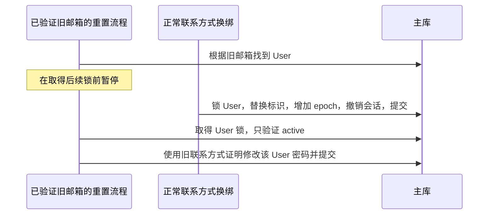

# Go 架构与代码质量复审

日期：2026-10-15。对象：`authova`、`authova-contracts`、`authova-console` 的当前工作区。**本轮评审未修改业务代码、未 commit、未 push。** 临时验证用例运行后已移除；其源码和结果作为复现证据保存。

## 1. 结论

现有分层和三个项目的职责划分可以继续使用，无需推倒重写或增加微服务。App 作用域、主库撤销判定、事务审计/outbox、标准协议库、有限资源与未知提交结果处理，已具备正式产品实现的多项基础。

但当前代码还不能按成熟身份产品的标准通过安全发布审查。本轮确认了 **4 类行为缺陷，其中两处凭据并发问题应先修复**；另外存在错误诊断和契约生成门禁不足，以及长期存储演进、主密钥轮换方面的设计债。已有测试通过证明的是已覆盖场景，不是不存在其他时序缺陷。

| 维度 | 评价 | 依据 |
| --- | --- | --- |
| 架构边界 | 方向合理 | Core 拥有身份与事务，Contracts 拥有协议，Console BFF 持管理 token；首版没有组织/业务权限占位服务 |
| 可读性 | 中等，局部需要整理 | guard clause 多、主要流程能跟踪；但管理路由内含大量业务规则、Flow 的状态事实过于集中、`bool` 参数和字符串状态不够自解释 |
| 可维护性 | 已有基础，长期演进准备不足 | PG/MySQL 共用事务 port；但领域结构直接作为持久化 gob 与部分 HTTP DTO，AppTx 达 55 个方法，跨仓库生成一致性尚未全部自动封闭 |
| 健壮性 | 常规路径较好，并发和故障细节仍不足 | context/超时/队列/连接池/commit unknown 已实现；本轮仍复现了失效凭据提交和日志失败计数错误 |
| 安全性 | 边界防护较完整，存在待修高优先级问题 | App 隔离、MFA、摘要、加密、SSRF、PKCE、CSRF 有实质代码与测试；两处证明/会话有效性与最终写入之间存在时序空档 |
| 性能 | 有工程措施，目标尚未验收 | KDF 有界、内省主库投影和解析缓存已有；历史持续 5000 QPS gate 仍失败，本轮没有重新压测 |

不提供看似精确的综合分数，也不把代码行数或测试通过数当作安全覆盖率。

## 2. 范围和方法

- Core 手写生产 Go 约 9,730 行，含 Demo/压测命令；Go 测试约 4,251 行。Console Go 约 920 行；Contracts SDK 约 130 行，另有约 10,988 行生成客户端。统计用于说明规模，不用于评价优劣。
- 深查了领域与 port、PG/MySQL adapter、凭据和会话、管理授权、协议适配、BFF refresh/代理、网络边界、安全日志与 CI。没有对全部生成代码逐行重审，也没有执行完整渗透测试。
- 在真实 PostgreSQL/MySQL 测试库上，用事务 port 包装器仅暂停指定边界，控制合法的并发先后顺序；实际读写仍由原 SQL adapter 和原应用服务完成。没有用伪造数据库返回值证明漏洞。
- 复现使用测试 fixture 构造合法的已验证流程/近期会话，故证明的是服务层并发行为；不是从未登录浏览器开始的完整攻击链。封号负面对照使用真实管理 HTTP 接口。
- 自助改密限流探针使用真实 HTTP、Cookie/CSRF 和数据库，配置始终拒绝的 Limiter，观察调用次数及响应。
- 日志探针使用返回 `io.ErrClosedPipe` 的输出 writer。
- Go vet、staticcheck、六个 Core 单元包 race、Console Go/真实 Valkey race、Contracts Go race 本轮重新执行通过。依赖漏洞扫描、全量浏览器、长压测、HA、OCI 和真实供应商本轮未重新执行。

证据：[清单](evidence/architecture-review-2026-10-15/manifest.json)、[复现源码](evidence/architecture-review-2026-10-15/probes_test.go.txt)、[输出](evidence/architecture-review-2026-10-15/probes.log)。

## 3. 必须先处理的行为缺陷

### F1 · P1：旧联系方式的重置证明可在并发换绑后修改密码

位置：`internal/application/authentication.go:309-325`，`ResetPassword`。

当前步骤先通过 `FindUser` 定位账户，再取得 App/用户锁，最终只检查 `Status == active`，没有重新验证已证明的标识仍属于该用户。可出现：

PG/MySQL 均复现。换绑实际先提交，用户已拥有新联系方式，但旧地址证明对应的重置仍成功。需要已有重置证明并赢得特定时序，不等于任意未登录请求都能重置任意账户。

建议：在短写事务内锁定用户后，重验标识当前归属；重置证明绑定目标用户及相关安全版本，防止重新分配/换绑后的旧证明继续使用。与换绑统一锁顺序，避免新增死锁。新密码 KDF 仍放在事务锁之外。

验收：同一可控时序必须拒绝重置；联系方式、当前密码和新会话状态保持正确。再覆盖邮箱/手机、标识重新分配以及并发重置。

### F2 · P1：锁定用户后，自助改密没有重验会话和安全版本

位置：`internal/application/selfcare.go:32-45`，`SelfPassword`。

当前代码在取得用户行锁之前调用 `AuthenticatedSession`；锁后仅比较 `PasswordHash`。如果另一事务重新生成恢复码、换绑 MFA 或做其他 epoch 撤销，密码 hash 可以不变，但先前通过的会话已经失效。

真实复现：暂停在 `User(..., true)` 前；正常 `RegenerateRecoveryCodes` 验证当前 TOTP，生成新恢复码、增加 epoch、撤销旧会话并提交；恢复暂停的改密，仍能修改密码。PG/MySQL 均成立。

建议：完成 KDF 后，在统一锁顺序下重验当前用户状态、epoch、当前会话有效性及原密码版本；不能只依靠 hash 相等。可提取专用于敏感写入的鉴权辅助函数，把这一不变量复用于其他凭据用例；保留短事务。

验收：恢复码/MFA/封号/会话撤销发生在受控边界时，旧证明不能继续修改密码；失败不能更改 hash 或产生成功审计。当前 `UnlinkExternal` 已有锁后重验，可参考其意图，但仍需统一全部锁顺序。

### F3 · P2：自助修改密码绕过现有分布式限流

位置：`internal/transport/account.go:111-112`。

MFA 维护分支调用 `s.limit`，密码修改分支直接调用 `SelfPassword`。在 Limiter 始终拒绝的探针中，错误旧密码仍进入 KDF，返回 401，Limiter 调用为 0；两库验证一致。

影响：已登录、近期会话可以反复尝试旧密码，并争用全局 KDF 槽位。全局有界 KDF 能限制内存/并发，但不等于每用户的尝试限制。该问题需要有效会话和 CSRF，不能夸大为直接匿名改密。

建议：KDF 前增加 App/用户维度的尝试预算，按实际部署补充来源预算；Valkey 不可用时明确失败策略。对外保持统一失败信息，日志保留分类，不记录密码。

验收：拒绝的尝试返回 429，Limiter 不可用按既定策略返回 503，并证明 KDF 未执行；跨 App 预算不串用。

### F4 · P2：日志输出失败仍计入 written，监控无法反映损失

位置：`internal/securityevents/recorder.go:90-92`。

`logger.Info` 不向调用方返回 Handler 写入错误，随后无条件增加 `written`。输出 writer 返回 `io.ErrClosedPipe` 时，当前结果仍为 `written=1, dropped=0`。这是输出阶段失败，和队列满的 dropped 是两件事。

建议：输出 adapter 暴露可观测的写入结果，分别计数 attempted/written/write_failed/queue_dropped；避免记录输出失败时再次调用同一故障 sink 造成递归。维持有界队列和认证线程不等待 I/O。

验收：输出失败进入 write_failed，而非成功写入；并发关闭时总账一致。即使增加该计数，也不能据此宣称日志具有崩溃无损持久性。

## 4. 其他明确的工程问题

### F5 · P2：数据库错误分类丢失诊断上下文

位置：`internal/storage/sqlstore/store.go:194-223`。

死锁、锁等待超时、连接中断和其他错误最终只剩宽泛的 `ErrUnavailable`；大部分原始错误和 SQLSTATE/错误编号不再可用。协议日志虽然能输出 error，却无法据此定位是哪类数据库故障。`context.Canceled`/`DeadlineExceeded` 的因果判断也可能丢失。

建议：建立内部结构化 StorageError，保留 operation、driver、SQLSTATE/编号、受控 cause 与重试语义；外部仍只映射稳定 domain/problem code。日志不要直接序列化原 SQL、DSN、参数或完整驱动报错。对死锁/超时等场景保留分类测试。

这不是要求向用户返回数据库错误详情。

### F6 · P2：生成一致性门禁不完整

依据：Contracts `.github/workflows/ci.yml:13-15`、`Makefile`、`scripts/generate-bindings.py`；Console `.github/workflows/ci.yml`。

Contracts CI 会重建并比较 OpenAPI，但没有重新运行 oapi-codegen 并比较生成 Go。Console 的 SDK 副本、TS 绑定来自相邻仓库生成，当前 CI 没有把它们与指定 Contracts 输入进行自动核对。类型断言能检查当前副本内部一致性，不能证明它与另一个仓库的最新权威输入一致。

本轮没有声称远端 CI 已失败；这是配置审查确认的覆盖缺口。当前工作区副本相符，也不代表后续提交不会漂移。

建议：为每个独立仓库固定契约输入版本/哈希，在 CI 中执行可复现生成并要求零差异；对关键变更运行 Core+契约的请求/响应兼容测试；发布验收使用三个候选版本的组合。无需为此改成一个仓库。

## 5. 需要在长期迭代前收敛的设计债

### 5.1 持久化模型不要长期等同于领域对象和 API 对象

`sqlstore` 直接 gob 编码领域结构（`store.go:308-320`），部分结构又携带 JSON tag 作为 API 输出。增加字段可兼容不等于任意重构都安全：字段改名/移位到其他结构、类型变更、默认值变化都可能改变旧数据解释。加密 payload 的变化也不一定伴随 SQL migration。

建议使用显式版本的持久化 DTO/codec 和升级测试；领域状态与公开响应分离。为旧版本密文/gob 样本建立升级 golden fixtures，检查身份、凭据、epoch 与权限事实保持。无需一次性把全部加密数据摊成数据库列，也无需引入 ORM。

### 5.2 存储主密钥与查找摘要的轮换需要可执行方案

`secure.Vault` 只有一把根密钥，Derive 固定 `authova:v1`；密文没有 key ID/codec envelope。根密钥同时派生存储加密和查找 HMAC。

运维文档已诚实说明不能直接换文件、当前不支持在线轮换。但问题不止“重新加密”：邮箱/手机号、外部 subject 等查找摘要也受影响。`external_identities` 只存 subject 摘要，没有可用于离线重算的原始 subject。因此不能承诺只扫描重加密现有 payload 就完成全部轮换。

建议把加密密钥版本和索引密钥生命周期分开设计：最小 key ID/读旧写新/迁移校验；对不可离线重算的摘要决定保留受控旧查找 key、登录迁移、可恢复加密原值或明确重新绑定路径。先实现并演练一条支持的迁移路线，再决定是否接 KMS/HSM。千万用户上线后再做这一设计，迁移成本会更高。

这是当前明确记录的产品/运维限制，不是本轮发现的远程密钥窃取漏洞。

### 5.3 抽象方向正确，但 port 与业务编排应更聚焦

`AppTx` 目前有 55 个方法；`management.go` 约 702 行，连接、Client、用户等验证和编排在 HTTP 分支里执行，部分 body 解码发生在取得管理事务锁之后。

建议按认证、凭据维护、Client、管理主体等用例拆内部文件和小接口；让 HTTP 层尽早解析有限 body、应用层持有规则，数据库 adapter 持有 SQL。使用可组合的小 port 保留**同一个事务**，不要把一次原子身份操作拆成多个独立数据库提交。

`write/private/lock` 多个 bool 参数可改成明确方法或有限枚举；公开 Service 的可变依赖应尽量由构造函数建立稳定不变量。这是局部整理，不是再创建多个服务或通用仓储框架。

### 5.4 把关键状态规则写成可检查的不变量

Flow 聚合了登录、OTP、MFA、恢复、绑定状态；字符串 `Step/Purpose/MFAOperation` 和 `Completed` 组合散落在服务和 transport 中。两处已复现问题也说明凭据修改的统一重验约定尚未收敛。

建议定义有限状态类型与 transition helper，明确每种敏感写入所要求的 User/Session/Identifier/Proof 版本；将“锁后有效性重验”写成共同约定和并发测试。无需开发可配置工作流 DSL。

### 5.5 时间和测试应更可控

应用逻辑普遍直接调用 `time.Now`，TOTP/近期 MFA/到期路径不易覆盖边界。建议应用服务注入一个小的时钟函数或接口，用于确定性的边界测试；真实时间、真实 DB 的持续流程验收仍保留。使用事务屏障测试检查并发次序，不能只靠 `-race`：race detector 不会自动发现这些跨事务逻辑错误。

### 5.6 性能优化继续以测量为准

`protocol.profile` 会解析、验签并重新签署上游引擎已经签发的 token，用于修正 typ/audience/at_hash；这是实际额外的签发 CPU 工作。可以评估在引擎支持的扩展点一次性生成最终 claims/profile，但不能以减少步骤为由破坏现有协议测试。

还应按真实画像检查主库往返、App/Owner/User 锁等待、RSA key 解码、gob/加解密、缓存命中率和 GC。当前源码观察不能证明哪一项造成历史内省压测未达标；签发路径和持久化在线内省必须分开测量。

## 6. 应保留的做法

- 事务 port 绑定 App，PG FORCE RLS/复合约束与 MySQL 作用域 SQL 共同防护；不可为了性能删除作用域校验。
- 主库读取当前 token/client/session/user 状态，缓存解析事实而不是缓存正向授权结论。
- KDF 与网络 I/O 尽量在数据库锁外，短事务内重新核验版本。修复 TOCTOU 不能退化为锁着用户做慢 KDF。
- 提交结果未知与明确失败分开；管理 secret 操作冻结、读回，客户端禁止隐式写重放。
- 显式第三方绑定，不以同邮箱自动合并；provider token 不做本地长期凭据。
- 标准协议库、受约束的上游 HTTP、PKCE/nonce、CSRF、TOTP 防重放、有限队列和关闭期限。
- 实际两库、故障、负面对照与版本证据。没有把 skip、mock 或短测包装成全部生产验收。

本轮负面对照：在 App 管理 token 初始校验后、取得后续锁前禁用管理员，两个后端均返回拒绝。最终 AdminRole 查询连接 active User，阻止了最初怀疑的写入；不列安全问题。

## 7. 建议执行次序

1. 先修 F1/F2，并把本轮探针改为“竞态必须拒绝”的永久回归；同时查同类凭据写入不变量。
2. 补 F3/F4 与结构化错误诊断；添加限流前不执行 KDF、sink 错误计数及取消分类测试。
3. 做一次有限的应用层/HTTP/port/state 整理，建立生成零差异和跨仓库组合验收。
4. 定稿版本化 payload 与存储/查找 key 的迁移方案，完成小数据演练后再按规模验收。
5. 用最终候选版本在独立资源画像上定位并重跑容量；此前持续 5000 QPS 未通过的结论维持。

不建议此时追加组织、复杂 RBAC、插件市场或新微服务。先完成已确认问题和核心工程约束的收敛。

## 8. 验证记录的解释

本轮探针共 9 个叶子检查：三个数据库缺陷各在两库复现（6），管理员禁用负面对照两库拒绝（2），输出失败计数复现（1）。最终命令 exit 0 表示这些观察均符合探针的检查目标，**不是产品安全 gate 通过**。

首次探针将管理撤权候选假设为漏洞，结果被两库拒绝导致假设检查失败；该输出保留，随后将其改为负面对照。没有把排除的猜测计入发现。

上轮 16 个新增场景、205 项前端测试和 5 条 Chrome 的结果仍是对应范围的历史证据；本轮补充的并发反例说明原覆盖分母尚不包括所有安全交错。两处 P1 修复前应视为阻断安全发布的问题。业务代码和历史证据清单未被本轮悄悄改写为“已修复”。
