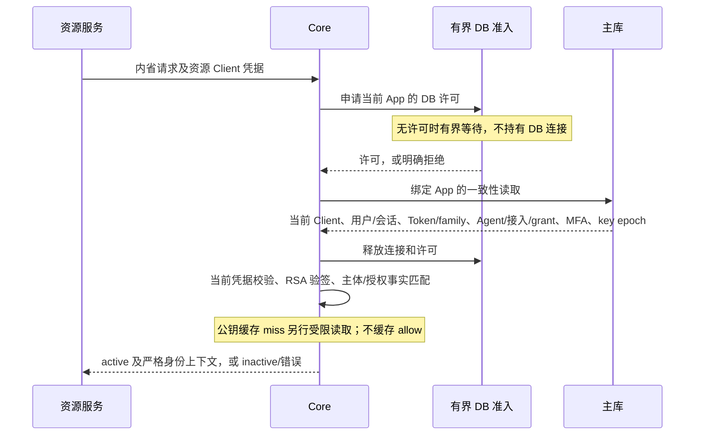

# Agent 在线内省容量整改

开始：2026-10-17，Asia/Shanghai。基线为本地提交 `d6c9709`；不 push。

<!-- FINAL_RESULTS -->
完成：2026-10-18。**PG、MySQL 独立完整一小时均通过本地 Linux 同网络画像的持续容量门槛。** 未 push；不代表目标生产部署、TLS 或所有鉴权路径的容量认证。

| 后端 | 计量 | 成功数 | 平均成功 QPS | 最低分钟 QPS | HTTP/刷新错误、掉队列、绑定错配 |
|---|---:|---:|---:|---:|---|
| PostgreSQL | 3600.0006 秒 | 18,360,000 | 5099.9992 | 5099.7658 | 全部为 0 |
| MySQL | 3600.0007 秒 | 18,360,000 | 5099.9991 | 5099.7729 | 全部为 0 |

每库实际刷新 2856 次，跨实例撤销验证均通过。PG 端到端 P99 为 4ms、最大 1712ms；MySQL P99 为 3ms、最大 700ms。最大观察排队数分别为 8054/3158，发生器缓冲 16384。包含全部计划到达延迟与排空时间；不能把该吞吐解释为最大延迟保证。两库二进制一致，源码哈希、各 18,360,000 笔结果计数和各 60 个分钟窗口已核对。两库安全回归 328 个叶测试、120 个顶层测试通过，10 个 opt-in 专项跳过另行计量；Core/Contracts 组合、Go vet、格式及秘密值扫描通过。

公开脱敏证据：[汇总](evidence/capacity-remediation-2026-10-17/summary.json)、[全部已完成尝试及失败记录](evidence/capacity-remediation-2026-10-17/attempts.json)、[回归场景](evidence/capacity-remediation-2026-10-17/quality-v5.json)、[校验清单](evidence/capacity-remediation-2026-10-17/manifest.json)。完整原始日志、实际 fixture、私钥和 dump 留在 gitignored 私有目录。
<!-- /FINAL_RESULTS -->

## 目标与口径

- PG、MySQL 各使用原有实际 1200 万用户背景数据，分别计满一小时，单独运行容量发生器。
- 实际两个 Core 进程，共享主库和 Valkey。每进程 pool=64，App DB concurrency=56；保留原管理预留，不扩大数据库许可。
- 目标到达 5100 QPS，要求整段及每分钟实际成功吞吐均超过 5000；原始 HTTP/刷新错误、inactive、绑定错误和掉队列均使门禁失败。
- 正常 Agent access TTL=120 秒，24 个分散用户/租户经真实 HTTP 每 30 秒刷新。逐响应核验 App、用户、Agent、接入、租户、grant、actor、resource、完整 scope 集和期限；不盲目重放结果未知的 refresh。
- 这是持续在线内省画像，不代表 5000 QPS 密码登录、签发或全 1200 万用户同时活跃。发生器与 Core 是独立进程，仍共享物理宿主和 Docker VM；没有独立远端负载机、TLS、跨主机 HA 或供应商认证。

## 定位与修复

### 数据库往返和许可占用

原路径用 App 事务包住整个协议处理。只读内省除主查询外，还要进行事务准备/作用域设置/提交，并在连接及许可仍被持有时执行 RSA 验签和 JSON 编码。诊断 CPU profile 中系统调用/调度占主要部分，互斥等待相对很小；不能把所有失败归为某个 SQL 索引或锁竞争。

新增存储能力 `ports.IntrospectionReader`，协议层不依赖 SQL driver。支持此能力的 adapter 在一次主库快照读取后释放连接，再验签和构造响应；其他 adapter 仍走 App 事务。两条路径共用同一条固定投影 SQL 和解码逻辑，没有增加 positive allow 缓存。

- **PG**：通过现有 pgx driver 管道发送只读 Repeatable Read BEGIN、参数化的事务内 App `set_config`、投影 SELECT、COMMIT。保留 FORCE RLS 和显式 App 条件。必须排空全部结果并确认连接 idle，才能返回事实；错误/取消后若无法确认连接状态，则丢弃连接。
- **MySQL**：使用单条 MVCC SELECT；每个物理连接固定 `autocommit=1` 和 `transaction_isolation='REPEATABLE-READ'`。拒绝关闭 autocommit、降低隔离或使用旧别名覆盖的 DSN，避免继承旧快照或读取未提交授权。写事务仍显式使用 Read Committed。
- 会话 MFA 所需密文作为同一投影的一部分返回并解码，核对会话/用户身份及正 MFA 时间；需要 MFA 时不能遗漏该条件。资源 Client 的 App/Client ID、当前 secret/status/audience 校验仍执行，JWT 仍逐请求验签并与当前事实匹配。
- 不改 schema，不加入跨 App 共享查询或绕过权限的连接。



### 瞬时预算拒绝与刷新饥饿

旧准入在预算刚满时立即拒绝，短暂往返/调度抖动也会产生 429；持续内省还可能抢在较早的 refresh 之前占用刚释放的许可。新增仅用于数据库的有界 FIFO 等待：

- 最长 1 秒，等待期间不占 DB 许可或连接；HTTP/KDF 继续立即准入或拒绝。
- 全局等待数最多 `max(8, 8 × DB pool)`，单 App 最多 `min(4 × effective App DB concurrency, global waiting bound / 2)`。
- 按可执行的请求先后分配许可；达到自身上限的 App 不阻塞其他 App。新请求不能抢走已分配给较早等待者的许可。
- App/业务共享/全局并发硬上限及管理预留保持原值；管理请求不进入业务队列，仍执行原认证和授权。
- 取消、超时、授予竞争及策略失效均清理等待和许可；同实例策略 invalidation 会拒绝该 App 的旧等待请求。
- `authova_resource_wait_duration_seconds{resource,outcome}` 记录 admitted、timeout、queue_full、cancelled、policy_changed，不使用 App 或秘密作为标签。

Linux 同网络的首次一小时尝试在第四分钟出现 14 次 App `queue_full`；已排队请求在该观察窗口均于 250ms 内获得许可，没有 timeout、刷新错误或掉队列。原等待数为全局 `4×pool`、单 App `2×effective DB limit`，可能在一个副本短暂积压有界 HTTP 突发时提前拒绝。该尝试在记录至六分钟的失败采样后停止，保留明确的中断记录，不计为一小时证据。随后将等待数调整为上述全局 `8×pool`、单 App `4×effective DB limit`，仍受全局一半限制；活跃连接、App/共享业务 DB 并发、管理预留、1 秒超时和 HTTP 总量上限均不变。新用例验证 200 个等待请求不会借用控制面许可，并验证全局及单 App 队列满时仍明确拒绝、取消后无许可泄漏。调整后的完整一小时必须重新计量，不拼接旧片段。

### 缓存过期时的重复加载与管理预留

进一步独立短测定位到：1 秒等待消除了此前的 timeout，但仍在缓存刷新时记录到 6 次 queue_full 和 8 次 shared 拒绝。路由及公钥缓存过期时，每个并发 miss 原先都会重新查库。路由读取还使用了未绑定 App 的数据库准入，可能占用管理预留。

- 内省路由的并发 miss 按 App key 合并，保持原有一分钟元数据 TTL；登录和其他路径继续读取当前路由，不扩大缓存范围。
- 公钥 miss 按 App、key epoch、kid 合并，RSA 解析放在缓存锁外。不同 epoch/kid 不复用在途加载，保留正常轮换和紧急撤销语义；失败不变成 positive cache，每个等待请求都标记自己的 dependency failure。
- 路由和资源策略读取使用独立的元数据准入：最多 `max(1, business DB capacity / 8)` 个活跃读取，并计入业务共享预算及原有有界队列。它们不能借用管理预留；通过认证的管理上下文保持原预留能力。
- 两种 flight map 都限制为 2048，并支持等待者取消及完成清理。不新增任何授权 allow 缓存，也不依赖缓存判断当前 Token 或授权是否有效。

定向并发用例验证路由及公钥各 32 个同时请求只有一次加载，epoch 改变重新读取；错误等待者明确返回依赖失败。另验证元数据占满业务预算时管理仍能获得预留。

### 刷新失败的诊断边界

旧报告没有每笔刷新错误分类，不能从旧汇总断言具体响应。新增记录只包含固定错误码、HTTP 状态、样本序号和时间；内省另外区分 HTTP、inactive、解码/传输和绑定错误，绝不写 token/secret/响应原文。

压测器原先在到达调度循环里同步抓两实例 metrics、读取 runtime 统计和写文件，慢采样会暂停调度并造成补发突发。现改为独立观察协程；计划到达时间、成功定义、有界队列及所有掉队列仍保持统计，每分钟按实际完成计数/实际时长核验吞吐。观察文件写失败也使门禁失败，不能静默丢失证据。发压器可用 `--race-generator` 验证并发安全；Core 保持普通构建。

等待队列整改后的五分钟复测通过，但紧接的一小时尝试在首分钟出现发生器缓冲掉队列，已发送请求及刷新没有错误，仍明确判失败并停止。默认 2048 个待发送作业约容纳 0.4 秒的目标到达量；同一 VM 内发生调度/处理停滞时，该上限可能先于服务端吞吐门槛触发。测量时另观察到宿主机 CPU 密集测试和磁盘扫描，不能据此确认唯一根因或撤回原失败。

工具新增显式 `--queue-capacity`（4–65536，默认保持 2048），后续独立画像使用 16384 个待发送作业。只有整数作业进入该有界缓冲，实际 HTTP 并发仍为 256；所有计划到达、排队延迟、最大端到端延迟和最终排空时间继续计量，不跳过启动阶段，也不把掉队列改算成功。报告同时记录最大到达调度滞后与最大已观察排队数。较大的缓冲不是服务端性能改进，结论须注明发生器画像；原 2048 画像的失败保留。持续低于目标的服务端仍会因实际吞吐、每分钟门槛或最终排空耗时而失败。

定向真实两库用例填满业务 DB 许可，复现 refresh 在事务前收到 429；解除压力后原 refresh 仍可旋转且 grant 不变，证明这一类失败没有消费有效 refresh。管理撤销仍成功，未认证和跨 App 操作仍拒绝。容量 fixture 遇到错误则冻结该链；随后旧 access 到期可能造成 inactive，不能把它混为授权绕过或只按 HTTP 200 统计成功。

## 安全与一致性回归

- 两库原有跨 App/租户/用户、scope/audience、撤销、密钥和 refresh 并发/reuse 用例。
- 新读取与普通 App 事务投影一致；MFA 开关及会话撤销立即生效。
- 单连接池并发交替访问两个 App，使用相同外部 Client ID，不能读出另一 App 的 token。
- 在真实数据库表锁下确认读取已经阻塞，再取消；连接池可继续读取，不保留事务或作用域。
- 在未提交的禁用/启用写入期间读取，只看已提交事实；提交后新读取可见禁用，回滚的启用不恢复访问。
- 队列的 App/全局界限、FIFO、peer/management 预留、超时、取消/授予竞争、策略失效和许可清理。
- 旧事务 adapter 仍单独读取并校验会话 MFA，不因可选快照接口而遗漏原有检查；缓存合并和元数据预算也有独立并发/race 用例。

完整 race、Core/Contracts 组合及专项最终结果以文首表格和机器证据为准。普通 gate 的 opt-in skip 不作为容量通过。

## 失败记录与限制

诊断和中间失败保留在 gitignored `.dev/agent-capacity-remediation-20261017`。CPU 剖析只在私有 Go overlay 构建中开启，不添加产品诊断端点；正式容量的 Core 服务端使用普通构建。早期短测与回归并行，有资源干扰，不能作为独立容量证明。任何五分钟或三分钟结果都不能替代完整一小时结果。

### 运行画像对照

macOS 上运行发生器、代理及 Core，通过发布端口访问 Docker VM 内数据库的画像，在整改后仍出现预算拒绝和发生器掉队列；仅把两个 Core 移入 Linux 容器也未通过。失败结果保留，不将其改记为通过，也不能据此断定唯一原因是宿主机或 VM。

随后使用同一生产代码，把发生器、代理和两个独立 Core 进程全部放进一个受限 Linux 容器，SQL/Valkey 走同一 Linux Docker 网络。这样消除了测量链路中的 macOS/VM 端口转发，但仍共用物理宿主和数据库，不能等同多机部署验收。PG 五分钟对照通过；完整两库结果以文首最终表格为准。

该容器使用 8 CPU、6 GiB 总限制，每个 Core 仍为 GOMAXPROCS=4、GOMEMLIMIT=512MiB、pool=64，App DB concurrency=56。运行 UID 为本地非 root 用户，只读文件系统、cap-drop ALL、no-new-privileges；私有 key/fixture 仅通过受限 bind mount 注入。两个 Core 具有独立进程、连接池和缓存。镜像中 Core/测试二进制的 SHA-256 已与实际提取的文件比对。

容量专用 scratch 镜像没有 CA bundle，仅用于本地开发依赖和 HTTP 测量，不作为生产发布镜像或 TLS 容量证明。原生产 Dockerfile 不由此替换。无论该画像最终是否通过，均不撤回此前 macOS 画像的失败结论。

## 复现

先按 [持续负载与恢复验收工具](AGENT-ENDURANCE-ACCEPTANCE-2026-10-16.md) 准备独立私有 run、主密钥和实际人口数据。使用完成的 fixture 分别运行，两库不要同时施压：

```sh
python3 scripts/agent-acceptance.py capacity --directory .dev/my-owned-run --driver postgres --duration 1h --qps 5100 --replicas 2 --db-pool 64 --app-db-concurrency 56
python3 scripts/agent-acceptance.py capacity --directory .dev/my-owned-run --driver mysql --duration 1h --qps 5100 --replicas 2 --db-pool 64 --app-db-concurrency 56
```

这里不设置 fail-fast，必须执行完整一小时。若失败，保留该次日志和报告，在新证据目录验证修复后的完整版本，不能累加片段或覆盖原失败。

Linux 同网络画像另有独立入口，输入为上述工具已准备、迁移并 seed 的私有目录，输出必须是新目录。命令不会修改数据库全局配置或使用 Demo 库；两个后端依次运行：

```sh
python3 scripts/agent-capacity-linux.py --directory .dev/my-owned-run --output .dev/capacity-pg-1h --driver postgres --duration 1h --queue-capacity 16384
python3 scripts/agent-capacity-linux.py --directory .dev/my-owned-run --output .dev/capacity-my-1h --driver mysql --duration 1h --queue-capacity 16384
```

该脚本在启动计量前构建普通 Linux Core/发生器，使用新的自有 scratch 镜像及 `authova-dev_default` 网络。私有 DSN 写入 0600 env 文件，不放入 Docker 命令参数或日志；中断只停止本次随机命名的容器。`result.json` 记录真实退出码，`build-metadata.json` 记录源码与二进制哈希；不能以脚本启动成功替代容量报告中的 `sustained_5000_qps_passed=true`。
