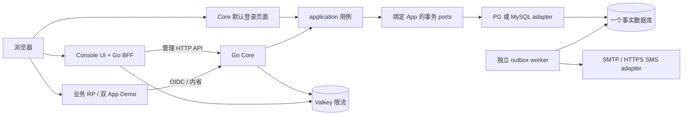
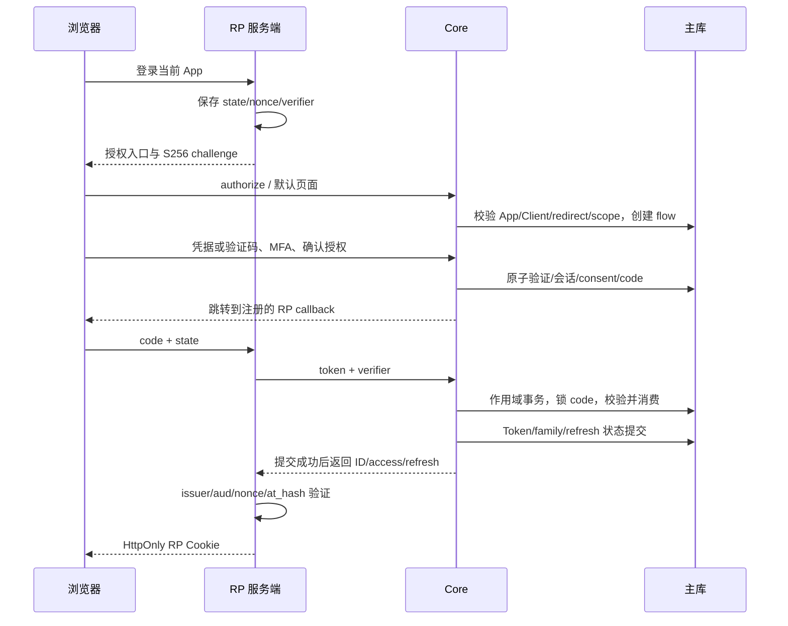
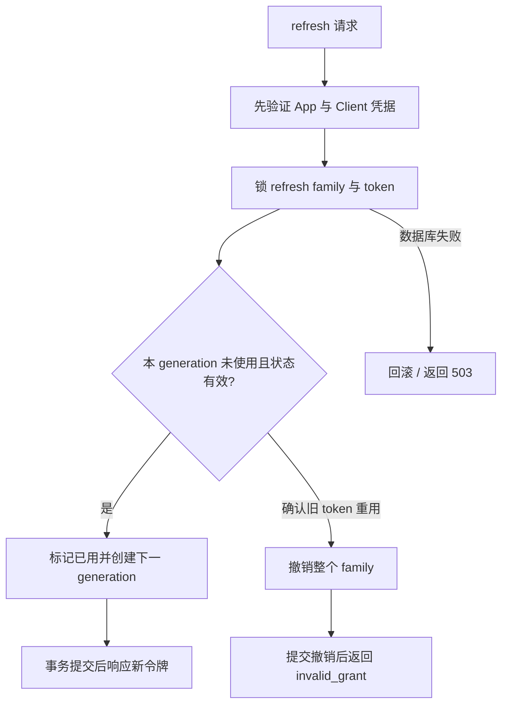

# 实际首版流程与数据库映射

2026-10-13，运行 schema 2。本页对应已实现代码；完整字段、索引、RLS及约束以 `internal/storage/sqlstore/migrations/{postgres,mysql}` 为准。图是结构说明，不是认证或图形渲染验收证据。

## 运行关系

三个仓库是源码/发布边界。Core 的 UI、协议和 application 在同一运行时；worker 可独立扩容。Console 没有 DB 凭据，替换它只需遵守管理 API。更换数据库是实现和数据迁移工作，不能承诺改一个 DSN 即完成迁移。

## Code + PKCE 登录

Email/Phone challenge 与加密 outbox 同事务；错误计数和已消费状态在确定拒绝时保留。外部 OIDC 使用独立 state/nonce/PKCE，验证 ID token 后读取 UserInfo并核对同一 subject；外部账户按 App+Connection+subject 建身份，不因同邮箱自动合并。

## Refresh 与撤销

Client 不匹配不能撤销别的 family。内省从一个主库新快照读取 App、请求 Client、Token、User、Session、family；只缓存路由/公钥，不缓存 active/管理角色。离线 JWT 验证的撤销窗口由 TTL、时钟容差和资源端缓存决定。

## 物理表映射

| 组 | 表 | 热事实和隔离 |
| --- | --- | --- |
| 平台 | apps | 唯一 app_key/slug、独立 immutable issuer、status/config_version |
| 平台管理 | operators, management_sessions, platform_idempotency | 独立 operator，不是 App User；会话摘要/当前角色/到期与创建幂等 |
| 身份 | users, identifiers | `(app_id,id)` 主键；`(app_id,kind,digest)` 唯一标识；status/epoch 为类型列 |
| Client | clients | App 内 client_id 唯一；kind/introspection 元数据约束；秘密密文 |
| 固定管理 | admin_grants, owner_locks | 只有 owner/admin/auditor；最后 owner 的修改串行化 |
| 登录态 | sessions, flows, challenges, codes | App 复合 FK；会话 epoch、挑战/code到期及一次性消费 |
| 令牌 | access_tokens, refresh_families, refresh_tokens | Token/family/session/Client 的同 App 外键；代次锁与重用撤销 |
| 外部身份 | connections, external_identities | App+Connection+subject_digest 唯一；不跨 App/email 合并 |
| 授权确认 | oauth_consents | App+User+Client；范围确认，不是业务权限引擎 |
| 签名 | signing_keys | 至多一个 current；正常旧公钥退休窗口；私钥加密 |
| 审计/异步 | audit_events, outbox, idempotency | 事务审计、加密投递 payload、领取租约/attempt fencing、请求幂等 |

PG 对 App 数据表强制 RLS并按事务设置 scope；runtime 非 owner/super/BYPASSRLS。MySQL 使用 binary collation、所有查询 App 条件与复合 FK，不能宣称有 PG RLS 的额外防线。平台 bootstrap/operator/公开 app 路由不借用 App User 数据域。

敏感字段采用按 App/用途绑定的 AES-GCM；索引使用用途分离 HMAC。内部持久化 gob 与公开 JSON DTO 分开，字段 `json:"-"` 不会把私有持久化字段丢掉。变更 gob 字段/类型需要兼容迁移；它不是第三方读库协议。

## API 与替换契约

正式管理定义在 Contracts `openapi/v1/management.yaml`。标准协议由每个 App 的 Discovery 描述。管理写操作在当前角色事务中完成，App/Client 用 config_version 防止覆盖，创建用 Idempotency-Key；网络/提交未知不能盲重试。Console BFF 仅转发并保管凭据，不重新实现 Core 权限。

邮件/短信使用真实 Sender 端口，SQL 是真实 Store 端口，OIDC 是真实连接配置。没有组织/PDP/任意插件的占位接口。新供应商、数据库或身份协议须带领域语义和同套 conformance，再讨论替换成本。
