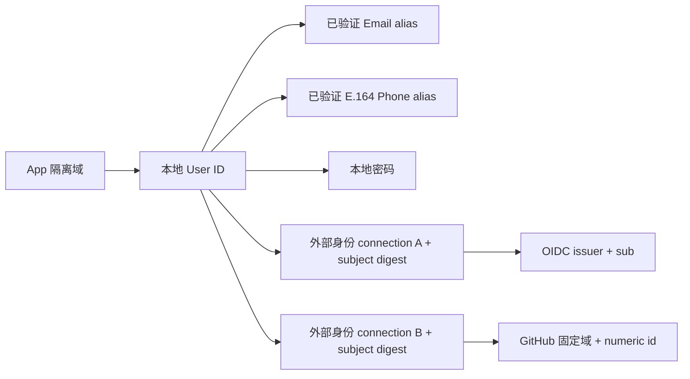

# 第三方、手机与身份绑定

更新：2026-10-14。本文区分已实现协议、可配置身份源、本地验收和真实供应商验收。

## 1. 支持矩阵

| 能力 | 当前实现 | 验证边界 |
| --- | --- | --- |
| 通用 OIDC 身份源 | Discovery、Code + S256 PKCE、nonce、RS256/ES256 ID Token、可选 UserInfo、sub 一致性 | 原有双 App OIDC 浏览器流程通过；具体供应商须使用实际凭据验收 |
| Google | 使用 OIDC 连接，issuer `https://accounts.google.com` | 协议适配，无 Google 实账号验收；不能据此宣称所有 Google 部署场景均通过 |
| Keycloak、其他符合标准的 IdP | 使用其真实 issuer 创建 OIDC 连接 | 无各供应商实账号兼容矩阵 |
| GitHub.com OAuth App | 新增 OAuth2 Code + S256 PKCE、固定 GitHub 端点、每次调用 `/user` 取稳定数字 id、读取 verified primary email | HTTP 协议 fixture、真实 PG/MySQL 回调/绑定/冲突验证；无真实 GitHub App 凭据验收 |
| 微信网站扫码、QQ 互联网站登录 | 已新增专用适配器、固定端点与 OpenID 校验 | 见 [接入说明](SOCIAL-PROVIDERS.md)；未完成真实供应商账号联调 |
| 微博、钉钉、飞书、企业微信等专用登录 | 尚无专用适配器 | 不用“通用 OAuth2”声称全部支持 |
| GitHub Enterprise、Apple 私钥 client assertion、SAML、LDAP | 首版未实现 | 不允许随意改 GitHub URL 或绕过 OIDC token authentication 方法限制 |
| 手机 | E.164 账号、已验证注册、密码/短信 OTP 登录、密码恢复、已登录用户绑定/换绑 | 两库手机号注册、OTP/密码登录、同账号换绑、跨 App 重用隔离；短信 HTTP adapter 测试与本地收件箱浏览器流程 |
| 单账号多身份源 | 一个 App user 关联多条 connection + subject；不同连接可以来自相同或不同协议 | 两库完整回调绑定两条连接、占用冲突、配置变更阻断、解绑保护 |

GitHub 官方流程：https://docs.github.com/en/apps/oauth-apps/building-oauth-apps/authorizing-oauth-apps 。邮箱接口：https://docs.github.com/en/rest/users/emails 。Google OIDC：https://developers.google.com/identity/openid-connect/openid-connect 。接入只申请登录所需 scope，不申请仓库/业务资源权限。`internal/federation.Provider` 隔离协议适配；现有安全 HTTP client、回调状态机和本地用户写入不由适配器替代。

## 2. 身份与绑定模型



- 外部身份唯一键为 `(app_id, connection_id, subject_digest)`；同一身份不能转绑给另一用户。同邮箱的第三方身份不会自动合并，避免账号接管。
- 一个账户可绑定多个连接，同一连接也可存多条上游身份。账号页显示每个连接的真实绑定数量、状态；解绑会移除此账户在该连接下的全部身份。先检查移除后的可登录性，再写入。
- 绑定必须从已登录账户页 POST 发起，验证同源、CSRF、最近 10 分钟认证；回调再次验证 Session、用户状态/epoch、flow epoch 和当前配置版本。后台没有“管理员指定 subject 强行绑定”的入口。
- 解绑锁定用户并再次验证会话；至少保留一个实际有效的登录方式：活跃其他连接，或真正已验证的 alias + 密码/已配置 OTP 渠道。资料中仅从上游得到的 email 不等于本地登录 alias，停用的连接也不计入。
- 成功解绑、手机/邮箱换绑会增加用户 epoch 并撤销已有会话及其在线有效性。解绑后需重新登录。解绑旧身份再次登录会按普通新第三方用户处理，不恢复原用户绑定。
- 管理员停用连接可能影响仅依赖该身份源的用户；停用用于应急控制，不扫描千万用户自动阻止操作，也不把已签发会话全部自动注销。需要注销时使用用户/会话撤销能力。
- 外部 subject 仅存 App 作用域 HMAC，provider secret 存加密 connection payload；上游 access/refresh token 不存入本地账号、日志或 API 响应。

## 3. 配置管理分层

### App 与 Client

Console 中现有 App 配置（名称、强制 MFA）和 Client 配置（回调地址、scope、audience、grant、停启用）保留，各自版本校验。组织与业务资源权限不加入首版。

### 外部身份连接

Console 的“连接”页支持 OIDC/GitHub/微信/QQ 创建、查看、修改名称、停启用和替换 secret。Provider 类型、issuer、client_id 创建后固定，防止原绑定被解释为另一个身份域；替换身份应用需创建新连接并由用户重新绑定。没有物理删除 API，停用保留现有绑定和审计。每 App 最多 100 个配置连接，连接列表有界；不按用户量增长。

| API | 内容 |
| --- | --- |
| `GET /api/v1/apps/{app_id}/connections` | 全部连接列表，包含 disabled，不返回 secret |
| `POST /api/v1/apps/{app_id}/connections` | `name, provider_type, issuer, client_id, client_secret`；GitHub/微信/QQ issuer 固定，可省略；OIDC 默认类型 |
| `GET /api/v1/apps/{app_id}/connections/{connection_id}` | 查询当前公开配置和 `config_version` |
| `PATCH /api/v1/apps/{app_id}/connections/{connection_id}` | 必须传 `config_version, reason`，可更新 `name, status, client_secret` |
| `GET /api/v1/apps/{app_id}/authentication-config` | 读取当前部署 Email/SMS 是否配置、支持的 provider_types 和精确 callback URL |

PATCH 例子（无需重复发送原 secret）：

```json
{"config_version":1,"reason":"切换身份供应商维护窗口","status":"disabled"}
```

secret 省略表示保留；空字符串会被拒绝；secret 无读取接口。旧版本返回 409，重新读取后人工合并。网络结果未知后先查询当前版本/状态；secret 无法读取，应核对是否版本前进并由管理员确认是否需要一次新的明确轮换，禁止盲目重放。创建接口暂不提供幂等键，结果未知需核对连接列表。Console 在提交进行中阻止 Escape/遮罩关闭，结果未知在父页面保留冻结记录；版本冲突或未知结果读回后，以服务端状态重新建立表单，清空旧输入/密钥，再由用户重新编辑。未确认的连接更新会冻结其他连接的更新，避免覆盖未确认记录。

配置变更每次增加版本并原子写审计。待完成的第三方登录绑定旧版本，变更后必须重新发起。回调最终写入用共享配置锁；配置更新用独占锁，允许同一 provider 的多个用户并行完成回调。

### 发送渠道与部署秘密

SMTP/SMS 凭据属于部署配置，首版不在 Web Console 提供全局秘密配置中心。`authentication-config` 表示已配置，不能证明供应商在线或余额/通道可用。

- Email：`AUTHOVA_SMTP_ADDRESS`、`AUTHOVA_SMTP_USERNAME`、`AUTHOVA_SMTP_PASSWORD`、`AUTHOVA_SMTP_FROM`。生产 SMTP 需 STARTTLS。
- 手机：`AUTHOVA_SMS_URL` + `AUTHOVA_SMS_TOKEN`，生产必须 HTTPS，禁止 URL userinfo/query；开发仅允许 localhost/127.0.0.1 HTTP。未配置时返回明确 unavailable，不悄悄成功。
- 修改部署环境后重启 Core 和 Worker；无需数据库存明文秘密。不同 App 的 message 带 `app_id`，适配器可按 App 选择模板、签名和厂商账号。

SMS adapter 契约：

```http
POST /send
Authorization: Bearer <adapter-token>
Idempotency-Key: <message-id>
Content-Type: application/json
```

```json
{"message_id":"unique-message-id","app_id":"app-id","destination":"+8613800138000","body":"verification message"}
```

成功返回 2xx；非 2xx/超时进入 outbox 有界重试。适配器必须按 message_id 幂等；发送超时可能已送达，不能再次产生重复短信。OTP 本身五分钟、最多五次验证，同 App 的目的/flow/current challenge 必须一致；发起端有账号/地址/IP 限流。不把 SMS 描述为防 SIM swap 的强认证；需要 MFA 时使用现有 TOTP。

## 4. 本地 Demo

`make demo` 启动 Core 18080、Console 18090、RP 18088、SMS mailbox **18089**、Mailpit 58025。Demo 自动创建 ignored `.dev/sms.token`，不输出秘密。短信地址使用 E.164（如 `+8613800138000`）。在 RP 登录页选择“手机短信”，验证码从 `http://127.0.0.1:18089` 读取；收件箱每 5 秒刷新，最多保留 15 分钟/1024 条，发送入口 Bearer + Idempotency-Key，监听仅 loopback，Host 检查抵御 DNS rebinding。它绝不向真实手机发送短信，不应部署到生产。

## 5. 存储升级与规模

新增 **003_external_lookup.sql**，为两库建立 `(app_id,user_id,connection_id)` 索引，避免账号绑定查询扫描全量 external_identities。已有 001/002 校验和保持不变；runtime 现在要求 clean schema version 3。Connection 新字段采用现有加密 payload，旧连接读取为 OIDC/version 1；首次编辑持久化新版字段，旧 pending federation flow 会失效。

升级需先停写/停止旧 Core 与 Worker，以独立 migrator 执行 `authova migrate`，再启动新二进制。index DDL 在大量绑定数据上可能持锁并占 I/O，需在目标数据规模安排维护窗口；MySQL dirty marker 仍需人工核对未确认 DDL，再恢复或前向修复。旧二进制拒绝 version 3；不提供静默降级。千万用户库和历史备份验收是此前 version 2 快照；本次索引/功能验收不替代长期容量 gate。

## 6. 本轮验收

具体报告见 `IDENTITY-ACCEPTANCE-2026-10-14.md`。供应商实账号、实际手机收件、供应商配额/风控仍需部署者使用真实凭据验收；本地协议 fixture 和短信收件箱只证明本地实现链路。
