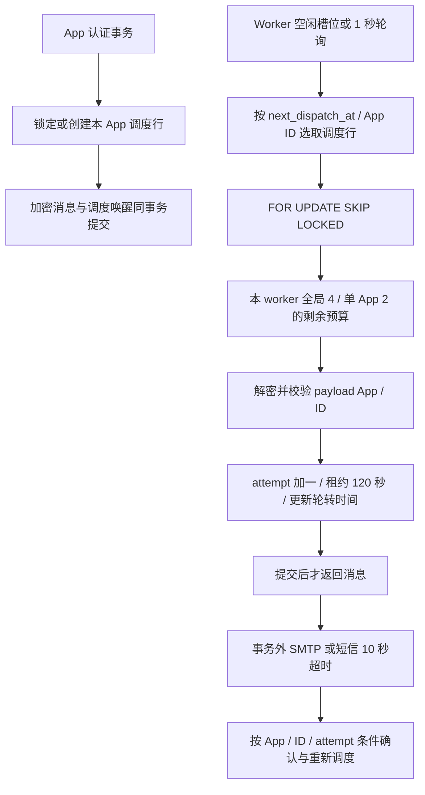

# Outbox App 调度与 Valkey TLS/ACL

## 边界

本轮不改 OAuth、Agent 委托模型、租户事实、HTTP API 或 Contracts。身份/权限继续按 App/tenant 校验，在线内省不缓存 positive active。容量整改的一小时双库画像及本轮验证分别记录，不能用短回归替代新部署的一小时容量证明。

## Outbox



- 新增 `outbox_dispatch(app_id PK/FK,last_dispatch_at,next_dispatch_at)`，时间以数据库微秒值排序；idle 为 NULL。`outbox_app_ready(app_id,completed,available_at,id)` 支持 App 内领取与最早时间查询，调度表有 `(next_dispatch_at,app_id)` 索引。
- 每 App 一次最多使用调用者余下预算。领取后把该 App 放到当前时间之后，旧 backlog 不按数量压住其他 App。新到的 quiet App 不需要等 slow App 的整批投递结束。多 worker 共用 SQL 排序，重启不丢轮转状态。
- 每个 worker 最多 4 个在途投递，其中单 App 最多 2 个；N 个 worker 上限分别为 4N/2N。该预算不声称跨实例的固定全局配额或严格按权重的延迟 SLA。`SKIP LOCKED` 保证被锁 App 不阻塞其他可领取 App；被持续持锁的 App 本身仍会延迟。
- 所有入队先锁调度行，再写消息；完成也按相同顺序，防止漏唤醒与反向锁依赖。DB 事务不跨提供方 I/O。任何 SQL/提交失败都不返回可发送的部分租约。
- 密文不可解、payload App/ID 不符或 attempts 非法时保留密文与 attempts，将该 App 暂缓 5 秒，记录不含收件人/正文的错误；其他 App 可继续。应告警并修复密钥/数据，不能把这种暂停当成功投递，也不自动销毁旧密文。
- ACK 由当前 attempts fencing；旧 worker 无权覆盖新尝试，终态不复活。保留过期检查、指数重试和 provider idempotency。SMTP 响应丢失仍有重复投递可能，不承诺端到端 exactly-once。
- `outbox_dispatch` 与原 outbox 同为可信 worker 元数据，不是新的公共 App 查询接口。原 24 张身份表的 FORCE RLS 不变。worker 的最小 DB 权限须同时包含 outbox_dispatch 的 DML；它仍持有软件主密钥，不宣称进程被完全隔离。

### 升级

备份 DB 与密钥 → 维护窗口停止旧 Core/worker/cleanup/全部写入者 → 用 migrator 升到 clean v7 → 核对七版 checksum、待处理消息及各 App 调度回填 → 部署全部新 writer/worker → 验证真实投递/重试 → 恢复流量。新增索引须在目标数据规模演练耗时。MySQL DDL/当前逐条迁移不是全程原子；失败保持 dirty，按备份恢复，不盲目清 marker。旧 writer 不维护调度表，不能混跑。

## Valkey 配置

Core 和 Console 各自包含很小的内部 transport config adapter，各自发布；Contracts 不引入基础设施依赖。两仓使用相同校验与负例，但不需要相互依赖。

| 环境变量 | 行为 |
| --- | --- |
| `AUTHOVA_VALKEY_ADDRESS` | host:port；拒绝 URL、userinfo、query、控制字符及非法端口 |
| `AUTHOVA_VALKEY_USERNAME` | 命名 ACL 用户；生产必填 |
| `AUTHOVA_VALKEY_PASSWORD` / `..._PASSWORD_FILE` | 二选一；文件最多 4096 字节，一个非空值，可有结尾 LF/CRLF |
| `AUTHOVA_VALKEY_TLS` | 仅接受 true/false；生产默认 true，显式 false 拒绝；开发默认 false |
| `..._TLS_CA_FILE` | 可选显式 PEM CA；为空使用操作系统根证书 |
| `..._TLS_SERVER_NAME` | 可选证书名称覆盖；仍执行正常 SAN 校验 |
| `..._TLS_CERT_FILE` / `..._TLS_KEY_FILE` | 可选 mTLS，必须成对、匹配且可解析 |

TLS 最低 1.2，没有 InsecureSkipVerify 参数，没有明文 fallback。关闭 TLS 却配置证书材料时拒绝启动。password file/CA/证书/连接错误不输出秘密。文件在启动时加载，轮换后须滚动重启客户端；配置不能由匿名 HTTP 请求修改。非 server 维护命令允许不配置 Valkey，生产 serve 与 Console 必须提供连接。

### ACL 与部署

- Core：仅 `~authova:limit:*`，`EVAL/INCR/PEXPIRE`；Console：仅 `~authova:console:*`，`GET/GETDEL/SET/DEL/EVAL`。
- 两者允许协议握手 `HELLO/PING/CLIENT SETINFO` 及客户端拓扑发现 `CLUSTER SHARDS/SLOTS`；不授其他 CLIENT/CLUSTER 管理子命令、不授 `+@all/~*`、`ACL/CONFIG/FLUSH*`。关闭默认用户。Lua 内也须通过键空间与命令 ACL，不能用脚本逃逸。
- 这些账号区分的是 Core 与 Console 服务角色。Core 本来服务全部 App，因此 App 隔离仍由服务端键构造与 SQL/权限层负责，ACL 不是给每 App 一个 DB 账号的替代物。
- 模板中各角色分别使用密码文件、客户端证书和私钥；BFF 不挂载 Core master.key，也不读 Core DB/SMTP env。CA 公共证书可共用。仅挂载需要的单个文件，禁止把整个秘密目录挂到 BFF。权限 0400、owner 10001:10001，父目录仅管理员可访问。
- 参照 [服务端模板](../../deploy/valkey.conf.example)、[ACL 模板](../../deploy/valkey.acl.example) 与 [部署说明](../../deploy/README.md)。ACL 文件 hash 是密码的 SHA-256；为两个角色分别生成强随机密码，私下计算 hash 并替换占位符，不能使用示例口令。
- mTLS 控制允许建立连接的客户端，默认不会自动选择 ACL 用户；本实现依然使用命名用户/密码认证。参见 [Valkey TLS 官方文档](https://valkey.io/topics/tls/)。

### 轮换与故障

正常轮换：给相同角色暂时添加新密码 → 更新对应 password file → 滚动重启该角色所有实例 → 验证新连接与真实请求 → 删除旧密码。CA/证书先建立重叠信任，再逐步更新服务端和客户端，最终移除旧 CA。不要同时删除所有有效材料。

应急泄露：停用/移除旧凭据后，由独立运维账号执行 `CLIENT KILL USER <role>`（评估该角色全部连接被断开的影响）或按事件流程重启服务端，随后验证旧凭据不能重连。`user off` 或删密码不会自动踢掉已认证连接，见 [Valkey ACL 官方文档](https://valkey.io/topics/acl/)。应用角色无权执行这类管理命令。

Valkey 不可用时限流及 BFF 共享会话操作明确拒绝，不切换到单机限流/浏览器可信会话。丢失 BFF 缓存须重新认证；恢复连通性不能复活丢失的会话。Valkey HA、持久化、备份、集群/Sentinel 故障转移与目标部署容量仍需分别验收。

## 可复跑验证

```bash
# 创建全新隔离实例，生成短期 PKI 与不同角色密码；不改现有 Valkey。
python3 scripts/valkey-tls-gates.py --evidence .dev/<new-tls-run>
# 真实两库测试，每次新库，结束清理。
python3 scripts/local-quality.py --evidence .dev/<new-quality-run>
```

TLS runner 实际运行两仓 race：合法握手/命名用户，wrong CA/SAN/password、缺失或不受信客户端证书、默认用户、明文拒绝；键前缀/Lua/管理命令拒绝；Core 共享限额、BFF 会话/CSRF/刷新；停止并重启真实 Valkey 验证 fail-closed/重连/会话丢失。默认结束删除其随机命名容器；`--keep-fixture` 仅用于后续专项验证，须最后删除 summary 中精确记录的自有实例。fixture/私钥/env 留在 `.dev`，不得发布。

实际结果及二进制/源码绑定见本轮验收记录；不会把跳过测试计为已覆盖。
