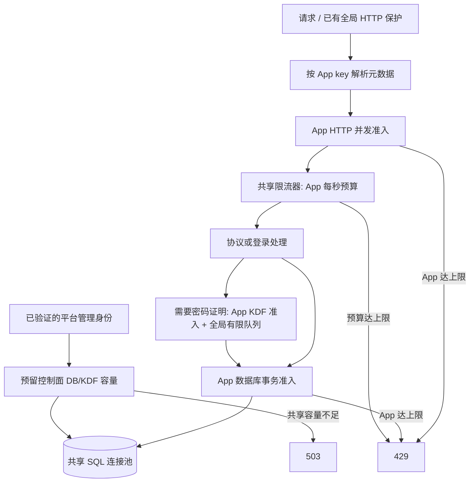
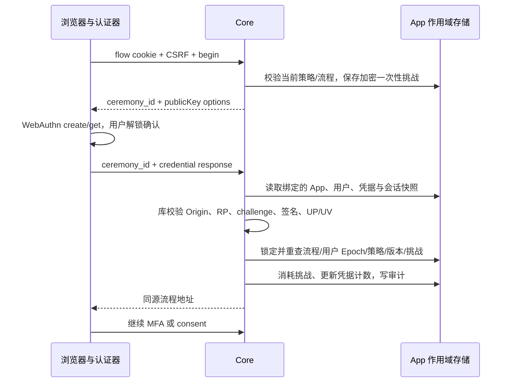
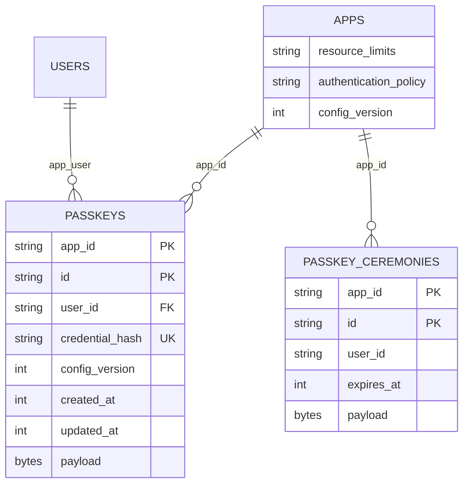

# App 资源隔离、Passkey 与可观测性

2026-10-16。本文记录本轮实现；Agent 调研见 [Agent 协作方案](../research/AGENT-COOPERATION-2026-10-16.md)。验收结果另见同目录的验收记录。许可保持 Apache-2.0；本轮不 push。

## 1. 模块与边界

| 模块 | 实现 | 约束 |
|---|---|---|
| App 资源预算 | `domain.ResourceLimits`、`resource.Manager`、SQLStore admission、transport quota | 逻辑资源隔离；不等于 CPU、内存、网络或物理数据库隔离 |
| Passkey | application 的 engine/registration/login/account 文件、版本化存储 DTO、hosted UI | 使用 go-webauthn 验证协议与密码学；App 终端用户可用，平台运营账号与系统管理客户端继续密码 + TOTP |
| 可观测性 | 独立 Prometheus registry、OTLP tracing、Core/worker instrumentation | 采样遥测与不可采样的审计事实分离；导出故障不改变授权结果 |
| Console | App 配置中的资源预算及 Passkey policy/readiness | 版本冲突/结果未知冻结，必须读取权威状态后再编辑，无自动写重试 |

Go 技术选择：go-webauthn v0.18.2、Prometheus client v1.25.0、OpenTelemetry v1.47.0、OTLP/HTTP。`x/net` 更新到 v0.60.0 以处理本轮扫描发现的 HTTP/2 漏洞报告。数据库继续支持 PostgreSQL 与 MySQL，业务层依赖 `ports.AppTx`。

## 2. 资源隔离

### 2.1 请求与事务路径



预算策略读取使用独立的有限元数据容量，不递归获取同一 App 准入。准入不等待时持有其他稀缺许可；拒绝后立即释放请求持有的许可。release 幂等。业务请求不能占满所有预留容量，已验证的平台管理操作可以读取并修复预算。

策略最多缓存 5 秒，写入成功后本实例立即失效。读取合并，缓存最多 4096 条；依赖失败短缓存 1 秒且拒绝新准入。4096 是当前每实例活跃策略缓存上限，不是用户数量上限。大量活跃 App 的部署需要单独做元数据层容量验收。跨副本的并发许可相互独立；RPS 与验证码额度由生产必需的 Valkey 共享。

| 字段 | 默认 | 可设置范围 | 语义 |
|---|---:|---:|---|
| http_concurrency | 256 | 1..100000 | 每 Core 实例该 App 同时处理请求数 |
| kdf_concurrency | 2 | 1..512 | 每 Core 实例该 App 密码计算并发 |
| db_concurrency | 32 | 1..4096 | 每 Core 实例该 App 数据库事务并发 |
| requests_per_second | 20000 | 1..1000000 | 共享计数器的 App 请求速率 |
| email_challenges_per_hour | 100000 | 1..10000000 | App 邮箱验证码请求预算 |
| sms_challenges_per_hour | 10000 | 1..10000000 | App 短信验证码请求预算 |

并发实际值还受全局容量减去控制面预留的上限约束，GET 返回 `effective_limits`。预算调低不会中断已经获得许可的请求，后续准入按新预算限制。小时预算是限流计数，包含通过相应准入检查的尝试，不是成功投递计费记录；失败不回退，以避免滥用和重复投递。

已有来源/目标地址限流继续生效。返回 Retry-After 表达保守等待上限；不是每个计数器的精确剩余时间。配额不能替代入口 DDoS 防护、供应商消费上限、进程资源限制和数据库容量规划。当前未实现 outbox 按 App 加权公平调度，也不声称拥有租户独立计算池。

### 2.2 管理 API

`GET /api/v1/apps/{id}/resource-policy`：

```json
{
  "config_version": 3,
  "limits": {"http_concurrency":256,"kdf_concurrency":2,"db_concurrency":32,"requests_per_second":20000,"email_challenges_per_hour":100000,"sms_challenges_per_hour":10000},
  "effective_limits": {"http_concurrency":256,"kdf_concurrency":2,"db_concurrency":32,"requests_per_second":20000,"email_challenges_per_hour":100000,"sms_challenges_per_hour":10000},
  "concurrency_scope":"per_process",
  "counter_scope":"shared_limiter",
  "propagation_seconds":5
}
```

`PATCH` 同一路径要求完整六项 `limits`、当前 `config_version` 和 `reason`。平台 owner/admin 或 App owner 可写；其他有管理读权限的主体只读。成功增加 App 版本并写审计；配置版本与 App 名称、MFA 和登录策略共用，以检测并发修改。

输入无效 400、权限不足 403、版本冲突 409、配额达限 429、依赖不可用 503。提交结果未知保留现有 `outcome_unknown` 语义；读回后重新编辑，不自动重放。

## 3. Passkey

### 3.1 认证与注册流程



- RP ID 是 canonical Base URL 的域名，Origin 精确匹配；HTTPS 域名可用，开发 HTTP 仅支持 localhost，拒绝 IP literal RP ID。不会为演示关闭 Origin 或签名检查。
- 必须用户在场 UP 与用户验证 UV，要求 resident credential；attestation 为 none，不做设备厂商信任认证。
- userHandle 是 App ID + User ID 的 HMAC，不使用邮箱；凭据查询键也是 App 作用域 HMAC。每个 App 只解析自己的绑定。每用户最多 20 个 Passkey。
- 当前一个部署域名共享一个 RP ID，浏览器凭据选择器可能显示用户在多个 App 的凭据；选择其他 App 凭据会被服务端拒绝。浏览器域名层面的品牌/凭据隔离需要独立 RP ID 与域名路由，目前没有实现每 App 自定义域名。
- 挑战两分钟有效，保存在服务端加密记录，绑定 flow 或近期认证会话。完成时再次检查当前策略、用户状态、Epoch、会话、凭据版本和一次性挑战，避免撤销与校验之间的竞争。
- 库保存完整 credential 状态，包括签名计数、备份标志、传输信息和必要协议元数据；拒绝 clone warning。支持规范允许的同步凭据零计数行为，不将其伪装为硬件防克隆保证。
- 登录完成保留原有 TOTP/MFA 要求；Passkey 不会绕过 App RequireMFA 或已有用户 TOTP。平台运营账号/系统管理客户端不开放该登录方式。

注册有两条路径：已有用户在近期认证的账号安全页添加；新用户先完成邮箱或手机验证，再以 Passkey 创建无密码账号。后者同时受 registration_enabled 与 passkey_enabled 约束，身份占用检查与用户/凭据写入在同一事务中完成。

删除需要近期认证、凭据所属用户与版本一致，并保留至少一种策略允许的登录方式。删除增加 User Epoch、撤销其他会话并保留当前会话的更新版本；旧的未完成注册挑战不能据此恢复凭据。添加/删除事务均写审计并 enqueue 安全通知。用户资料清除会移除 Passkey 与该用户注册挑战。

### 3.2 Hosted API

这些接口属于受保护的用户交互端点，尚未作为第三方公共 SDK API 发布。GET 不返回 credential ID、公钥或协议持久化记录。

| 路径（省略 `/a/{app_key}/ui`） | 方法 | 输入/输出 |
|---|---|---|
| /flows/{flow}/passkey/login/begin | POST | `{}` → `{ceremony_id,options:{publicKey:...}}` |
| /flows/{flow}/passkey/login/finish | POST | `{ceremony_id,credential}` → `{redirect}` |
| /flows/{flow}/passkey/register/begin | POST | `{display_name,name?}` → ceremony/options |
| /flows/{flow}/passkey/register/finish | POST | `{ceremony_id,credential}` → `{redirect}` |
| /account/passkeys | GET | `{enabled,available,items:[{id,name,config_version,created_at,last_used_at}]}` |
| /account/passkeys/register/begin | POST | `{name}` → ceremony/options |
| /account/passkeys/register/finish | POST | `{ceremony_id,credential}` → `{redirect}` |
| /account/passkeys/{id} | DELETE | `{config_version}` → `{redirect}` |

所有写请求验证精确 Origin、HttpOnly flow/session cookie 和 `X-CSRF-Token`。Hosted JSON 总请求最多 64KiB，credential 最多 60KiB。CSRF 与当前 cookie/session 绑定，不能仅持 ceremony ID 完成注册。浏览器支持检查只决定展示，服务端仍独立强制验证。

`GET/PATCH authentication-config` 新增只读 `passkey_available`，policy 新增 `passkey_enabled`。PATCH 现在要求完整七个布尔字段；省略、null 或未知字段拒绝。**旧六字段客户端须与本轮生成契约一起升级**，不能无提示地默认为 false。迁移为原有 App 补 false，原有策略其余字段保持原值。

### 3.3 新存储结构

迁移版本 005，两个数据库等价：



唯一性是 `(app_id, credential_hash)`；用户外键为 `(app_id,user_id)`。passkeys 按 App/user 索引；ceremony 有过期索引与 App/user 索引。PostgreSQL 两表均 FORCE RLS；MySQL 所有查询显式绑定 App，运行时账号无 DDL 权限。

payload 使用显式 version=1 JSON 存储 DTO，AAD 分别为 `appID:passkey:keyID` 与 `appID:passkey-ceremony:ceremonyID`。不是直接序列化领域对象。应用内部协议记录另有版本，升级库时必须评估完整记录兼容性。加密重包工具纳入两表，校验封套后重加密；真实双数据库轮换演练覆盖库存、分页、旧密钥退役。过期挑战沿用定时清理宽限期，不能假设一到 TTL 就已物理删除。

## 4. 可观测性

细节、PromQL、告警规则、Collector 与 Dashboard 见 [部署包](../../deploy/observability/README.md)。

HTTP、密码计算、数据库事务和投递处理使用 histogram；资源拒绝使用有限标签 counter。Core 与 Worker 导出共享 outbox 的有界快照，包括失败、延迟、快照新鲜度和计数截断标记。HTTP 请求关联 request ID 与可选 trace ID。App ID 允许作为受保护日志/链路中的不透明关联信息，不作为 metric label。

OTLP 导出默认关闭，配置后异步、有界、采样，生产要求 HTTPS。当前覆盖 Core/Worker 内部及出站 HTTP 子 span；不声称已经贯通 Console BFF 与第三方的分布式 trace。遥测中不记录密码、验证码、cookie、token、目的地址、请求正文、URL 参数或原始 SQL。

## 5. 演示与升级

独立 Passkey 演示：

```sh
python3 scripts/passkey-demo.py start
# RP http://localhost:18188
# Console http://localhost:18190
# 私有管理员文件 .dev/passkey-demo/bootstrap.json
AUTHOVA_PASSKEY_DEMO=1 npm run test:e2e -- tests/e2e/passkey-resources.spec.ts
python3 scripts/passkey-demo.py stop
```

helper 使用独立 authova_passkey_demo 数据库、密钥、进程身份记录和端口，不把原演示数据库替换掉。仅在已有开发依赖可用时运行，不下载新数据库镜像或清理原数据。浏览器验收使用 Chrome 虚拟认证器；用户手动演示时应在自己的设备创建真实 Passkey。测试产生的虚拟认证器随测试浏览器销毁，其私钥不随代码分发。

升级原环境前先备份，再协调 schema 005、Core、worker、Console 与契约客户端。MySQL DDL 不具备 PostgreSQL 式整体事务回滚能力；失败后应核对 authova_schema/authova_migration_history 与实际对象，不能把再次运行脚本当作安全回滚。不要将旧版 Core 指向已升级 schema。

当前所有本地验收都不等于真实微信/支付宝等供应商验收、真实 Passkey 硬件兼容认证、千万用户容量或持续 5000QPS 的生产准入。它们分别需要真实凭证、目标设备矩阵、生产近似数据量和硬件条件下的独立测试。
