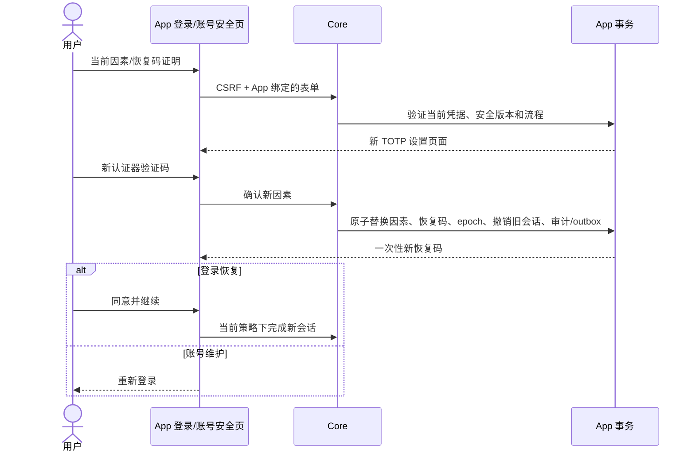

# 六项核心生命周期补齐

日期：2026-10-15。对应 [调研确认的六项缺口](../research/CORE-CAPABILITY-REVIEW-2026-10-15.md)。本文记录当前实现与验收边界；本轮不改变既定持续容量、真实供应商或多机 HA 的验收结论。

## 1. 功能与入口

| 缺口 | 已实现行为 | 用户入口 |
| --- | --- | --- |
| App 认证策略 | 完整六项布尔策略、版本校验、原因审计、当前事务状态执行；旧流程不能仅靠旧页面绕过 | Console → 配置 → 登录策略 |
| MFA 凭据维护 | 主动换绑、恢复登录时确认新 TOTP、恢复码重新生成；旧因素/恢复码/会话失效 | 本 App 的 `/ui/account`；登录 MFA 恢复流程 |
| 用户恢复启用 | disabled → active；核对当前 session_epoch；不会复活 deleted 用户或旧会话 | Console → 用户详情 → 恢复用户 |
| Client secret 维护 | 同一 Client ID 下轮换、0–86400 秒有限重叠、显式撤销前一份凭据；明文只返回一次 | Console → 客户端 → 轮换密钥 / 撤销旧密钥 |
| 签名密钥泄露处置 | 公钥状态元数据、应急撤销、必要时原子替代 signer、跨独立 verifier 缓存失效 | Console → 概览 → 签名密钥；与正常轮换分开 |
| 失败安全事件 | 认证、MFA/恢复、验证码、联邦和管理请求的有界结构化结果记录、脱敏关联和丢弃指标 | Core stdout JSON 与 `/metrics`，由部署采集系统保留 |

Core 继续拥有权限、状态及事务；Contracts 定义正式管理 API；Console 负责管理交互和 BFF。用户 MFA 不是管理人员可直接清空的字段。安全日志不是新建的 SIEM、业务事件总线或无损审计库。

## 2. 正式管理契约

基址：`/api/v1/apps/{app_id}`。全部管理写操作仍校验当前身份、当前固定角色及近期管理 MFA；不以 Console 是否显示按钮替代后端授权。

| 方法和路径 | 关键请求字段 | 结果 |
| --- | --- | --- |
| GET `/authentication-config` | — | 部署就绪状态、policy、config_version |
| PATCH `/authentication-config` | 完整 policy、config_version、reason | 最新认证配置 |
| POST `/users/{user_id}/enable` | session_epoch、reason | 已恢复用户；敏感标识按既有管理规则脱敏 |
| POST `/clients/{client_id}/secret/rotate` | config_version、grace_seconds、reason | Client、新 client_secret、previous_secret_expires_at |
| POST `/clients/{client_id}/secret/revoke-previous` | config_version、reason | Client；前一份 secret 不再可认证 |
| GET `/keys` | — | 仅 kid/current/created_at/retire_at/revoked_at 与配置版本 |
| POST `/keys/{key_id}/revoke` | config_version、reason | 被撤销 kid、必要的新 kid、配置版本 |

`client_id` 指 OAuth Client ID；secret 端点不适用于 public 或系统管理 Client。正常 `POST /keys/rotate` 继续保留旧验证公钥 24 小时，不能被解释为应急撤销。正式 OpenAPI 现为 27 路径、36 操作，生成的 Go / TS 绑定与实现同步。

六项 policy 字段：`registration_enabled`、`password_login_enabled`、`email_otp_enabled`、`phone_otp_enabled`、`federation_enabled`、`external_registration_enabled`。缺少字段、null 或未知字段不会被当作 false 默默接受。

注册开关约束新用户。当前本地注册仍需验证邮箱/手机并设置密码；禁用密码方式时，这条注册路径也不可用。验证码开关控制 OTP 登录，不禁止账号联系方式的所有权验证；它们不表示投递提供方已验通。`password_login` 是内置密码能力的可用性元数据；实际准入以 policy 为准。系统管理 Client 保留密码入口并强制 MFA，以避免关闭业务密码登录后失去管理入口。

策略会影响安全解绑对“还剩可用登录方式”的判断：未启用的方法、停用的提供方、只有资料邮箱而没有验证别名的身份均不被计作有效后路。固定管理身份的受保护管理 Client 仍按其实际可登录性判断。

## 3. MFA 流程和失败边界

主动换绑的准备步骤不提前消耗最后一个恢复码；流程只保留证明摘要/计数器，确认时再次核对凭据 epoch、旧会话和原证明。多个待确认流程只有符合当前 epoch 的一次确认可成功。登录恢复已消耗的恢复码不能重复使用；必须确认新 TOTP 才能进入同意/会话完成步骤。

恢复码重新生成要求当前 TOTP，以免仅持有最后一个恢复码的用户在响应丢失后失去唯一证明。新码只展示一次，GET 不回读。原有 TOTP 仍可用于重新认证和显式重新生成；不得把浏览器的重提表单视为自动重试机制。全部因素和恢复证明均丢失时，没有免证明的 HTTP 管理后门。

通知采用现有事务 outbox；入队不等于供应商已成功送达。后台与用户页面均不记录或持久化明文恢复码；持久层存摘要和加密的 TOTP/待确认流程。

## 4. 正常轮换与应急撤销

应急撤销与 signer 替换、App `key_epoch` 提升在同一事务提交。在线内省的原主库 liveness 查询同时读取 generation；公钥解析缓存按 `App + generation + kid` 区分，因此不同 Provider 的预热缓存不依赖进程内通知或 pub/sub 投递才能失效。管理 JWT/UserInfo 等路径检查当前 key 撤销状态。

JWKS 不返回 revoked key。外部离线 JWT 验证器依然必须刷新/拒绝旧 kid；不能承诺其缓存立即失效。私钥泄露后不能仅等待合法 token 的 TTL，因为攻击者可能继续伪造 token。实际处置顺序和最大窗口见 [OPERATIONS](OPERATIONS.md)。

Client secret 的正常轮换允许有限重叠；存在仍有效的 previous secret 时拒绝再次覆盖。轮换控制后续客户端认证，不自动等同于撤销全部已签发 token。需要止损时可禁用 Client；在线状态和离线验证继续有各自边界。

所有 secret/key 写操作在结果未知时先读取当前版本/状态，不自动重放。无法找回的明文要按丢失处理；由操作者在核对后显式撤销旧凭据或再次轮换。

## 5. 安全日志可靠性

安全事件与管理审计分别处理：关键变更审计在原事务提交，失败认证事件在事务之外进入固定队列，因此拒绝/回滚不会吞掉该操作的失败事件。日志包含固定动作/结果/原因分类、服务端 request_id、App、已知 Client/主体或 HMAC 引用、来源 HMAC 和时间；不序列化请求体或原始凭据。不信任请求中的 Forwarded 头。

队列默认 1024，字段在入队前有长度限制；超限字符串复制截断，避免切片保留大底层字符串。队列满时认证线程不等待日志 I/O，丢弃有计数；关闭期间的并发记录也计入写入/丢弃事实。关闭等待受调用者期限约束。

指标：`authova_security_events_written_total`、`authova_security_events_dropped_total`。生产采集器须负责保留、权限、轮转和告警；此机制不承诺进程崩溃时无损，也不替代既有数据库审计。

## 6. 升级和验证记录

v4 迁移增加 App 策略、key generation 和 key 撤销元数据；Client/MFA 新事实使用既有加密 payload。旧 App 默认保留原先启用的方式，旧 User/Client 不需全量重写。启动检查要求四个 checksum 和 clean v4。

本地 MySQL 第一次迁移验证暴露 TEXT 默认值不兼容：第一条 DDL 被拒绝，version=3、dirty=1、新字段数=0、历史最大版本=3。核对该状态后才解除 dirty，改用有上限的 VARCHAR，再执行正式迁移；未把失败跳过或手工标成已完成。PostgreSQL 的已执行迁移内容和 checksum 没有为此改写。

验收输出与源码校验清单在本轮证据目录；Go 测试、前端行为测试、真实 Chrome 和生产部署验证分别报告。既有持续容量不足、真实供应商、多机 HA 和外部审查边界不因本轮功能补齐而消失。
