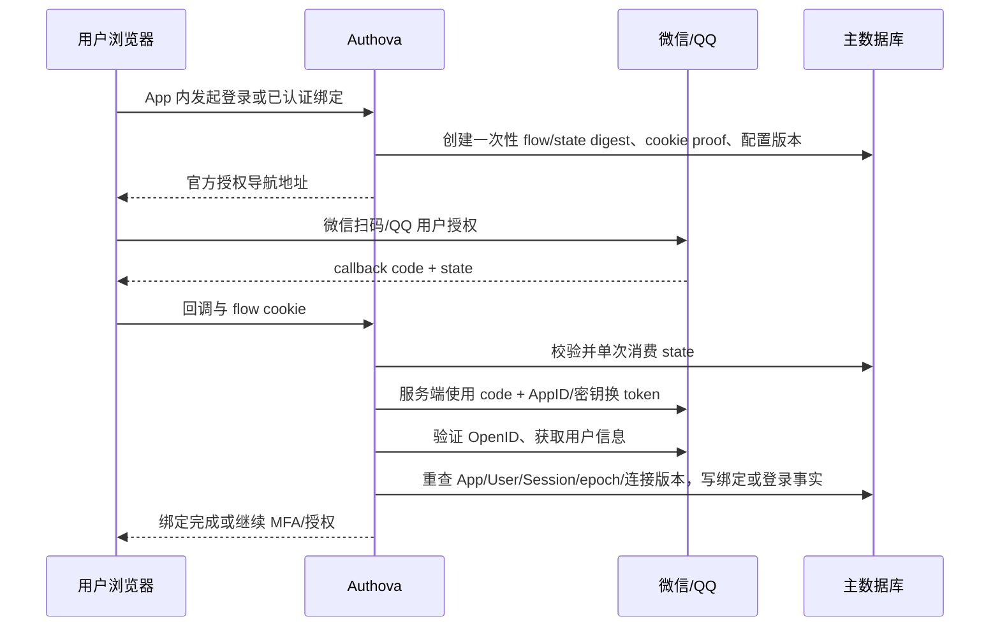

# 微信与 QQ 网站登录

更新：2026-10-14。新增两个正式协议适配器；当前 provider_type 为 `oidc`、`github`、`wechat`、`qq`。继续使用独立 App 数据域、现有绑定/解绑、MFA、审计、配置版本与 OIDC 对外授权。无需新增表或迁移，schema 仍为 3。

## 支持范围

| 类型 | 支持形态 | 凭据 | 固定身份域 |
| --- | --- | --- | --- |
| `wechat` | 微信开放平台网站扫码登录（`snsapi_login`） | 已审核网站应用 AppID / AppSecret | `https://open.weixin.qq.com` |
| `qq` | QQ 互联网站授权码登录（`get_user_info`） | 网站应用 AppID / AppKey | `https://graph.qq.com` |

移动原生 SDK 登录、微信小程序、公众号网页授权、企业微信、钉钉/飞书/微博等专用协议不在本次实现中。微信登录不会自动成为手机号登录；QQ 登录也不把 OpenID 当成 QQ 号码或 email。

## 官方依据

实现按原始官方文档核对：

- [微信网站应用登录](https://developers.weixin.qq.com/doc/oplatform/Website_App/WeChat_Login/Wechat_Login.html)
- [微信授权接口/用户信息](https://developers.weixin.qq.com/doc/oplatform/Website_App/WeChat_Login/Authorized_Interface_Calling_UnionID.html)
- [QQ 授权码与 Access Token](https://wiki.connect.qq.com/使用authorization_code获取access_token)
- [QQ 获取 OpenID](https://wiki.connect.qq.com/获取用户openid_oauth2-0)
- [QQ 用户信息](https://wiki.connect.qq.com/get_user_info)

微信官方页面经公开 HTTPS 直接读取（Web 检索工具无法打开，但原站返回 200），QQ 文档经浏览工具读取。没有用第三方博客替代协议事实。文档检索成功不等于实际供应商联调成功。

## 配置步骤

1. 在对应平台申请并审核网站应用，取得 AppID 与密钥，配置授权回调域/地址。
2. Console 选中目标 App，打开“连接”，类型选择“微信网站扫码”或“QQ 网站登录”。Client ID 填 AppID；Client Secret 分别填 AppSecret/AppKey。Issuer 由服务端固定，用户不能修改。
3. 将“联邦回调地址”按供应商要求配置到应用后台：`https://<Authova origin>/a/<app_key>/ui/federation/callback`。QQ 换码严格发送同一 redirect_uri；微信按登记的授权域校验。真实供应商审核/回调不能由 localhost 的协议 fixture 代替。
4. 启用连接后，登录页出现连接名称；已有账户在“账号安全”里从已登录、最近认证会话发起绑定。可以分别绑定微信、QQ、GitHub/OIDC，仍对应同一个本地 User ID。
5. 对接真实凭据时完成同意/取消、绑定/占用冲突、重复回调和换密钥的实际验收。Console 密钥无读取接口，更新需版本与原因，网络结果未知时先读回核对。

管理接口例子（示意凭据，无真实值）：

```json
{"name":"微信登录","provider_type":"wechat","client_id":"approved-website-appid","client_secret":"website-app-secret"}
```

```json
{"name":"QQ 登录","provider_type":"qq","client_id":"approved-qq-website-appid","client_secret":"website-app-key"}
```

使用现有 `POST /api/v1/apps/{app_id}/connections`。不传 issuer；自定义任意 issuer 会被拒绝。后续 `GET/PATCH /connections/{connection_id}` 与既有版本化操作一致，provider_type/issuer/client_id 不可变。`authentication-config.provider_types` 已包含四个类型。

## 协议与身份流程



微信调用固定 `api.weixin.qq.com/sns/oauth2/access_token` 与 `sns/userinfo`，要求有效 token/OpenID/`snsapi_login` scope，UserInfo 的 OpenID 必须与换码响应一致；若两处均有 UnionID，它们也必须一致。QQ 请求 `fmt=json` 的 token/me，校验 `me.client_id` 等于已配置 AppID，用户信息要求显式 `ret=0`；不执行或解析 JavaScript/JSONP。两者不伪造 email/email_verified，也不下载不需要的头像数据。

**持久化主键使用 OpenID，不条件切换为 UnionID。** UnionID 可缺失或以后出现，不应让同一身份换主键。外部唯一键仍为 `(app_id, connection_id, subject_digest)`；同昵称/同 UnionID/同第三方 OpenID 不自动合并不同 Authova App，也不会隐式关联两条不同连接。明确绑定来自近期认证的当前用户。

## 安全边界

- 发布的两套网站流程未提供上游 PKCE 参数承诺，本适配器不发送并假装它们已验证 PKCE。使用服务器端 confidential 凭据、强随机 state、HttpOnly flow cookie、一次性消费、配置版本与绑定会话重查。Authova 与业务客户端之间仍采用 Code + S256 PKCE。
- 供应商换码/userinfo 文档要求凭据或 token 位于 HTTPS query；因此错误只返回固定领域错误，不透传 HTTP URL、上游 errmsg 或 token。使用已有固定目标/公共地址 DNS 检查、禁止环境代理和跳转的客户端；query 不作为管理响应返回。
- 第三方 token 不存入用户/会话/flow/日志；OpenID 只保存 App 作用域 HMAC。Nickname 截断到 200 UTF-8 字节；响应有 1 MiB 限制，依赖非 200/网络失败显式失败。未验证身份不创建有效登录事实。
- 绑定仍需要同源 CSRF、最近认证、当前 session/user epoch；回调重放被拒绝，停用/改配置使旧 flow 失效。解绑仍防止删除最后一个实际可用的登录方式并撤销旧会话。
- 供应商 AppID/AppSecret/AppKey 的审核、可用性及其平台策略由实际部署者验证，不能把本地 fixture 宣称为真实扫码/QQ 账户验收。

## 验收

本轮报告为 [SOCIAL-ACCEPTANCE-2026-10-14.md](SOCIAL-ACCEPTANCE-2026-10-14.md)。两库测试经过真实管理 API、状态/会话回调、身份写入与登录复用；只有供应商 HTTP 响应用固定端点 transport fixture 替代。浏览器验证 Console 配置创建/禁用与密钥隐藏，真实供应商扫码仍未验证。沿用前轮生产候选/容量边界，不新增“生产认证通过”结论。
