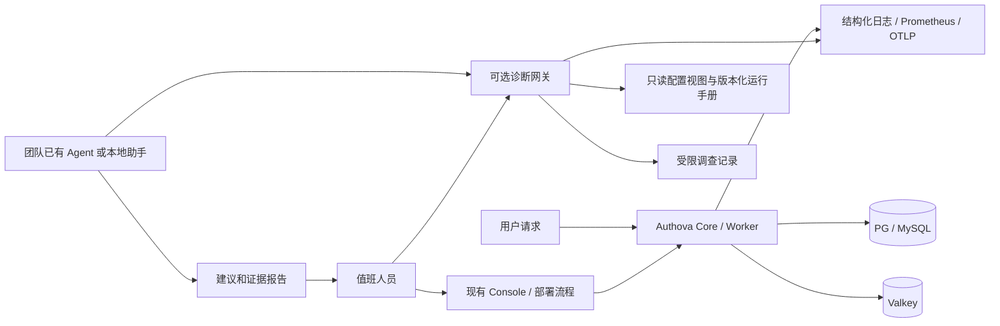
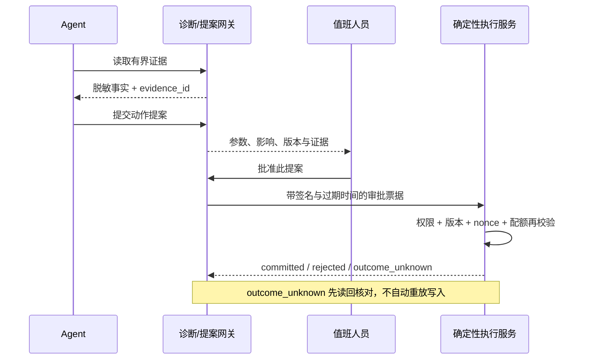

# Authova 上线后与 Agent 协作的评估和建议

> 需求澄清：用户关心为 Agent 提供身份及用户/租户授权接入。正式实施以 [Agent 身份设计](../technical-design/14-agent-identities.md) 为准。下文运维助手为早期讨论，不作为当前产品优先路线。

日期：2026-10-16。性质：调研与待讨论方案；本文没有将 Agent 接入认证链路，也没有实现 MCP、令牌交换或自动修复。

## 1. 结论与适用条件

Authova 的登录、令牌签发、内省、会话撤销和 App 隔离应当能够完全独立运行。部署 Agent 不是上线前提。数据库故障时需要确定的拒绝行为，登录高峰需要可预测的延迟；模型推理、远程模型配额和提示词不能成为这些决策的依赖。

建议准备两个相互独立的方向：

1. **运维协作**：提供受限、可审计的诊断接口，让团队已有的运维 Agent 可以解释指标、串联故障证据并形成建议。先做只读，效果得到验证后再讨论受控操作。
2. **为业务 Agent 提供身份**：让业务 Agent 以自己的机器身份，或者在用户明确委托下访问业务资源。Authova 负责证明身份与签发受限凭证；业务资源服务器继续决定具体业务操作是否允许。

首选次序：可观测性和运行手册 → 人工可用的诊断工具 → 可选只读 Agent 连接器 → 有明确客户需求时做用户委托。当前不建议增加一个内置通用 Agent 平台、模型路由器、长期记忆库或自动改权限系统。

这不是否认 Agent 的价值。它的价值主要来自跨日志、指标、配置与变更记录的归纳，以及把专业排障知识交给非认证专家使用。只有两个 App、运维人员熟悉系统且故障简单时，仪表盘与运行手册通常更便宜。多团队、多 App、多渠道、多副本、跨时区值班时，诊断助手更值得试验。用户规模大本身不能证明需要 Agent。

## 2. 从实际产品和标准中得到的证据

以下是文档可确认的能力；厂商说明不代表我们完成了安全验证、效果评测或开源可用性认证。

| 来源 | 文档确认的事实 | 对 Authova 的启发与限制 |
|---|---|---|
| [Azure SRE Agent 运行模式](https://learn.microsoft.com/en-us/azure/sre-agent/run-modes) | 区分 Review 和 Autonomous 等运行模式，操作能力还受实际身份权限限制。 | 分离调查与执行权限。不能据此推断自动处理身份安全操作可接受。 |
| [AWS DevOps Agent IAM](https://docs.aws.amazon.com/devopsagent/latest/userguide/aws-devops-agent-security-devops-agent-iam-permissions.html) | 用户使用 Agent 的权限，与 Agent 调查资源的 API 权限分开；定向执行可以配置额外角色，并以操作员审批后的修复为例。 | 人与 Agent 都要有明确身份；“操作员可以查看助手”不等于助手获得管理员权限。 |
| [Grafana Assistant RBAC](https://grafana.com/docs/grafana-cloud/platform/grafana-assistant/privacy-and-security/rbac/) | 聊天、调查、全局调查读取和管理权限有不同授权；不同部署形态的权限支持有差异。 | 多 App 的调查报告本身也要控制访问，不能把所有日志合并进一个共享聊天。 |
| [kagent 的工具审批](https://kagent.dev/docs/kagent/1.x/agents/human-in-the-loop/) | 工具绑定可要求审批，由运行 harness 处理暂停和继续；不同 harness 的支持范围有差异。 | 可以复用团队已有执行框架，但 Authova 网关仍须自行检查权限。框架弹出批准按钮不是后端授权证明。 |
| [Auth0 Token Vault](https://auth0.com/docs/secure/call-apis-on-users-behalf/token-vault) | 保存连接账号的外部访问/刷新令牌，通过受控交换支持用户代表调用，包括业务 Agent。 | 社交登录与对第三方 API 的持续代理授权是两类需求。当前 Authova 的登录连接不具备同等凭证托管能力。 |
| [OWASP Agent 安全指南](https://cheatsheetseries.owasp.org/cheatsheets/AI_Agent_Security_Cheat_Sheet.html) | 涵盖工具滥用、提示注入、最小权限和人在环路等控制。 | 不应靠系统提示词限制越权；工具入口要验证租户、权限、参数和输出。 |

**我的推论**：实际可取的共同点是身份、受限工具、访问边界和审批，而不是必须内置某个 Agent。我们不需要为了追赶产品标签，把首版收敛后的认证服务扩展成一个通用自动化平台。

## 3. 方向 A：运维助手解决什么问题

### 3.1 场景与允许范围

| 实际问题 | 需要的证据 | Agent 可以交付的结果 | 确定性执行边界 |
|---|---|---|---|
| 管理后台出现 dependency_unavailable | /readyz、Core/BFF 状态、DB 和 Valkey 检查、请求编号、版本 | 按证据指出故障依赖、受影响时间段、下一条检查命令 | 数据丢失、切库和重建必须走现有恢复流程，不能自动生成新库替代旧库 |
| App 1 突发流量拖慢其他 App | App 预算、429/503、KDF/DB 时延、App 作用域安全事件 | 区分 App 配额、全局容量、数据库瓶颈，并给出配置差异建议 | 不能自动调高所有预算或取消限流；物理容量扩容仍属部署系统 |
| 短信或邮件收不到 | 通道是否配置、出站错误类别、outbox 延迟/失败/新鲜度 | 判断未配置、供应商故障、工作进程停止、消息过期等可能原因 | 不读取验证码正文，不自动更换供应商密钥或重复发送验证码 |
| Passkey 无法使用 | App policy、canonical origin/RP ID、浏览器错误类别、流程状态 | 区分 IP 域名问题、取消、过期、UV 不足、挑战不匹配等 | 不能降低 UV、放宽 Origin 或将一次拒绝解释为账号已被盗 |
| 登录方式配置后“锁住用户” | 当前 policy、连接状态、通道就绪、配置版本、审计差异 | 呈现哪些方式实际可用，形成待审核补救方案 | 当前版本仍允许维护期全部关闭；变更必须由有权限的人明确提交 |
| 密钥轮换后资源调用失败 | kid、公开 JWKS 状态、配置/撤销时间、消费方缓存信息 | 区分过期缓存、紧急撤销与时钟问题 | 不接触私钥，不自动恢复被撤销密钥 |
| 安全日志出现攻击流量 | 脱敏事件、限流统计、来源摘要、时间窗 | 关联重复模式，列出证据和不确定性 | 不能自动封禁大范围用户、重置 MFA 或授予管理员角色 |
| 发布后 p95 上升 | 版本、发布时刻、采样链路、DB/KDF/出站耗时 | 给出与变更的相关性、备选假设和验证步骤 | 相关性不等于因果；回滚由发布流程处理并校验数据库兼容性 |

配额指标没有 App ID 标签，以避免无界时间序列。因此按 App 排查必须结合已授权的结构化安全日志，而不能从全局指标猜测某个 App 是原因。采样 trace 的缺失也不能证明某个请求没有发生。

### 3.2 部署结构



诊断网关是独立部署、可关闭的适配层，初期只开放读取。复用已有 Grafana、云平台或团队 Agent；无需另写 Agent 调度引擎。诊断网关停机、模型额度耗尽、超时和错误输出都不应影响正常登录。

不为“Agent”引入组织模块。平台操作员与 App 管理员继续沿用现有作用域；一个调查固定绑定 deployment 和显式 App 集合，默认只有一个 App。只有平台级权限才可以获得跨 App 的汇总视图；汇总输出也不能携带其他 App 的用户资料。

### 3.3 第一阶段的工具契约（建议，尚未实现）

| 工具 | 受控输入 | 输出约束 |
|---|---|---|
| get_runtime_health | deployment、固定组件枚举 | readiness、依赖类别、版本、采样时间；不含 DSN、地址凭证 |
| get_app_auth_configuration | 已授权 App ID | 策略、资源预算、配置版本、通道就绪；不含账号列表或连接密钥 |
| get_metric_window | 固定 metric_set 枚举、最多 30 分钟时间窗 | 固定模板查询结果、单位、新鲜度、截断标记；不允许任意 PromQL |
| find_security_events | App、时间窗、reason 枚举、最多 100 条 | 脱敏事件、请求编号、来源摘要；不提供验证码或密码尝试 |
| get_request_trace | trace ID、已授权 App | 检查根 span 的 App 归属；归属无法确认则仅平台诊断角色可读 |
| get_runbook | 运行手册 ID、服务版本 | 固定仓库中审核过的内容和内容 hash；不访问模型给出的任意 URL |

每次读取返回统一证据封套：`evidence_id, source, sampled_at, app_scope, schema_version, redaction_version, truncated, facts`。事实缺失和过期必须显式表达。调查结论应列出证据 ID、时间窗、假设、反证、下一步和不能确认的部分，不输出隐藏推理过程。

网关认证不能复用或导出浏览器的 Console session、平台管理员 bearer token。优先使用独立工作负载身份和单独 audience，或者通过成熟的外部权限网关接入已有观测系统。当前平台管理 API 不提供运维 Agent 机器角色；新增该入口需要单独设计只读主体和 scope 映射，不能直接用现有 owner 凭据凑合。

### 3.4 第二阶段才讨论操作

先允许 Agent 生成提案，人员在 Console 或部署系统审核和执行。若试验表明确有价值，再为少数操作增加服务端审批票据；优先考虑 worker 的有界重启、固定诊断采样或发布系统的已有回滚动作。

不能给 Agent 通用 shell、SQL、管理员 REST 转发或可任意修改 YAML 的权限。MFA 重置、管理员角色变更、用户批量禁用、密钥替换、关闭审计、解除 App 隔离和数据库切换均不纳入 Agent 自动执行范围。

审批应绑定具体动作，至少包含：

```
proposal_id, actor_identity, deployment_id, app_id, action_enum,
target_id, expected_config_version, canonical_parameters_hash,
evidence_ids, reason, approver_identity, expires_at, nonce
```

执行服务重新校验权限、版本、目标状态、票据有效期和一次性 nonce。修改参数或目标使审批失效。一次批准不能变成无限期“以后都允许”。审批主体要与执行主体区分；敏感动作再要求适当的近期认证。



即使动作只读，日志、用户名、连接名称、HTTP 头和第三方返回内容也可能包含提示注入。模型被引导去“调用另一个 App”时，网关仍只能读取票据允许的 App。工具输出默认当作不可信数据，禁止其中的指令获得额外工具权限。凭证由执行层注入，不能进入模型上下文、聊天记录、trace 或工具结果。

### 3.5 成本、可靠性和数据出口

- 每个事件固定最大工具调用数、输入输出体积、并行数和费用；同类告警聚合、冷却，不让攻击流量触发无限推理账单。
- 模型出站需团队显式配置；默认不向任何托管模型自动传日志。私有部署可接内部模型，外部模型只收到经授权与脱敏的最小证据。
- 调查记录、检索索引和聊天摘要同样按 App 隔离，设置保留期限和删除流程。不能仅在原始数据库隔离后，把摘要放入共享向量库。
- 模型不可用时返回“调查未完成”，保留证据检查点；不切换到另一供应商、不自动升级权限、不把旧报告当作当前状态。
- 控制并行调查数量，使观测系统和 Core 读取也受到资源预算保护。读取失败不能反过来压垮已经故障的数据库。

## 4. 方向 B：业务 Agent 身份与用户委托

### 4.1 三种身份不能混淆

| 身份 | 权限来源 | 当前 Authova 能力 | 还缺什么 |
|---|---|---|---|
| 后台任务 / 机器 Agent | App 内注册的机密客户端、允许的 scopes/audiences | 已有 client_credentials、客户端密钥轮换、令牌和在线内省 | 运行时工作负载身份联合、私钥客户端认证可后续评估；不能把现有共享 client_secret 视为最理想长期方案 |
| 用户正在交互的 Agent 客户端 | 用户通过浏览器完成登录与 consent | 已有授权码 + PKCE，Passkey/MFA 保持在真实用户浏览器中 | 需要具体资源服务器按 audience/scope 验权和客户端互操作验收 |
| 长期代表用户、调用多个工具的 Agent | 用户委托 + Agent 自身身份 + 资源服务策略 | 尚无完整通用委托链 / RFC 8693 token exchange / 外部 token vault | 明确 actor 与 subject、授权收窄、审批/撤销传播、第三方令牌生命周期和协议兼容性 |

机器身份不自动拥有某个用户的权限。用户登录时绑定过微信、QQ 或支付宝，也不表示 Agent 获得该供应商所有 API 的调用权。当前社交登录只为确认身份，临时上游凭证不会自然变成可长期代理的令牌仓库。

### 4.2 委托模型的建议

先选一个受控用例，例如“Agent 读取用户在 App 1 中的工单”，而不是立即支持任意工具自主调用。

有效权限应是用户授权、Agent 客户端允许范围、资源服务器策略与该 App 策略的交集。委托至少绑定 `app_id, subject, actor_client_id, resource, scopes/actions, purpose, expires_at, grant_id`；重试、排队任务和子 Agent 不得扩大范围。App 1 的委托不能用于 App 2，不能因两个 App 在同一部署就自动互通。

[OAuth Token Exchange RFC 8693](https://www.rfc-editor.org/rfc/rfc8693.html) 提供交换请求、actor token 和 `act` 声明等机制，区分代表调用与身份扮演。它不是完整的业务授权或撤销系统。我们的实现还须维护委托状态、验证链、限制嵌套，并让资源服务器检查 audience、scope 和当前撤销状态。

对长任务，短期 access token 只是一个控制点：队列中的任务、子任务、第三方请求和已经执行的副作用还要单独追踪。撤销不能承诺撤回已发送的邮件或已经提交的外部操作。任务恢复前再次检查 grant 状态；无法确认时停止新的副作用，保留 `outcome_unknown`。

需要保管第三方 refresh token 时，建议先作为独立可替换的凭证代理来设计，使用 App/用户/连接/用途绑定、加密、刷新并发控制、轮换、撤销与审计。模型只选择受限 connector ID，凭证留在代理与供应商之间。上游权限、数据保留和厂商授权规则另行验收。本次不新增这个系统。

### 4.3 MCP 接入的实际差距

MCP 是可选的工具互通方式。简单的内部工具不一定需要它。HTTP MCP 资源服务器与授权服务器是不同角色，Authova 可以成为后者；把管理 API 一键包装成 MCP 并不能自动获得正确安全边界。

截至本次核对的 [MCP 2026-07-28 授权规范](https://modelcontextprotocol.io/specification/2026-07-28/basic/authorization)，HTTP 授权涉及资源元数据、授权服务器发现、资源指示符和客户端注册机制。该版本推荐客户端 ID 元数据文档，DCR 保留兼容且被标记为弃用；预注册仍是允许的路径。不能只按较旧教程补一个 DCR 端点，就宣称完整支持。

Authova 现有 OAuth/OIDC 是基础，但以下内容必须逐项验证或补齐后才能声称兼容：

1. 工具服务器提供 RFC 9728 Protected Resource Metadata 和正确的 WWW-Authenticate 发现信息。
2. 授权与令牌流程按 RFC 8707 处理目标 resource，并签发该资源专用 audience；错误 resource/audience 必须拒绝。
3. 客户端认证、PKCE、redirect URI 校验和用户同意符合具体 MCP 客户端要求。第一阶段优先预注册客户端，避免立即引入开放注册面。
4. 若支持动态元数据获取，要防 SSRF、DNS 重绑定、私网地址、重定向、超大响应和缓存污染；不能开放任意网络抓取。
5. 工具端校验 issuer、audience、scope、App 与主体，不能把收到的 token 直接转发第三方。参考 [MCP 安全实践](https://modelcontextprotocol.io/docs/2026-07-28/tutorials/security/security_best_practices)。
6. 对 MCP 路由、采样记录和提示内容做隔离与脱敏；HTTP MCP 与 STDIO 的凭证获得方式不同，不能混为一套浏览器授权流程。

这些是后续差距清单，不是当前已实现能力；是否实现取决于第一个真实接入方。

## 5. 验证 Agent 是否有收益

建议以可重放的本地故障集先做对照实验，不连接真实客户数据。人工使用运行手册为基线；同一批事件随机分配给“人工 + 静态工具”和“人工 + Agent”。评审人能看到真实根因，但助手不能看到答案标签。

首批 12 个场景：DB 停止、Valkey 停止、worker 停止、SMTP 拒绝、短信超时、App HTTP 饱和、KDF 饱和、DB 池等待、Passkey RP ID 错误、策略关闭全部入口、JWKS 缓存陈旧、带跨 App 指令的恶意日志。为其中至少 4 类加入相似但不同根因的干扰证据。

验收分母明确记录事件总数、可完成数、需人工接手数、错误归因数和失败原因。重点指标为：首次有效定位时间、完成排障时间、错误根因比例、无证据断言、工具越权/跨 App 数据泄漏、调查费用与查询负载。模型自评不能替代事实核验。

建议的试验进入条件：工具权限测试和跨 App/注入测试无越权；故障恢复不依赖 Agent；每个报告有有效证据指向。是否推广要看对比结果，不能预先声称节约某个百分比的 MTTR。

后续若做执行能力，还要加入审批被篡改、权限在审批后变化、配置版本过期、票据重放、模型超时、执行后连接断开、未知提交结果和重复告警等场景。任何一次越权或跨 App 泄漏都阻止扩大执行权限。

## 6. 可讨论的实施阶段

| 阶段 | 交付 | 继续条件 |
|---|---|---|
| 本轮 | App 预算、Passkey、指标/链路/告警、本文方案 | 完成本地验收，准确标记硬件/供应商/容量边界 |
| 后续 A0 | 人工可用的只读诊断 CLI/API + 证据封套 | 现有故障能借此更快定位；无模型依赖也能使用 |
| 后续 A1 | 一个独立可关闭的 Agent 适配器，接现有观测工具 | 对照试验有收益，注入、隐私与跨 App 验收通过 |
| 后续 B0 | 一个真实业务 Agent 以预注册 OAuth 客户端接入 | 具体资源服务完成 issuer/audience/scope 与撤销验收 |
| 后续 B1 | 基于实际需求设计用户委托、token exchange 或凭证代理 | 明确首个用例、威胁模型、委托撤销语义和维护责任 |
| 后续 A2 | 极少量受控运维动作 | 审批票据、确定性执行、失败核对和撤销测试通过 |

建议接下来讨论 A0/A1 的工具边界与业务 Agent 的第一个具体调用场景。暂时不为假设中的扩展增加新核心服务。两条方向共享身份、审计和证据规范，但发布周期、模型依赖和执行权限应该保持独立。
