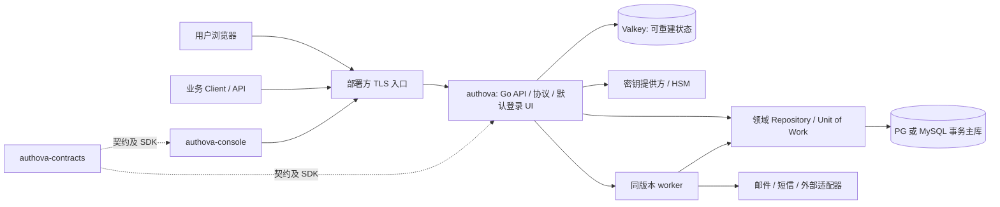

# 1. 边界、部署与威胁模型

## 1.1 运行组件与所有权

核心服务只做协议、安全与领域状态的最终判定。默认 UI 随核心构建并同源提供，前端不持有 OAuth Client Secret、用户密码数据库或签名私钥。控制台只调用管理 API，不直连数据库。worker 可以作为同一个二进制的不同运行角色部署，异步处理投递和清理；版本必须与数据库迁移兼容。

### 内部模块

| 模块 | 拥有的行为 | 依赖边界 |
| --- | --- | --- |
| `platform` | App 生命周期、平台管理员、部署配置 | 不查询 App 用户作为平台身份 |
| `client` | Client 注册、重定向 URI、密钥、scope 和资源 audience | 所有操作先固定 App |
| `identity` | User、已验证标识、凭据、外部身份绑定 | 不直接签发协议令牌 |
| `authn` | 认证步骤、挑战、MFA、风险门槛、受托 UI 流程 | 仅从 `identity` 取得证明结果 |
| `session` | App 浏览器会话、设备、退出、会话版本 | 每个会话不可变绑定 App/User |
| `protocol` | 发现、授权、token、JWKS、撤销/内省 | 校验 App/Client/issuer/audience；调用领域模块 |
| `audit` | 安全事件、持久 outbox、导出 | 不阻断必要的事务内审计写入 |

模块接口传递不可伪造的内部 `AppContext`（经入口解析和校验，包含稳定 ID、issuer、状态、配置版本、调用主体），repository 方法必须以它为参数。不要提供 `GetUser(id)` 这类默认跨 App 查找。平台操作走独立 `PlatformContext`，需要明确权限与审计；禁止用空 AppContext 表示超级管理员。

## 1.2 App、Client 和管理员的边界

- 一套部署可容纳 App1、App2。每个 App 自有 User、标识、凭据、外部连接配置和绑定、Session、OAuth Consent、管理授权、审计范围与 issuer/key ring。App1 的登录 Cookie 不用于 App2。
- Client 属于且只能属于一个 App，可是浏览器、移动或服务端客户端。同一业务系统可配置多个 Client。Client ID 在整个 Deployment 中全局唯一，以便入口无歧义路由；仍需核验其 App 归属。
- 平台管理员与 App 管理员属于不同主体域和 token audience。App 管理员可以是 App 用户，但授权仍通过固定管理角色授权，不能由普通业务 scope 自动获得。
- 每 App 使用不可变公开 `app_key` 组成 issuer，例如 `https://id.example.test/a/{app_key}`；展示 slug/名称可更改而不改变 issuer。真实域名由部署配置决定，发行后 issuer URL 迁移视为协议迁移，不能悄悄改名。此 URL 结构仍须进行 Discovery 兼容测试后冻结。

## 1.3 信任边界与入口规则

1. TLS 终止点、代理头来源和外部公开 origin 在部署时显式配置。仅信任受控反向代理传来的转发头；任何 Host/Forwarded 注入不能影响 issuer、回调或邮件链接。
2. 协议请求先以不可变 issuer 路径定位 App，再验证 `client_id` 的 App 归属、状态、注册的回调与授权方式。管理请求先验证平台或 App 管理员凭据，再校验路径 `app_id` 与授权范围。资源内省请求必须验证调用 Client 身份以及 App/audience 范围。
3. 资源加载、写入、缓存、worker 任务和审计都携带 App；来自数据库或消息体的 `app_id` 要与可信上下文比对。跨 App 对象引用返回统一资源不存在/拒绝行为，并留安全审计。
4. 外部身份提供方、短信/邮件供应商和自定义适配器均是不可信的外部边界。认证结果不能仅凭邮箱文本；要验证上游 issuer、签名、audience、nonce/state、`sub` 和本地连接配置。
5. 插件/适配器无核心数据库和私钥权限。必要凭据通过最小授权的秘密引用/短期凭据提供；适配器输出是待验证的声明，不是已经签发的 Authova 身份。

## 1.4 威胁清单与首版对策

| 威胁 | 典型路径 | 首版要求 / 验收 |
| --- | --- | --- |
| 跨 App 串用 | App1 token、Cookie、外部回调或资源 ID 提交给 App2 | issuer/audience/App/Client/资源归属多重校验；全流程负向测试 |
| OAuth 混淆与重放 | 改 redirect URI、换 code/PKCE、复用 nonce/state | 精确 URI 匹配、一次性 code、绑定 Client/issuer/redirect/PKCE、短 TTL |
| 账号接管 | 通过未验证邮箱自动绑定社交身份、验证码暴力尝试 | 不自动绑定；强证明后绑定；一次性挑战、限次限时与风险审计 |
| 令牌盗用 | access/refresh token 外泄后继续使用 | audience 限定、短期 access、refresh 轮换与家族撤销、密钥轮换；高风险资源在线校验 |
| 管理越权 | App 管理员伪造路径或平台恢复入口 | 分 audience/角色/作用域、首次引导一次性、MFA、每项敏感操作审计 |
| 缓存错判 | 身份/配置缓存过期、Valkey 故障 | 带 App+配置/会话版本的键；内省和管理权限从主库新快照判断，不使用旧 active/allow 放行 |
| 供应商/适配器失陷 | 假短信成功、错误上游 subject | 原始结果验签、可信连接配置、超时与熔断、审计与连接禁用 |
| 枚举与滥用 | 批量查询是否注册、短信成本攻击 | 统一外部响应、账户/IP/设备/Client 多维限速、供应商预算与告警 |
| 数据与密钥泄露 | 日志、备份、运维账号过宽 | 加密/最小授权/脱敏、密钥与数据备份分离、审计访问 |

威胁模型是评审入口，不代替独立渗透测试、依赖审查或真实部署的配置审计。
