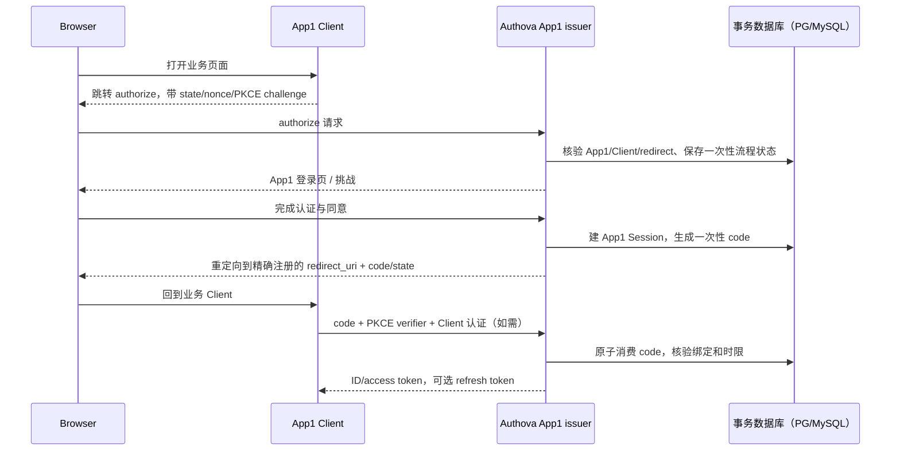

# 2. 身份、认证协议与令牌

## 2.1 协议面与版本

首版建议实现每 App 的 OIDC Discovery、JWKS、Authorization Code + PKCE、Token、UserInfo、Revocation 与 Introspection。仅声明已通过兼容测试的规范能力；不发布 implicit grant、ROPC/password grant。服务对授权码、token、UserInfo 的错误保持标准格式，不使用管理 API 的 Problem Details。规范基线是 [OIDC Core](https://openid.net/specs/openid-connect-core-1_0-22.html)、[Discovery](https://openid.net/specs/openid-connect-discovery-1_0-22.html)、[RFC 9700](https://www.rfc-editor.org/rfc/rfc9700.html)、[RFC 9068](https://www.rfc-editor.org/rfc/rfc9068.html)。

令牌的目标类型分开：ID token 只供 Client 验证登录；access token 只供目标资源服务；refresh token 只供 token 端点。签名 key ring 以 App 为边界，标明 `kid`、用途、状态、生效/停用时间。JWKS 只含可验证的公钥，旧公钥保留到最长已签发令牌过期及缓存窗口结束。资源服务校验 `iss`、`aud`、`exp`、`nbf`、`iat` 容差、`typ`、`alg` 允许列表、`kid` 对应公钥、Client/App 关系；绝不把 ID token 当 access token。JWT access token 以 RFC 9068 为目标，`typ=at+jwt`、`iss/sub/aud/exp/client_id/jti` 等字段的具体约束写入契约。签名算法选择与互操作性测试定稿，禁止 `none`、对称/非对称算法混淆。[JWT BCP](https://www.rfc-editor.org/rfc/rfc8725.html) 是实现验收项。

## 2.2 典型授权流程

**授权请求**：先定位 App1 issuer；再根据全局唯一 Client ID 验归属、状态、准许 grant/response、`redirect_uri` 精确值、请求 scope/resource、PKCE S256。对浏览器 Client 要有 `state`，OIDC 要验证 `nonce` 的生成、存储和回显语义。可选的用户授权同意必须绑定 App/Client/scope/resource 及条款版本；管理员可明确配置第一方信任 Client 的同意策略，不能隐式扩大权限。

**code**：高熵、短时、一次性；只存 hash，记录 `(app_id, client_id, user_id, redirect_uri, code_challenge, scope, audience, nonce, auth_time, session_id, expires_at)`。消费用事务条件更新或唯一状态转换，两个并发兑换仅一次成功。错误返回不能区分过多内部原因。回调 URI 不支持通配符；移动端重定向须单独评审平台声明和应用绑定。

**托管登录状态**：流程 ID 是随机不透明值，服务端保存 App/Client/redirect/PKCE/nonce/登录步骤/TTL。浏览器使用独立 App 范围的 Cookie 标识会话；Cookie `Secure`、`HttpOnly`、合适 `SameSite`，修改状态的页面/接口校验 CSRF token 与 Origin/Referer。Cookie Path 不是安全边界，服务端每次比对 Session App。自建 UI 的公开认证流程 API 在同源/CSRF/凭据暴露威胁模型确认后另版推出；默认页面不能把认证判定放到前端。

**App2 请求**：即使浏览器持有 App1 Cookie，也不会因此跳过 App2 认证。session 行带不可变 `app_id`；服务端拒绝在 App2 issuer 下使用 App1 session。为了避免同一域 Cookie 名冲突，Cookie 名/路径也分 App，但只是辅助措施。

## 2.3 本地标识、密码与验证码

- User ID 在 App 内稳定且不复用。邮箱经明确规范化规则（大小写/Unicode/域名；不擅自去点或去别名），手机号转 E.164；验证状态独立于提交文本。规范化规则版本纳入数据迁移，以免升级造成唯一性碰撞。
- 标识注册先建立短期 `pending_verification` 挑战；验证成功才把 `(app_id, kind, lookup_digest)` 唯一绑定到 User。相同标识可在另一 App 独立使用。修改标识要验证新联系方式、处理旧渠道通知和并发冲突。
- 密码使用成熟的抗离线攻击算法与部署可调参数（优先评估 Argon2id）；每账户独立 salt，必要时增加由 KMS 保护的 pepper。参数由目标硬件压测；变更参数时登录后渐进 rehash。参考 [NIST SP 800-63B](https://pages.nist.gov/800-63-4/sp800-63b.html) 的口令长度、受损口令阻止与尝试限制要求。密码重设凭据一次性、短时、存 hash，完成后撤销指定或全部 session/refresh 家族的策略需定稿。
- 邮箱/短信 OTP 只用于允许的认证/验证步骤；按实际码长生成均匀随机值，数据库存 `HMAC(独立 OTP pepper, app_id || challenge_id || code)` 而非可被离线穷举的普通 hash，限制次数、重发间隔、TTL、目的地址变更及供应商成本。投递所需明文只短时存于加密 outbox 载荷，投递结束/过期清理。请求响应避免账号枚举；供应商投递成功只说明已接受消息，不说明用户已完成验证。短信不适合作为所有风险等级的唯一强认证手段；高风险管理操作要求更强因子。
- 首版 MFA 建议 App 管理员与平台管理员强制，普通用户由 App 策略选择。TOTP/recovery code 的密钥加密保存，恢复码只展示一次并存 hash；首版不设计额外认证扩展的占位接口。

## 2.4 第三方身份与账号绑定

每个 App 单独配置 provider connection、上游 Client ID/Secret、允许的 issuer/发现文档、scope、回调和映射版本。启动流程保存一次性 `state`/`nonce`，回调必须匹配流程的 App、provider connection、浏览器和上游响应。上游 OIDC ID token 验证签名、issuer、audience、时限、nonce；普通 OAuth 提供方的用户信息提取由单独审查过的适配器实现。绑定唯一键是 `(app_id, provider_connection_id, upstream_issuer, upstream_sub)`。

首次登录若无绑定，可依 App 策略创建本 App 用户；不得仅凭上游返回的 email 与现有用户自动合并。绑定到已登录用户需要近期重认证及上游证明；解绑必须防止移除最后一种可用登录方式。上游邮箱变化不自动覆盖本地已验证标识。App1 的上游账号与 App2 的同一上游账号仍是两个独立绑定。

外部适配器使用版本化 HTTP/gRPC 请求响应，传入限定的连接配置与流程 ID，返回原始可验证 claim/错误类别；签发、User 关联与事务仍在核心。适配器超时、重试、熔断、幂等和升级兼容写入单独契约；不能以插件异常解释为“认证成功”。标准 OIDC 优先由核心共享实现，非标准供应商再走适配器。

## 2.5 Session、刷新与撤销

浏览器 Session、OAuth grant、refresh family、access token 是不同对象。Session 包含 App/User、认证强度、最近认证时间、创建/最后活动/绝对过期、设备元信息、撤销时间。会话 Cookie 只含随机 handle，数据库存摘要；轮换会话 handle 以抵抗固定会话攻击。设备列表可按 session 展示，但仅展示有限元数据。

Refresh token 仅对符合策略的 Client 发放；绑定 App、Client、User、已批准 scope/audience、Session 和 family，有绝对和空闲过期。公开 Client 的 refresh 使用每次轮换或发送者约束，符合 [RFC 9700 §4.14](https://www.rfc-editor.org/rfc/rfc9700.html#section-4.14)。首版选择轮换：数据库存 token 摘要与代次，刷新事务锁定 family，旧 token 从 `active` 变 `used`，新 token 与签发记录原子写入；重用旧 token 撤销整个 family 并审计。首版不提供 refresh 重放窗口；Client 串行刷新，响应丢失时重新授权。未来若增加限定幂等恢复，须单独安全评审。DB 不可用时拒绝刷新，不从缓存猜测状态。

主动退出/封号立刻更新 Session/refresh 状态，在线内省从主库新快照核验撤销状态。已发出的自包含 access token 在过期前仍可能被离线资源服务接受。默认 access token TTL 候选为 5–15 分钟，最终以安全与负载测试确定；高风险资源用在线状态检查或更短 TTL。`revocation` 对标准端点遵循其响应语义，不向未授权调用者透露 token 是否存在。App 暂停时停止新授权、刷新，资源服务内省返回 inactive；已发行离线 JWT 的剩余有效期必须在运维操作中明确提示。

## 2.6 密钥、秘钥和故障

- 签名私钥、上游 Client Secret、OTP pepper、标识盲索引密钥按用途分开；密钥提供者接口支持本地受保护密钥文件与外部 KMS/HSM，配置中只记录 key reference。不能声称软件文件存储等同 HSM。
- 每 App 独立签名密钥集合。轮换先发布新公钥，再用新私钥签发；旧公钥在最长 token/缓存窗口后移除。紧急泄露处置可立即停用，但会让旧 token 验证失败，需通知资源服务刷新 JWKS。
- 公钥/发现文档可缓存并有 ETag/Cache-Control；私钥读取故障时拒绝新 token，不能回退到共享/旧私钥。时钟偏移容差有限且可配置，监控 NTP 偏差。
- 日志、trace、审计内容不得记录密码、OTP、code、refresh/access token、上游 Secret、完整敏感联系方式。审计记录事件类型、App/主体/目标、结果、来源、request ID 和有限脱敏上下文。
