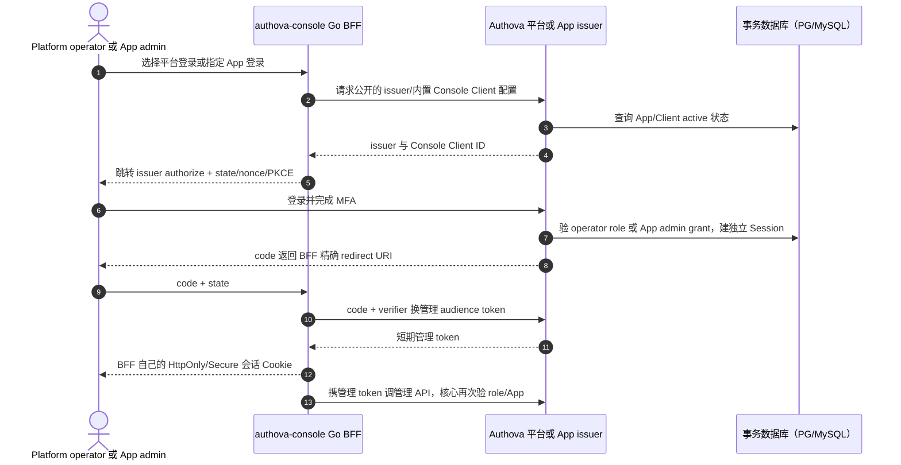
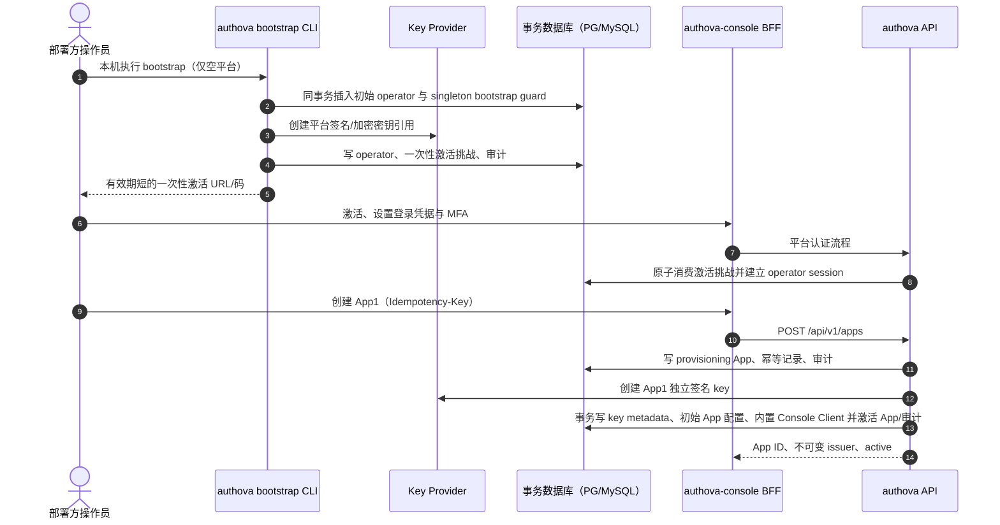
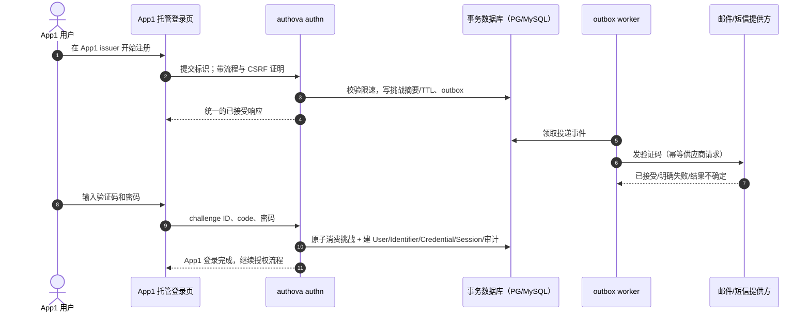
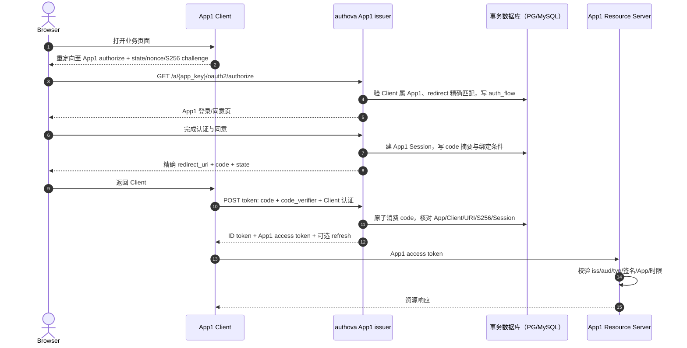
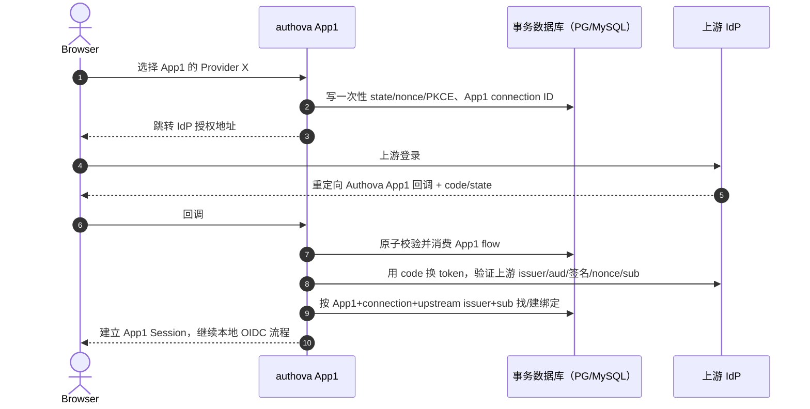
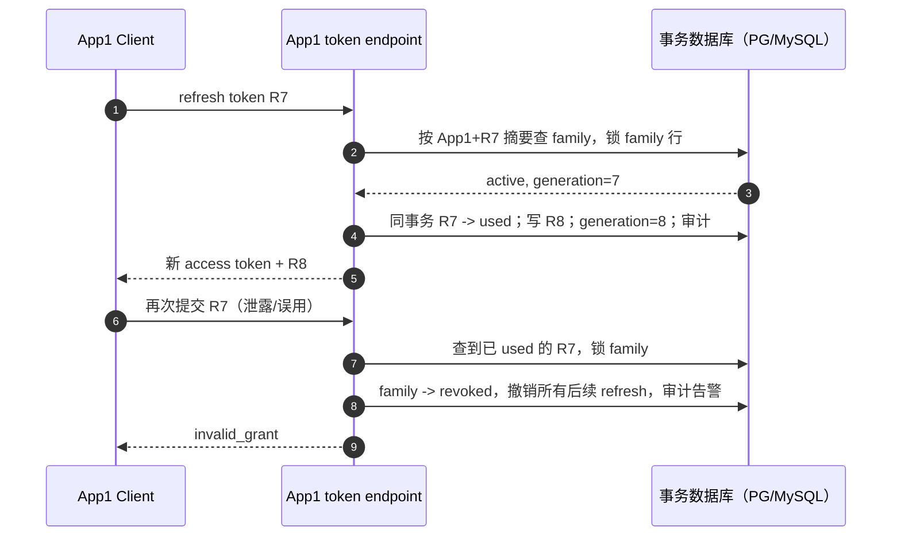
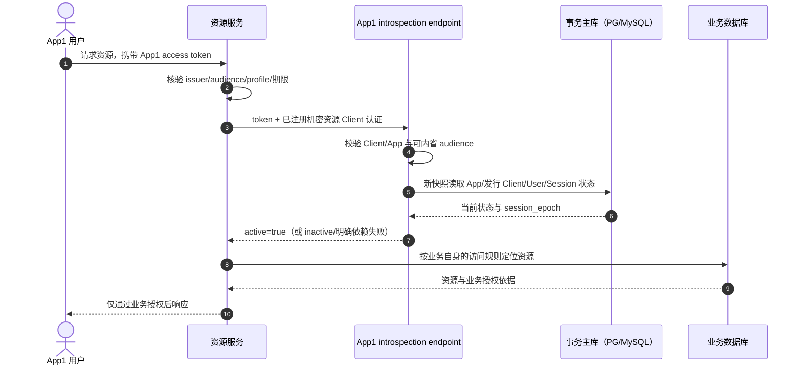

# 8. 端到端流程和异常分支

本章把每条流程拆成入口、可信 App 定位、状态写入、外部依赖、响应和失败补偿。图中的路径使用 `authova-contracts` 草案名称；它们尚未发布。`App1` 与 `App2` 始终是同一部署内的独立身份域。

## 8.0 控制台管理员登录

平台 issuer 与 App issuer 使用不同主体库和 signing key。Console 的内置 Client 用公开 Client + PKCE + 精确回调，不需要向每个 App 分发 Client Secret；只有服务端创建的 `is_system` Client 可请求管理 audience。BFF 按 `issuer + App ID +管理员主体` 区分会话，不能用 App1 管理会话静默操作 App2。平台 operator 的跨 App 权限来自平台角色，不继承任何 App User。BFF 只做 token 保管和页面会话，API 的最终授权在 Authova 核心。BFF 只从已配置的 Authova origin 读取公开登录配置；平台与 App 接口草案见 `authova-contracts/openapi/drafts/console-login-v1.yaml`。

## 8.1 平台首次引导与创建 App

**不变量**：bootstrap CLI 只在部署初始/受控恢复模式运行；激活码存摘要、一次性、限时。App 只有 key、初始配置和内置 Console Client 全部就绪后才 `active`。外部 KMS 调用不放在数据库事务中，故 App 建立分 `provisioning → active` 两步；若 KMS 成功但数据库失败，恢复任务按幂等 key 查并重试或销毁孤儿 key。公共 `POST /apps` 可以等待激活后返回 `201`，超时则返回可查询 operation ID；这一响应细节须与当前只公开 `active/suspended` 的草案对齐。不能返回一个可签发状态不明的 App。

**故障**：并发首次引导由 `platform_bootstrap_guard` 的 singleton 主键阻止重复提交；guard 和初始 operator 同事务写入。KMS 不可用时不激活；已创建 App 的重试用同一幂等键返回同一 App；不同请求同 key 返回 `409`。平台 operator 恢复流程不得静默创建第二个超级管理员，需离线审计与现有密钥证明。平台 issuer 的 Code+PKCE 使用 `platform_auth_flows`/`platform_auth_codes`，不借用任何 App 的授权码表。

## 8.2 邮箱/手机号注册与登录

**标识算法**：Email 保留原始展示值，另按版本化规则规范化后计算 App 专属 HMAC 查找摘要；Phone 先校验/规范化为 E.164。待验证标识不占用 active 唯一索引；验证完成的事务以数据库唯一约束解决并发占用。同一规范化标识在 App2 有另一条记录。User ID 为随机不透明 UUID，不从联系方式推导；注册只建立本 App 身份及认证状态。密码只传 TLS，哈希由服务端完成，不进日志、outbox 或分析事件。

**失败**：用户不存在与已存在的发送响应统一，避免枚举；供应商成功只代表接收消息；worker 超时结果不确定时按供应商幂等能力重试，不能发送无限验证码。验证码错/过期/已用返回同类外部错误，但内部计数不同。唯一约束冲突返回稳定 `identifier_conflict`，不创建无标识 User。服务端 DB 故障时不根据缓存里“已验证”状态完成注册。

密码登录复用相同 `AppContext`：按 `(app_id,kind,lookup_digest)` 找 active Identifier；未知账号执行成本受控的假 KDF 路径，结合 App/账号/IP/设备限速；验证 User 状态、密码和 MFA；成功轮换 Session handle。登录失败不泄露是否存在标识。密码 KDF 的参数需要目标硬件基准，不能通过无限并发挤占在线内省。

## 8.3 OIDC 授权码 + PKCE 与 App 隔离

**授权码绑定**：`app_id`、`client_id`、`redirect_uri`、`code_challenge`、`scope`、`audience`、`nonce`、`user_id`、`session_id`、到期时间。Token 端点位于 App1 issuer 路径，先确定 App1，再验证 Client 与 code 都属于它。App1 code/token/Session 送到 App2 路径必须失败。`state` 由 Client 校验；Authova 管理自身登录流程 CSRF 与 OIDC nonce。ID token 只给 Client，Resource Server 只接受 access token。

**失败**：回调地址未精确注册、PKCE 不符、Client 状态停用、code 重放、App 暂停、浏览器中途切换 App，均拒绝且不得把 code 重定向到未注册地址。若已提交 code 消费但 token 响应丢失，重试不能重新使用 code；Client 应重新走授权流程（或在未来定义单独的安全幂等机制）。

## 8.4 外部 OIDC 登录与绑定

上游邮箱不是本地账号归并依据。首次自动建用户是否启用由 App 策略决定；若上游 email 与本地已验证邮箱碰撞，进入显式账号绑定流程，需要先证明本地账号控制权与上游控制权。连接停用、state 不匹配、上游 token 校验失败、上游 subject 缺失时拒绝；不得降级为仅靠 userinfo email 登录。App2 配置相同 IdP 时仍用 App2 的 connection 和 User。上游 issuer/配置 URL 必须防 SSRF（HTTPS、DNS/IP 策略、重定向控制、长度/响应大小/超时）。

## 8.5 Refresh 轮换、重用与撤销

**并发要求**：同一 family 只有一个事务可从代次 N 进入 N+1。若两个合法并发 refresh，第二个会命中 used；首版建议不设宽松的重放窗口，Client 必须串行刷新。若响应丢失，Client 重新授权。这牺牲少量体验，换取清晰的盗用检测；如后续引入幂等窗口，必须绑定同一认证 Client/设备、保留加密响应且有测试证明攻击者无法利用。此选择替代前版“可能提供窗口”的开放提案。

用户退出/禁用：事务更新 Session、family、User `session_epoch`（若禁用）、审计/outbox；在线 introspection 在新主库快照中拒绝。离线 JWT 到期前可能仍被接受，资源服务需按风险选择短 TTL/在线内省。App 暂停同理：停止新授权与刷新，在线内省 拒绝，不能声称立即撤销所有离线 token。

## 8.6 在线内省与业务访问

Introspection 不判断业务动作。客户端身份、用户身份和管理身份分别处理，缺少调用 Client 认证或 Token 越 App/audience 范围不能获得有效 active 响应。服务 Token 没有 User/Session，按 App/Client 分支核验。

退出、封号或 App 暂停在内省读取开始前已提交，则新主库快照必须看见。首版不缓存 positive active，不从延迟副本或 Valkey 推断撤销；依赖失败不能作为认证成功。详细并发、管理撤权与离线 JWT 窗口见 [第 4 章](04-management-and-apis.md)。

## 8.7 状态与失败矩阵

| 对象/动作 | active | suspended/disabled | deleting/expired | 默认失败方式 |
| --- | --- | --- | --- | --- |
| App 新 authorize/token/refresh | 依 Client/User 状态办理 | 拒绝 | 拒绝 | 标准协议错误 + 内部审计 |
| App 资源 Token 内省 | 核验 Token 及关联状态 | inactive | inactive | 依赖失败为明确错误，不伪造 active |
| User 登录/刷新 | 可以 | 拒绝 | 拒绝 | 不暴露账号存在性 |
| Client 授权码兑换 | 可以 | 拒绝 | 拒绝 | 不签发令牌 |
| Provider connection 新流程 | 可以 | 拒绝 | 拒绝 | 已开始流程也要重新校验状态 |

每条流程都要求 request ID、明确错误类别、超时预算和幂等策略。外部调用结果不确定时只允许 read-back、对账或有界重试；绝不能把“超时”解释为认证/授权成功。
