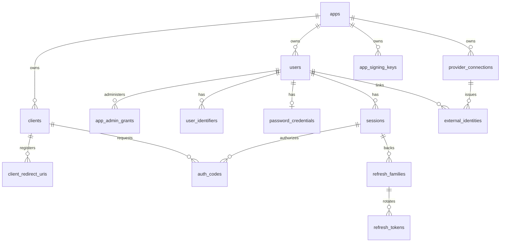

# 9. 逻辑数据模型与 PostgreSQL 物理草案

本章与 [schema-v1.sql](schema-v1.sql)、[rls-v1.sql](rls-v1.sql) 一起构成数据库评审稿。SQL 是可以进一步验证的具体设计，不是已批准的生产迁移。基线 PostgreSQL 17+；App UUID 由 Go 生成。表前缀没有将每个 App 拆成独立 schema，目的是支持大量 App 的统一迁移和连接池；生产隔离由入口作用域、复合约束与强制 RLS 共同保证。

2026-10-11：领域模型经 Repository/UoW 复用于 PG/MySQL；本章 SQL、数据类型、部分索引、连接池和 RLS 均是 **PG adapter 的具体草案**。MySQL 需独立物理模型/迁移，差异和支持门槛见 [第 12 章](12-portable-storage.md)，不能把本章验证扩展为 MySQL 支持。首版范围以 [第 13 章](13-v1-scope.md) 为准，固定管理员授权仍是核心安全数据。

验证记录（2026-09-28）：旧版 SQL 与 RLS 草案在临时 PostgreSQL 17 容器上通过 `psql ON_ERROR_STOP=1`；App1 Session 指向 App2 User 的写入被复合外键拒绝；以 `authova_app` 角色设置 App1 上下文只见 App1 User，不设置上下文时见 0 行。这是旧版证据；未覆盖生产迁移、连接池并发、恶意 SQL、密钥轮换或性能。

本轮验证（2026-10-12）：修订后的 schema/RLS 在临时 PostgreSQL 17 上成功装载 32 张核心表，8 张已移除的业务表不存在；跨 App Session→User FK 拒绝，无 App 上下文读取 User 为 0 行、App1 上下文为本 App 的 1 行。公开 Client 配置内省 audience 被 CHECK 拒绝，机密 Client 的同类配置可写入。容器随后删除；这些检查只证明草案 DDL、约束和基础 RLS，没有验证服务端内省、管理撤销/最后 owner、MySQL 或容量。

## 9.1 关系图



图省略平台 operator、审计/outbox 和挑战等边以保持可读性。真实外键全部参照 SQL。`apps` 表保留删除 tombstone，避免历史 issuer/ID 被再次利用并维持审计归属。

## 9.2 分层与主要表

| 数据组 | 表 | 热路径与增长 | 保留建议（评审值） |
| --- | --- | --- | --- |
| 平台配置 | `apps`, `app_signing_keys`, `platform_operators`, `platform_bootstrap_guard`, `platform_activation_challenges`, `platform_operator_roles`, `platform_sessions`, `platform_signing_keys`, `platform_clients`, `platform_auth_flows`, `platform_auth_codes` | 少量写，JWKS/管理员登录读 | App/key tombstone 长期保留；激活/授权流程按过期清理 |
| Client 配置 | `clients`, `client_redirect_uris`, `client_secrets` | 授权入口频繁读，变更少 | 历史 Secret 只留受控审计，不留可用 verifier |
| 用户身份 | `users`, `user_identifiers`, `identifier_lookup_aliases`, `password_credentials`, `provider_connections`, `external_identities`, `external_identity_lookup_aliases` | 标识查询和社交绑定读写；用户体量主导 | 用户删除按合规/恢复期执行，标识密文清除方案单定 |
| 一次性流程 | `auth_challenges`, `auth_flows`, `auth_codes` | 高频短期写/条件更新，TTL 短 | 到期后延迟清理并保留聚合指标 |
| 会话与 Token | `sessions`, `oauth_consents`, `refresh_families`, `refresh_tokens` | 登录、刷新和撤销事务热区 | 家族及重用证据至少覆盖最长 refresh TTL 和调查期 |
| App 管理授权 | `app_admin_grants` | 管理请求读，固定角色授权写 | 角色变更与审计同事务；不保留业务权限模型 |
| 交付与运维 | `audit_events`, `outbox_events`, `idempotency_records` | 审计/任务写，时间范围读 | 分级保留、归档；幂等记录按操作类型设置 TTL |

`outbox_events.payload` 只容纳非敏感路由/事件元数据；OTP 等必须投递的短期机密放 `sensitive_payload_ciphertext`，由 worker 以受限 KeyProvider 解密后发送，投递完成/过期按策略清除。`auth_challenges` 只保留验证码摘要，不能指望 worker 从 hash 还原验证码。`idempotency_records.response_ciphertext` 只在 `secret_replay_expires_at` 前供同主体同键重试使用；到期清除密文，保留 `resource_id` 直至 24h 幂等记录到期，重试返回同一资源但不再给 Secret。

### 核心外键和唯一性

- App 所有主键采用 `(app_id,id)`，外键也用 `(app_id,foreign_id)`；这让“App1 Session 引向 App2 User”即使写入端有 bug 也会被数据库拒绝。
- `clients.client_id` 由服务端生成 `avc_` + 26 位随机小写字母数字，全部署唯一，不接受调用方自选；与 UUID 形式的 User `sub` 处于不同命名空间，避免服务凭据与用户主体混淆。`app_id` 仍参与 Client 内部 FK。`apps.app_key` 和 `apps.issuer` 不可变且全部署唯一；slug 是展示/管理名，不作为 issuer 或授权依据。
- `clients.is_system` 标记核心服务为 Console BFF 自动注册的第一方 Client；普通 App admin API 不允许创建/修改此标记，也不能让其他 Client 申请管理 audience。平台 issuer 的 Console Client 单独存在 `platform_clients`，与业务 App Client 不混用。
- 平台 Client ID 使用 `avp_` 命名空间，平台授权流程、授权码与 App 数据完全分表；bootstrap guard 只允许首次 operator 引导提交一次，operator 激活挑战存摘要且一次性消费。待激活 operator 的密码与 MFA 凭据为空，激活事务设置两者后才允许进入 `active`。
- active Email/Phone 唯一键是 `(app_id,kind,lookup_digest)` 的部分索引；`identifier_lookup_aliases` 为每个在用 HMAC key version 建唯一查找入口，支持在线轮换。退役标识保留历史但同时删除 active aliases，不继续占用 active 唯一键；重新分配给其他用户的风险和等待期须在账号回收政策中定稿。
- active 外部绑定唯一键基于 `(app_id,connection_id,upstream_subject_digest)`；摘要输入包含带长度分隔的上游 issuer 与 subject，避免二者拼接歧义。`external_identity_lookup_aliases` 负责 HMAC key 轮换期间的多版本唯一查找。不可直接把潜在超长的上游 subject 放入 B-tree 唯一索引。一个上游主体在同 App/Connection 不能并发绑定给两个 User。

## 9.3 典型读写 SQL 形态

### 通过已验证联系方式定位用户

```sql
SELECT u.id, u.status, u.session_epoch, p.verifier
FROM identifier_lookup_aliases AS a
JOIN user_identifiers AS i ON (i.app_id=a.app_id AND i.id=a.identifier_id)
JOIN users AS u ON (u.app_id=i.app_id AND u.id=i.user_id)
LEFT JOIN password_credentials AS p ON (p.app_id=u.app_id AND p.user_id=u.id)
WHERE a.app_id=$1 AND a.kind=$2 AND a.lookup_key_version=$3
  AND a.lookup_digest=$4 AND i.status='active';
```

查询必须以 `app_id` 为首要范围，命中 alias 主键；若 key 轮换期间允许双版本读取，也必须先用对应版本 key 计算摘要。未知标识也要对外给一致登录响应。密文联系方式不得在普通日志或 内省链路解密。

### Refresh 的并发事务

```sql
BEGIN;
SELECT family_id, generation, status
FROM refresh_tokens
WHERE app_id=$1 AND token_digest=$2;
SELECT generation, status, expires_at, session_id
FROM refresh_families
WHERE app_id=$1 AND id=$3 FOR UPDATE;
-- 领域代码检查 token 是 active、代次一致、Client/User/Session/App 均 active。
UPDATE refresh_tokens SET status='used', used_at=now()
WHERE app_id=$1 AND token_digest=$2 AND status='active';
-- 必须检查 affected rows=1，然后 INSERT 新 token、UPDATE family generation、INSERT audit。
COMMIT;
```

上例说明锁和条件更新，不是可直接运行的完整 stored procedure。取得 family lock 后要再次读取 token 状态，以避免并发请求在第一条读取和加锁之间发生变化；若旧 token 已 `used`，撤销 family 并审计。若查不到 token 只给 `invalid_grant`，不能区分具体失效原因。新 token 的明文只在响应构造时短暂存在，数据库存摘要。

### 用户会话状态的内省读取

```sql
SELECT a.status AS app_status, c.status AS client_status,
       u.status AS user_status, u.session_epoch AS user_epoch,
       s.session_epoch AS session_epoch, s.expires_at, s.revoked_at
FROM apps AS a
JOIN clients AS c ON c.app_id=a.id AND c.id=$2
JOIN users AS u ON u.app_id=a.id AND u.id=$3
JOIN sessions AS s ON s.app_id=u.app_id AND s.user_id=u.id AND s.id=$4
WHERE a.id=$1;
```

上例是已核验 Token 签名/profile 后的用户状态查询，不是完整内省实现：发行 Client、User、Session ID 来自通过验证的 Token，仍需检查期限、audience、App 归属与调用 Client 的独立 `allowed_introspection_audiences`。服务 Token 走 App/发行 Client 分支，不引用 User/Session。首版读主库新快照，无 positive active 缓存；多语句核验使用新只读快照事务。任何依赖失败都不能推断 active。固定管理角色另查 `app_admin_grants`，不能把资源内省结果当作管理许可。

## 9.4 标识密文、查找摘要与密钥轮换

标识需兼顾唯一查找和隐私。推荐流程：

1. 按 `normalization_version` 规范化 Email/Phone，保留原始展示形式的加密值。
2. 对 `app_id || kind || normalized_value` 使用独立的 lookup key 做 HMAC-SHA-256，产生固定 32 字节查找摘要；加密原文使用不同的 DEK/KEK 用途。
3. 轮换时先生成新 lookup key，后台为每个 active identifier 写新版本 alias；在新 alias 全量建立前，新注册/变更在同事务同时写旧、新两个版本 alias。两套 alias 均有数据库唯一约束。完成一致性扫描后把查询切到新版本，再删除旧 alias 并退役旧 key。若规范化规则改变导致历史记录冲突，进入人工冲突修复，不强行合并账号。外部身份别名使用同一流程。
4. lookup key 被泄露时，低熵手机号仍可能被离线枚举；应单独管理 key、限制读取和审计。HMAC 不是匿名化承诺。

双版本 alias 在过渡期的写入和唯一冲突要用并发测试证明；删除旧 alias 前必须核验新 alias 数量、内容和绑定归属。密钥轮换不是普通字段更新，不能只修改 `lookup_key_version` 而不重建查找索引。

## 9.5 事务隔离、连接池与 RLS

默认使用 PostgreSQL `READ COMMITTED`，通过唯一约束、条件更新和 `FOR UPDATE` 保护具体不变量；需要跨多行无幻读保证的流程单独评估 `SERIALIZABLE` 与重试。所有请求有 deadline；事务内不调用邮件、短信、上游 IdP、KMS。`pgxpool` 总连接数按节点数预算，避免每个节点都设很大的池。

生产运行时每个 App 数据事务先 `SET LOCAL authova.app_id = ...`，所有 App 查询在该事务/连接内执行。后台任务也显式设置 App。App 运行角色不是表 owner、superuser、`BYPASSRLS`，不连接为迁移账号；平台与公开路由分别用受限 SQL role 和专用路径。RLS 覆盖全部 App 所有表的 `SELECT/INSERT/UPDATE/DELETE` 与 `WITH CHECK`。数据库官方明确说明 superuser、`BYPASSRLS` 和通常的表 owner 可绕过行安全策略。[PostgreSQL RLS 文档](https://www.postgresql.org/docs/17/ddl-rowsecurity.html)。RLS 对遗漏租户条件有效，但 App 角色能设置普通自定义变量，所以不能把它当作抵抗任意 SQL 注入的单一屏障；参数化查询、受限构造的 AppContext、复合外键和跨 App 测试仍必需。连接池、后台任务、迁移与性能要在阶段 1 专项验收。

## 9.6 规模、索引与迁移

对 1200 万+ User 造真实偏斜数据，重点测：identifier 唯一索引大小、同一热点 App 登录、Session 按 User 列表、refresh family 行锁、内省状态关联查询、清理过期短期表、管理员授权变更与批量会话撤销。`audit_events`、`outbox_events` 和到期短期凭据可首先按时间分区/归档；分区表唯一/主键必须包含分区键等限制，应在分区前验证现有唯一性设计。[PostgreSQL 分区文档](https://www.postgresql.org/docs/17/ddl-partitioning.html)。

发布迁移要记录 schema version、所需最小/最大服务版本、可否滚动、backfill 估算、回滚数据策略。大表新增非空列分“加 nullable → backfill → 校验 → 加约束”；大索引用并发构建且单独监控。迁移工具只在部署命令/Job 执行，API 节点不并发抢跑迁移。恢复演练同时验证数据备份与 key provider 的密钥可用性。

## 9.7 数据层尚需审查的硬点

- Refresh 的响应丢失策略当前选择重新授权，不提供明文 token 回放；某些移动客户端可能体验较差，需以安全测试决定是否设计限定幂等恢复。
- `audit_events` 的保留、分区、不可篡改和个人信息删除互相影响，需要面向目标部署司法辖区制定政策。
- 高可用切主若丢失已确认的 refresh 使用记录，会破坏重用检测。生产必须明确 PG 同步复制/RPO、切主一致性及失败时是否暂停签发。
