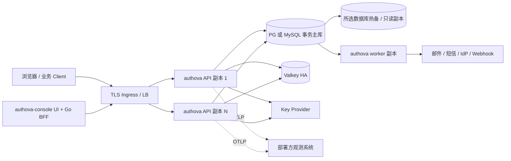

# 10. 技术选型、组件边界与部署形态

本章是正式开发的**建议基线**。2026-10-11 修订存储边界：PG/MySQL 通过同一领域 Repository/UoW 适配，细节见 [第 12 章](12-portable-storage.md)。其它组件版本/许可仍保留 2026-09-28 快照，真正锁依赖时再核实；不是当前运行能力证明。选型原则是可维护、Go 为主、独立自部署、允许二开，并以证据验收 1000 万+ User 与不同类型 5000+ QPS。

## 10.1 选型结论总表

| 层 | 建议基线 | 为什么 | 替代/风险与验证门槛 |
| --- | --- | --- | --- |
| 核心语言 | Go 1.27.x，生产只支持官方仍维护的 Go 版本，构建时固定 patch 版本 | 与产品 Go 主导目标一致；单二进制交付和高并发 I/O | 目前本机是 Go 1.27.1；依赖须在 CI 验证目标 Go 版本。[Go 发布/支持政策](https://go.dev/doc/devel/release) |
| HTTP | Go `net/http` + 显式中间件，按 OIDC/管理/内省 分路由 | 少一个深层框架依赖，安全入口顺序清楚 | 若路由参数/生成器需要，引入轻量 router 前先用 API 契约和基准证明收益 |
| 协议引擎 | [Ory Fosite](https://github.com/ory/fosite) 为首选评估对象，封在 `internal/protocol` 内 | 已有 Go OAuth2/OIDC 组件及存储扩展接口 | **条件选用**：验证每 App issuer/keys、授权码和 refresh 原子事务、RFC 9700、互操作；失败则重新决策，不把协议正确性寄托于接口包装。其源码标识 Apache-2.0，[存储接口](https://github.com/ory/fosite/blob/master/handler/oauth2/storage.go)需实测 |
| JOSE/JWT | [go-jose/v4](https://github.com/go-jose/go-jose) 候选；最终只保留一套经过审查的 JOSE 栈 | 避免自行实现 JWS/JWK/JWT 底层 | 要与 Fosite 实际依赖一致，核验算法 allowlist、`typ/aud/iss` 和 KeyProvider；v4 是当前稳定线，v5 尚在变化，版本以发布锁定为准 |
| 密码哈希 | [golang.org/x/crypto/argon2](https://pkg.go.dev/golang.org/x/crypto/argon2) 的 Argon2id (`IDKey`) | 可显式设内存/时间参数，支持渐进 rehash | 参数以目标硬件与内存预算压测，不直接照搬文档示例；FIPS/特定合规部署另评估可替换算法 |
| 主数据库 | 正式目标 PG 17/18 或 MySQL 8.4 LTS InnoDB，一个部署选一个 | 适应部署方基础设施；共同验收事务、唯一性、复合 FK 和撤权 | PG 额外 RLS，MySQL 无同样行策略；SQL/迁移/容量独立验收。当前只有 PG 物理草案，不能宣称两者已支持 |
| Go 数据访问 | 领域 Repository/UoW；PG 用 pgx/v5，MySQL 用 database/sql + go-sql-driver/mysql；两方言分别 sqlc 生成 | 领域代码共用，保留各库显式 SQL 与优化空间 | sqlc Go 将两库列为 Stable；生成器不证明隔离/事务。[支持矩阵](https://docs.sqlc.dev/en/latest/reference/language-support.html)；接口见 [12.3](12-portable-storage.md#123-go-接口形态与事务组合) |
| 迁移 | 两套版本化 SQL + 单独部署 Job；golang-migrate/migrate 为跨库候选 | 支持 PG/MySQL，同一领域 release 配对迁移；取代 PG 专用 tern 基线 | MySQL 多数 DDL 不能依赖事务回滚；各库验证锁、失败恢复/backfill/升级窗口。[工具](https://github.com/golang-migrate/migrate) |
| 缓存/限流 | 高吞吐 HA 画像使用 Valkey 9.1.x（当前支持版本）及 [valkey-go](https://github.com/valkey-io/valkey-go) 候选 | 可重建的缓存/计数从事务数据库热路分离；Valkey BSD-3-Clause，客户端由项目维护 | Valkey 故障按风险回源/拒绝；数据真相在所选事务库。版本随安全补丁更新，[发行列表](https://valkey.io/download/releases/) |
| 消息/异步 | 所选事务库 outbox + Go worker；无首版 Kafka/NATS 依赖 | 事件与领域写入同事务提交；两 adapter 通过同一验收 | outbox 领取/重试按引擎实现，积压或多区域成为瓶颈后再增加 broker |
| 观测 | OpenTelemetry Go traces/metrics + 结构化日志，OTLP 输出；审计独立建模 | 接部署方现有观测系统，不绑定单一平台 | OTel Go traces/metrics 官方列为稳定，logs 状态另核实；敏感字段一律脱敏。[官方状态](https://opentelemetry.io/docs/languages/go/) |
| 默认登录 UI | 核心 Go 服务同源提供的服务端页面/静态资源，少量前端交互 | 与核心认证流程同版本，Cookie/CSRF 边界容易审查 | 主题/模板可替换；完全自建 UI 需另发受限流程 API |
| 管理控制台 | `authova-console`：TypeScript UI + Go BFF，同仓库独立部署 | 管理操作多页面/复杂表单；BFF 让管理 token 留在服务端 | 增加一个部署组件；BFF 不直接访问数据库、不拥有身份。静态 SPA 方案只有在 XSS/token 威胁评审后才考虑 |
| API 契约 | OpenAPI 3.1.2，`authova-contracts` 维护；标准协议另用规范+互操作用例 | 独立于服务和 Console 发布，适合 Go SDK 与二开 | 管理 API 草案需校验/兼容矩阵；不靠生成器自动保证授权语义 |

## 10.2 明确放弃或推迟的选项

| 方案 | 当前结论 | 原因及何时重新考虑 |
| --- | --- | --- |
| 一开始拆身份/协议/会话为多个服务 | 不采用为首版 | App/User/Session 在认证与撤销中需要共同事务；单核心运行时按模块及资源池划分 |
| 每 App 一个 schema 或数据库 | 首版不默认采用 | 大量 App 放大迁移/连接池成本；需要 DB 强行隔离的部署优先 PG RLS，专用库路由是未来独立方案 |
| ORM 作为主数据访问 | 不采用为基线 | Repository 可移植性不等于 ORM；关键 App 条件、复合 FK、锁、索引和快照仍须显式评审 |
| 在 access JWT 中固化业务角色 | 不采用 | Token 承载有限 scope/audience/身份，业务权限由业务服务拥有 |
| Redis 8 作为默认缓存组件 | 不采用为默认 | Redis 8 提供 RSALv2、SSPLv1 或 AGPLv3 许可选项；对可二开、自部署产品增加分发/商业模式审查。Valkey 的 BSD-3-Clause 更符合当前依赖偏好。[Redis 官方许可](https://redis.io/legal/licenses/)；[Valkey 项目许可](https://github.com/valkey-io) |
| Go 动态插件加载第三方鉴权 | 不采用 | ABI/版本、进程崩溃和私钥访问边界难以治理；优先 OIDC 标准连接、受限出进程适配器 |

这些取舍基于 Authova 当前边界。用户自部署时若已有兼容缓存服务，可以做技术兼容测试；许可证与分发义务仍由部署/发行方审查。

## 10.3 协议库准入实验

Fosite 是协议库，不是 Authova 完整身份产品。进入正式依赖前必须完成一个**可丢弃的选型实验**（不作为 demo 产品交付），证明以下接口和行为：

1. 两个 App 在同一进程拥有独立 issuer、配置和 key ring；10,000 App 元数据缓存不会导致不可接受的内存和初始化时间。Fosite 若要求每 App 常驻重对象，则设计按请求/有限 LRU 缓存的包装或重新选库。
2. Authorize code 存储、消费、refresh 轮换/reuse 检测可使用 Authova 事务与复合 `app_id` 约束；Fosite 的 storage 方法不会绕过核心领域状态机。
3. Code+PKCE、OIDC ID token/nonce、Discovery、JWT access profile、撤销、内省的组合能按当前标准通过互操作/攻击测试；不支持的扩展不得在发现文档宣称。
4. 协议对象与内部领域对象双向转换不泄漏密码、Secret 或错误细节；版本升级能通过固定的 golden 测试集合。
5. 依赖锁定版本、许可证与传递依赖 SBOM 均可接受，近期安全修复有明确升级策略。

若失败，应重新比较“更窄的协议实现 + go-jose”等备选，而非悄悄在 Fosite 外叠一套互相冲突的授权码/刷新逻辑。协议变更仍需独立安全评审。

## 10.4 密钥与密码策略

初版签名算法支持 RS256 作为互操作基线，[RFC 9068](https://www.rfc-editor.org/rfc/rfc9068.html) 要求 JWT access token profile 的实现支持它；是否额外启用 ES256 由 Client/资源服务兼容测试决定。签名私钥每 App 独立。软件部署可用信封加密私钥并在受限进程内签名，KMS 只包裹/解包数据密钥；这种模式的私钥会在 Authova 进程内存在，不能宣称 HSM 级隔离。高安全部署可用远程 HSM/KMS 签名，必须压测签名 QPS、延迟、限额和故障；`KeyProvider` 将两种方式隔离。

默认 JWT access TTL 候选 10 分钟，refresh 绝对 TTL 候选 30 天、空闲 TTL 7 天；这些是设计参数而非固定规范。高风险管理 token 更短并需要近期 MFA。密码 Argon2id 参数在生产画像的 CPU/内存预算中校准，保存带算法/参数/salt 的 verifier 字符串，升级时渐进 rehash。高熵 Client Secret 和随机 token 使用不同的验证摘要策略，不把低熵口令的 KDF 直接套到每次高 QPS token 查找。

## 10.5 部署画像与数据流

**开发画像**：单 API、所选数据库单实例，Valkey 可省略但风险限流采取保守模式；用于功能与集成开发，不用于声称 5000 QPS。**生产 HA 画像**：至少两个 API 副本、所选数据库主备与经验证备份、Valkey 高可用、独立 worker 与 KeyProvider、Ingress TLS；所有 App 共用基础设施但逻辑隔离。**大 App 画像**：同样的模块，不盲目多一套微服务；先按内省/登录/worker 运行角色分配副本和资源池，并分别证明两后端的热点/锁/索引可承受，再决定读模型或分片。

管理 Console 通过稳定 OpenAPI 调用核心，外部适配器通过独立受控协议调用，不连接数据库。生产级配置、镜像签名、SBOM、升级/回滚、RPO/RTO 与备份恢复见 [容量运维章](05-scale-and-operations.md)。

## 10.6 二开与许可证边界

**可稳定替换**：管理 Console（只需公开管理 API）、邮件/短信/非标准 IdP 适配器（独立协议）、默认登录外观（主题/模板）；SDK 可从契约再生成。**不承诺直接替换**：核心 User/Session 数据模型、数据库驱动、协议库内部类型。存储接口复用领域语义，切换数据库仍需迁移和两后端分别验收。

截至 2026-09-28 的上游许可快照：

| 组件 | 上游标识的许可证 | 发布风险处理 |
| --- | --- | --- |
| [PostgreSQL](https://www.postgresql.org/about/licence/) | PostgreSQL License | 保留版权与许可文本，检查镜像打包内容 |
| [pgx/v5](https://github.com/jackc/pgx) / [sqlc](https://github.com/sqlc-dev/sqlc) | MIT | 保留许可/版权；构建工具也入 SBOM |
| [golang-migrate/migrate](https://github.com/golang-migrate/migrate/blob/master/LICENSE) | MIT（2026-10-11 查询） | 候选迁移工具，分发保留许可/版权 |
| [go-sql-driver/mysql](https://github.com/go-sql-driver/mysql) | MPL-2.0（2026-10-11 查询） | 修改并分发受 MPL 约束的文件需遵循其源码义务；与 MySQL Server 许可分开 |
| [MySQL Server](https://www.mysql.com/about/legal/licensing/oem/) | GPLv2 / 商业许可 | 客户现有数据库接入与产品捆绑服务器分发分别审查，不能从驱动许可推导服务器许可 |
| [Fosite](https://github.com/ory/fosite) / [go-jose](https://github.com/go-jose/go-jose) / [valkey-go](https://github.com/valkey-io/valkey-go) | Apache-2.0 | 保留 LICENSE/NOTICE，检查其传递依赖及专利条款 |
| [Valkey](https://github.com/valkey-io/valkey) | BSD-3-Clause | 保留版权和许可文本，核对所用镜像附带组件 |
| [Redis 8](https://redis.io/legal/licenses/) | RSALv2、SSPLv1 或 AGPLv3 三选一 | 默认发行包不捆绑；客户自选时需逐个使用方式审查相应义务 |

Authova 本身使用什么开源协议尚未决定。正式公开/分发前生成锁版本 SBOM，检查直接和传递依赖的许可证、NOTICE/版权保留、商标和二进制分发义务；由熟悉目标市场的法律人员确认产品许可和发行方式。
