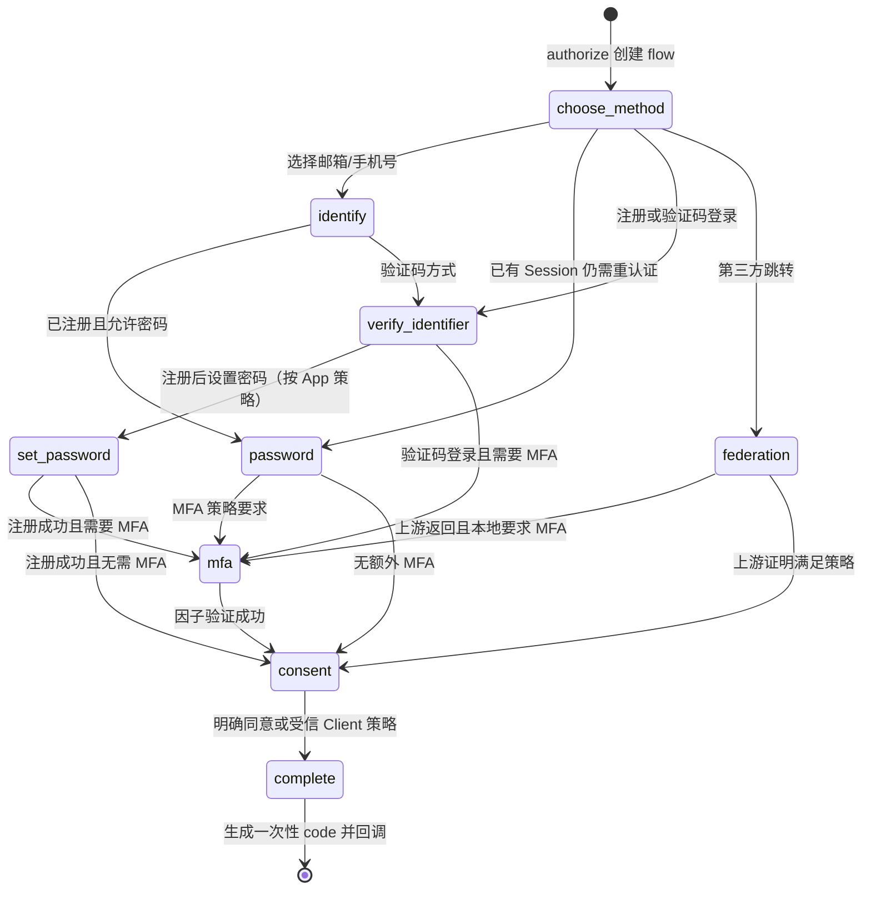

# 11. 默认登录页内部流程 API

状态：与核心 `authova` 同版本的**私有接口设计**，不会先写入公开 Go SDK。默认登录 UI 与核心同源交付；未来若允许部署方完全自建页面，需要另发稳定的流程 API、CORS/CSRF 威胁模型和兼容测试。下面的路径/字段足以指导核心与默认 UI 同步实现，但发布前仍需前端可用性与安全评审。

## 11.1 入口与浏览器状态

用户访问某 App 的 OIDC authorize，核心完成 App/Client/redirect/PKCE 初步校验后写 `auth_flows`，将浏览器 302 到 `/a/{app_key}/ui/flows/{flow_id}`。`flow_id` 是高熵不透明随机值，数据库行不可跨 App 使用；浏览器另持绑定 Cookie，服务端比较其摘要。页面由 Go 核心同源提供，静态资源使用严格 CSP；所有修改状态的请求检查 `Origin`/CSRF token、绑定 Cookie 和 flow 状态。请求体中的 `app_key`/Client ID 不能覆盖 flow 已绑定的数据。

Cookie 候选：`Secure; HttpOnly; SameSite=Lax`，以 App 不同名称/路径辅助隔离；服务端始终验 `flow.app_id` 与 `session.app_id`。浏览器页面 JS 不读 Session Cookie，不持 access/refresh token。若页面被嵌入 iframe、跨站重定向或自定义域名，需独立评审 SameSite/CSP 与第三方 Cookie 行为。每个流程绝对 TTL 候选 10 分钟，关键步骤后轮换 CSRF token，密码重设与敏感绑定要求近期认证。

## 11.2 状态机



SQL `current_step` 包含图中的 `federation` 与 `set_password`。密码找回、标识变更和绑定有独立的 `flow_type`，不能把找回流程误当 OIDC 授权请求签发 code；它们使用同样的 App/Cookie/CSRF/TTL 安全边界，但结束时只完成相应状态变更。`status=completed` 后所有 POST 拒绝；`expires_at` 过期时即使未清理也拒绝。

## 11.3 内部端点与请求响应

所有路径都在 `/a/{app_key}/ui/flows/{flow_id}` 下。`POST` 请求带 `X-CSRF-Token`，成功可返回 JSON `next_step` 或 303 页面跳转；为了便于自动化测试，服务端内部用统一 FlowState 输出，但不得包含密码/OTP/token。错误使用私有 UI 错误码，外部提示要避免账号枚举。

| 方法与相对路径 | 输入 | 输出/副作用 | 失败与限速 |
| --- | --- | --- | --- |
| `GET /` | Cookie + flow ID | 页面所需 `allowed_methods`、App 显示名、`current_step`、CSRF | flow 不存在/跨 App/过期统一失效页 |
| `POST /identify` | `kind=email|phone`, `value` | 规范化，选择允许步骤；不返回“是否存在账号” | 按 App/IP/标识摘要/设备限速 |
| `POST /password` | `identifier`, `password` | 核验密码、User 状态、更新 flow 的 User/认证时间 | 错误统一；KDF 并发预算独立 |
| `POST /challenges` | `purpose`, `channel`, `destination` | 原子写 challenge 和加密 outbox；返回 `challenge_id` 与统一 accepted | 重发间隔、每日费用/目的地限额；供应商结果不影响 accepted 的含义 |
| `POST /challenges/{challenge_id}/verify` | `code` | 条件更新挑战为 consumed，标记 flow 已验证 | 尝试上限、TTL、重复使用拒绝 |
| `POST /register` | 验证证明引用、可选密码与资料 | 同事务建本 App User/标识/凭据，写审计，进入 MFA/consent | active 标识冲突、证明不匹配、DB 故障均不建半账号 |
| `POST /mfa/totp` | `code` | 验 TOTP 并记录 `mfa_time` | 窗口/重放/限次；管理用户强制 |
| `POST /federation/{connection_id}/start` | 仅 flow/CSRF | 生成上游 state/nonce/PKCE，302 上游 | connection 不属 App/停用拒绝 |
| `GET /federation/callback` | 上游 code/state | 核验并消费上游 flow，再由核心绑定 User | 状态错/上游失败不建立 Session |
| `POST /consent` | `approved_scopes`, `approved_audiences`, `terms_version` | 只接受原请求与 Client 注册上限内的子集，记录同意 | 提权 scope/跨 Client 拒绝 |
| `POST /complete` | CSRF + flow | 原子建 App Session/code，303 精确注册的 redirect URI | 已完成/过期/用户禁用/App 暂停拒绝 |
| `POST /cancel` | CSRF + flow | `cancelled`，返回安全的取消页面 | 不向未注册 URI 泄露参数 |

示例：

```http
POST /a/a1b2c3d4e5f6/ui/flows/6e1f.../challenges
Content-Type: application/json
X-CSRF-Token: <anti-forgery-value>
Cookie: <App1-flow-cookie>

{"purpose":"register","channel":"email","destination":"user@example.com"}
```

```json
{"challenge_id":"11111111-1111-4111-8111-111111111111","accepted":true,"next_step":"verify_identifier"}
```

上面的 `accepted` 只说明请求被系统接受进入投递流程，绝不证明邮件已送达或身份已验证。`GET /` 页面不能将未使用的 OTP、密码哈希、Client Secret 或整个 `auth_flows` 行序列化到浏览器。

## 11.4 找回密码、变更标识与第三方绑定

- **找回密码**：单独 `purpose=reset_password` flow，发送响应统一；挑战验证后允许设置新密码，写入新 verifier，按 App 策略撤销所有 Session/refresh family，通知旧联系方式。不能用仅有的未验证邮箱作为恢复依据。
- **变更邮箱/手机号**：要求已有 Session 的近期认证 + 新地址验证；原 active 标识退役、新 active 标识和 lookup aliases 在一个事务变更。旧地址收到安全通知，不在通知中泄露新完整地址。
- **绑定外部身份**：要求已登录本地 User 最近认证，再走上游 state/nonce；回调用 `(app_id,connection_id,upstream_issuer,sub)` 事务唯一绑定。若该上游身份已绑定其他 User，拒绝并审计。
- **解绑**：至少保留另一种已验证登录方式；解绑后旧上游回调不得继续命中该 User。

这些操作的用户自助公开 API 尚未冻结；默认 UI 可以先调用同版本私有流程接口。管理 API 无权直接读取或设置用户密码/验证码。未来开放自定义登录 UI 时，先把挑战与 CSRF/跨源策略作为一个完整稳定契约发布，而不是将私有 URL 直接作为“可二开 API”。

## 11.5 时序和验收用例

1. App1 flow/Cookie/CSRF/challenge 各自发送到 App2 页面或端点，全部拒绝；同浏览器对两个 App 可同时保有独立流程，不互相覆盖。
2. 过期、已完成、已取消、错误步骤、重复 OTP、密码错误、供应商未知结果都不能进入 complete。
3. 两个并行注册相同 App 标识，只一方占用 active 唯一键；App1/App2 同标识可分别注册。
4. 登录成功后 Session handle 轮换；退出/禁用后页面和刷新不能恢复旧会话。
5. 用户拒绝 consent、Client 请求未注册 scope、浏览器改 redirect URI 时，不向未注册地址发 code。
6. CSRF、XSS、CSP、点击劫持、Origin/代理头伪造、任意 URL 重定向和日志敏感值用自动化与独立安全评审覆盖。
