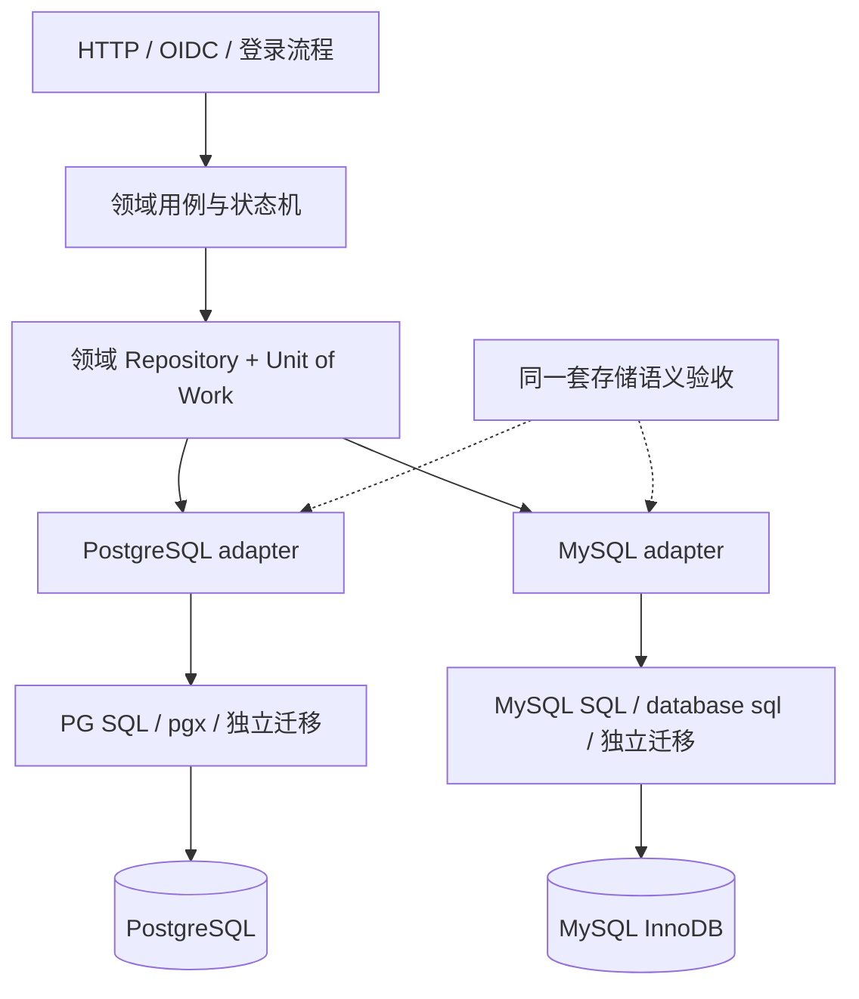

# 12. 存储抽象与多数据库设计

修订日期：2026-10-11。**支持 PostgreSQL、MySQL 的存储抽象是已确认需求；接口、实现和兼容矩阵仍为设计，当前没有可运行的数据库适配器。** 本章取代原方案中“核心必须绑定 PostgreSQL”的假设。现有 `schema-v1.sql` / `rls-v1.sql` 保留为 PostgreSQL 物理设计草案，不能用来证明 MySQL 已支持。

## 12.1 支持范围与选择方式

首批正式目标为 PostgreSQL 17/18 与 MySQL 8.4 LTS + InnoDB；具体 patch 在发布时锁定。一个部署选择一个事务事实源，App、User、Session、协议凭据、固定管理授权、审计和 outbox 在同一事务数据库中。部署配置决定适配器，业务请求不能自行指定数据库。MySQL 的 LTS 路线见[官方版本说明](https://dev.mysql.com/doc/refman/8.4/en/mysql-releases.html)。

| 范围 | 产品承诺的目标 | 当前状态 |
| --- | --- | --- |
| PostgreSQL / MySQL | 对外 API、身份语义、事务不变量和撤权规则相同；两者都是发布验收对象 | 设计目标；仅已有 PG DDL 的历史基础验证 |
| 各数据库物理优化 | 允许不同索引、SQL、连接池和迁移方式，分别给出容量报告 | 待实现/基准 |
| MariaDB、SQLite、TiDB、兼容 PG 协议的分布式库 | 可增加适配器；协议兼容不能代替语义兼容验收 | 未承诺支持 |
| 非关系数据库 | 需要另证事务、唯一性、跨聚合写入和持久一次性消费 | 不列入首批后端 |
| 在线切换 PG ↔ MySQL | 需要停写/迁移/校验/切换方案及 key/issuer 保持规则 | 独立迁移能力，不能靠修改 DSN 实现 |

Valkey 缓存/限流与事务存储分别抽象。缓存失效不能改变数据库中的身份、唯一绑定、撤销和一次性状态。首版不在同一部署内混用“用户在 MySQL、会话在 PG”的事实源。

## 12.2 抽象位置



领域层拥有注册、绑定、refresh 重用撤销、管理授权变更等规则；存储层实现作用域查询、约束、锁、条件更新、快照与提交。领域层不接收 `pgx.Tx`、`sql.Tx`、驱动错误或 SQL 字符串。协议库的 storage 接口也通过 Authova 用例与事务适配，不能另开不受控事务。

抽象以领域能力为单位，例如 `FindVerifiedIdentifier`、`LockRefreshFamily`、`ConsumeAuthorizationCode`、`LoadSessionState`。不提供允许任意表名/条件的通用 `Find(table, filter)` 作为核心接口。SQL 方言差异和错误码归一化由各适配器处理；身份/用户状态机不复制到两个 adapter 中。

## 12.3 Go 接口形态与事务组合

以下是说明边界的接口草案，类型和包组织须在正式实现评审后冻结：

```go
type Store interface {
    ReadApp(ctx context.Context, scope AppScope, opts ReadOptions,
        fn func(AppReader) error) error
    WriteApp(ctx context.Context, scope AppScope,
        fn func(AppTx) error) error
    ReadPlatform(ctx context.Context, scope PlatformScope, opts ReadOptions,
        fn func(PlatformReader) error) error
    WritePlatform(ctx context.Context, scope PlatformScope,
        fn func(PlatformTx) error) error
}

type AppTx interface {
    Identities() IdentityRepository
    Protocol() ProtocolRepository
    Clients() ClientRepository
    Sessions() SessionRepository
    AdminGrants() AdminGrantRepository
    Audit() AuditWriter
    Outbox() OutboxWriter
}

type ProtocolRepository interface {
    LockRefreshFamily(ctx context.Context, id FamilyID) (RefreshFamily, error)
    GetRefreshToken(ctx context.Context, digest TokenDigest) (RefreshToken, error)
    MarkRefreshUsed(ctx context.Context, id TokenID) (changed bool, err error)
    InsertRefreshToken(ctx context.Context, token NewRefreshToken) error
    RevokeRefreshFamily(ctx context.Context, id FamilyID) error
}
```

`AppScope` 由可信入口构造。Repository 在事务建立时绑定该作用域，方法中的裸 UserID/FamilyID 不能改变 App；SQL 仍显式包含 `app_id`。`AppTx` 所有 repository、audit/outbox 共用同一个数据库事务，禁止一个用例中隐式开启第二条连接。事务对象不能逃逸回调、用于后台 goroutine 或在提交后继续访问。

未登录的公开 App/issuer 定位使用独立、只读且受限的 routing repository，只返回必要路由状态/公开 Console Client 配置；不能得到 PlatformReader 或跨 App User 查询能力。

| 契约 | 必须满足的行为 |
| --- | --- |
| 写入原子性 | 领域数据、审计、outbox、幂等记录一起提交或回滚；无跨数据库事务 |
| 条件更新 | 返回是否发生预期状态转移；不把 MySQL affected rows 差异直接交给领域层判断 |
| 锁范围 | refresh 按 family 串行；code 按一次性记录原子消费；唯一性以 DB 约束最终裁决 |
| 读取一致性 | 内省和管理校验读主库新快照，关联状态属于同一快照；不提供业务决策版本 |
| 生命周期 | deadline、rollback、连接归还明确；PG App 上下文只在事务内，MySQL 不依赖连接变量隔离 |
| 重试 | 默认回调只执行一次；只有明确已回滚且可安全重跑的死锁/序列化失败才有界重试 |
| 提交未知 | 网络中断可能导致提交结果未知，返回独立内部分类；同幂等键对账，不盲目重做安全写入 |

外部邮件/短信/IdP/KMS 调用和 token 明文响应在事务之外。出错后不能从 Valkey 恢复“code 没消费”“会话没撤销”等推断。`SKIP LOCKED` 可用于 outbox 领取任务，不能用于跳过用户/会话状态而判定 active。[MySQL 锁定读取说明](https://dev.mysql.com/doc/refman/8.4/en/innodb-locking-reads.html)。

## 12.4 必须分别处理的数据库差异

| 事项 | PostgreSQL adapter | MySQL adapter | 统一语义要求 |
| --- | --- | --- | --- |
| UUID | `uuid` | 推荐 `BINARY(16)`，由 Go 做统一字节编码 | API 仍是 UUID 字符串；不混用 UUID 字节交换格式 |
| 时间 | `timestamptz` | `DATETIME(6)` + UTC 会话/编解码约束 | Go 统一 UTC；TTL/版本不按本地时区推断 |
| 摘要/密文 | `bytea` | 摘要 `BINARY(32)`、密文 `BLOB` | 固定摘要长度；禁止文本排序规则改变比较 |
| 标识字符串 | 明确 byte-wise 比较/约束 | 对 key、issuer、Client ID、标识类型 使用明确的二进制/大小写敏感比较 | Email 规范化由应用完成；不依赖 DB 默认 collation |
| scopes / audiences | 现草案 `text[]` 可保留为 PG 物理实现 | 可用子表或 JSON，由 adapter 映射 | 领域是集合；授权不能依赖某库的 JSON/数组查询规则 |
| JSON | `jsonb` | `JSON` | 只做配置/事件结构；关键唯一性/授权字段用类型化列 |
| active 唯一性 | 部分唯一索引 | 活跃占用表或 nullable generated column + unique index | 活跃唯一、历史可保留；不能简单增加 `status` 到唯一键 |
| 当前签名 key | 部分唯一索引 | 唯一 current-key 指针或 generated column | 同一 App/用途至多一个当前 signer |
| 外键 | 复合 FK | 显式复合 FK + 被引用的标准唯一键 | App1 Session 不能引用 App2 User；不关闭外键提升写速 |
| 返回更新后的行 | `RETURNING` | 同一事务更新后按 PK 读取，检查状态转移 | 不依赖另一连接的读结果；不用 `REPLACE` 实现安全更新 |
| upsert | `ON CONFLICT` | `ON DUPLICATE KEY` 或显式冲突处理 | 幂等/冲突键明确；不能吞掉非目标唯一冲突 |
| DDL | 多数操作可事务化，部分索引操作例外 | 许多 DDL 隐式提交 | 逐步可恢复，不声称一份多语句迁移整体可回滚 |
| 分区 | 按 PG 主键/唯一键规则设计 | InnoDB 的外键与用户分区限制须单独处理 | 不为分区删除核心跨 App FK |

MySQL 的生成列/索引可作为具体实现工具；通用逻辑模型优先复用现有 active lookup aliases 作为唯一占用记录。[生成列索引](https://dev.mysql.com/doc/refman/8.4/en/create-table-secondary-indexes.html)。MySQL 外键不支持用户分区的 InnoDB 表，不能将 PG 的分区/约束组合直接照搬。[外键约束](https://dev.mysql.com/doc/refman/8.4/en/create-table-foreign-keys.html)。DDL 隐式提交见[官方说明](https://dev.mysql.com/doc/refman/8.4/en/implicit-commit.html)。

## 12.5 隔离能力必须如实区分

**所有后端的必备基线**：可信作用域、限定 repository、参数化 SQL、每个 App 查询带范围、跨关系复合 FK、受限 DB 账号、独立平台路径、缓存/任务范围、同一套跨 App 反例。Repository 从未绑定 AppScope 时拒绝执行；平台访问不能通过空 AppScope 触发。

**PostgreSQL 额外强制 RLS**：继续采用 `SET LOCAL`、FORCE RLS 和角色分离。它可阻止漏写 App 条件的读取；现有 RLS 草案仍只属于 PG。不能因为引入公共接口就取消该防线。

**MySQL 共享表画像**：不具备这套 PG 原生行策略，复合 FK 能防跨 App 引用，不能阻止遗漏范围的 SELECT。SQL 审核/生成规则、作用域测试与最小权限降低风险，但不是同等级数据库行隔离。MySQL 官方权限机制可见[权限列表](https://dev.mysql.com/doc/refman/8.4/en/privileges-provided.html)；本方案不采用自定义会话变量 + view 来宣称等价 RLS。

部署若要求“即使查询遗漏范围也必须由数据库拒绝跨 App 读取”，应选择 PG RLS 画像，或未来经验证的专用数据库/账号路由方案。专用库会增加迁移/连接池/运维成本，首版不默认采用。启动时检查部署要求与 adapter capability，发现不兼容就失败，不能静默关闭防线。

## 12.6 事务隔离与统一错误

写事务建议两后端显式使用 `READ COMMITTED` + 必要行锁/唯一约束/条件更新，不能使用各自默认值来“碰巧等价”。多语句内省/管理校验只读快照使用显式 `REPEATABLE READ`，在新主库事务中读取；禁止复用一个已持有旧快照的长事务处理新内省/管理请求。MySQL consistent read 与 locking read 的快照不同，写流程在加 family lock 后读取/重查 token，不把锁前旧读取当最终状态。[MySQL 一致性读取](https://dev.mysql.com/doc/refman/8.4/en/innodb-consistent-read.html)。

内部错误归一化为：`NotFound`、`UniqueConflict`（含约束名）、`ForeignReferenceConflict`、`VersionConflict`、`RetryableRollback`、`DependencyUnavailable`、`CommitOutcomeUnknown`。DB 原始错误仅写受控脱敏诊断；公共 API 继续映射现有 HTTP/code，标准 OAuth 错误不改格式。死锁重试应重跑整个事务，且 ID/幂等键稳定，不能只重跑最后一条 UPDATE。

## 12.7 工具与工程结构

建议 PG 使用 pgx/v5，MySQL 使用 `database/sql` + `go-sql-driver/mysql`；各自 SQL 用 sqlc 生成后包在 repository 中。sqlc 的 Go 支持矩阵把两者列为 Stable，但这不验证 Authova 的业务语义。[sqlc 支持矩阵](https://docs.sqlc.dev/en/latest/reference/language-support.html)。

```text
internal/storage/
  postgres/       # pgx、作用域事务、PG 查询映射和错误映射
  mysql/          # database/sql、MySQL 查询映射和错误映射
  conformance/    # 同一组后端语义验收（具体位置可放 integration tests）
migrations/
  postgres/       # PG DDL/索引/RLS
  mysql/          # MySQL DDL/索引/GRANT
queries/
  postgres/
  mysql/
```

领域 repository 的最小接口放在消费它的领域包；UoW 的组合由 application 层定义，storage 适配器实现，避免所有领域反向依赖一个巨大的 storage 包。外部二开不直接依赖生成器类型或内部 SQL schema。

迁移工具改为跨库候选 `golang-migrate/migrate`（支持 PG/MySQL、MIT），替代原 PG 专用 tern 基线；最终锁定版本前验证迁移锁、失败恢复与大表 backfill。两套迁移以同一领域 schema release 配对，但分别记录执行状态，MySQL DDL 失败不能依赖事务回滚恢复。[工具支持](https://github.com/golang-migrate/migrate)、[LICENSE](https://github.com/golang-migrate/migrate/blob/master/LICENSE)。

新依赖许可：`go-sql-driver/mysql` 是 MPL-2.0；其上游说明未修改的驱动可用于私有/商业项目，分发修改过的 MPL 文件有相应源码义务。[驱动说明](https://github.com/go-sql-driver/mysql)。MySQL Server 的 GPLv2/商业许可与 Go 驱动许可分开；客户连接现有实例和产品捆绑分发服务器需要分别判断。[Oracle 分发许可说明](https://www.mysql.com/about/legal/licensing/oem/)。

## 12.8 兼容与发布门槛

正式支持一个后端，必须在真实数据库上通过以下同一组语义验收，不能以内存 fake 或只跑 DDL 替代：

1. App1/App2 同标识独立注册；跨 App 引用失败、查询/列表/导出不越界；缺 AppScope 拒绝。PG 额外跑漏范围查询被 RLS 拒绝；MySQL 明确不宣称该额外能力。
2. 并发同标识注册、同 code 兑换、同 refresh family 轮换和重用；领域/审计/outbox 一起原子提交。注入回滚、死锁和提交响应丢失，区分已回滚与提交未知。
3. 新主库快照内省/管理校验看见此前已提交的身份、会话和管理授权变更；延迟副本不能用于这些撤销路径，不缓存旧 active/allow。
4. 活跃唯一/历史保留、固定管理员授权唯一性、签名 key 切换、HMAC alias 轮换、UUID/大小写/时间精度一致。
5. 空库安装、N-1→N 升级、失败迁移恢复、备份/密钥恢复、outbox 领取与重放；两后端分别在 1200 万用户与热点 App 数据上压测。

支持两后端意味着 SQL、迁移、故障测试和性能调优都要维护两份，这是适应部署方现有基础设施的产品成本。可复用的是领域代码与验收语义；能否宣称同样 QPS/延迟，要由两份实际报告决定。本轮只修订设计，没有增加 MySQL 实现或性能证据。
