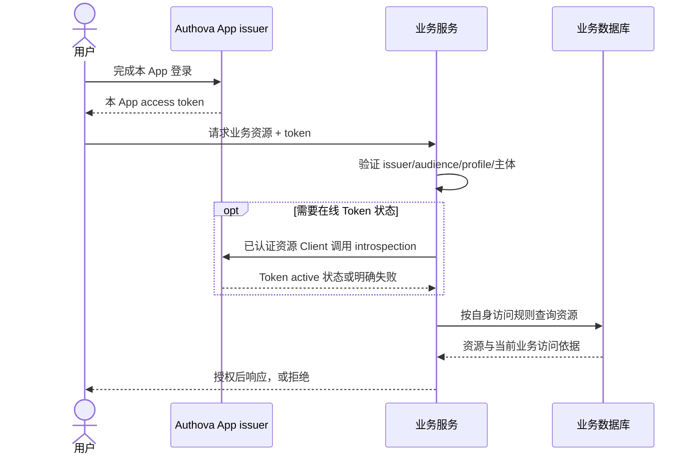

# 13. 首版范围与数据所有权

日期：2026-10-11。**用户已确认首版只专注核心能力，组织相关设计全部移除。** 此决定取代 v0.3 的可选组织及业务 RBAC 提案；不建立候选扩展清单、空模块或预留接口。未来新需求另行评审，不属于首版交付依赖。

## 13.1 首版交付范围

| 能力 | Authova 拥有的事实与行为 |
| --- | --- |
| 独立 App | App 生命周期、身份域、issuer、密钥、隔离与配置 |
| 用户身份 | User、已验证 Email/Phone、密码与 MFA 凭据、找回、外部身份绑定 |
| 登录接入 | 本地认证、验证码投递、标准第三方登录和必要供应商适配 |
| 会话 | 浏览器 Session、退出、封号、会话撤销和安全版本 |
| OAuth/OIDC | Client、Code+PKCE、scope/audience、同意、Token、刷新轮换、Discovery/JWKS、撤销与内省 |
| 管理 | 固定平台/App 管理角色、配置、用户/会话操作与 Console |
| 正式交付 | 审计/outbox、PG/MySQL 存储抽象、迁移、监控、升级和恢复验收 |

业务组织目录、成员关系、部门/分组、邀请、组织身份策略、业务 Role/Permission、业务授权 Check 和通用策略引擎均不属于首版。Authova 自己的管理权限与 OAuth scope 仍是核心安全能力。

## 13.2 数据与 API 清理规则

- 删除组织与成员表、业务角色/权限/绑定表、服务 Check 授权表和业务策略版本表；RLS 清单同步清理。
- 删除对应 OpenAPI 端点、Schema、参数和错误；不保留 `organization_id`、成员状态、业务角色 Claim 或空权限引擎接口。
- 保留 `platform_operator_roles`、`app_admin_grants`，仅保护 Authova 管理接口，使用代码固定的角色矩阵。
- 保留 App/Client `config_version`、User `session_epoch` 和 OAuth consent/grant，分别承担配置并发、会话失效及协议授权，不复用业务策略版本。
- 清理实施阶段、负载模型、流程图和待决策项中的业务组织/权限依赖。Git 历史可追溯讨论，当前文档不承诺被移除能力。

## 13.3 与业务系统的连接

业务服务验证 Token 的 issuer、audience、签名/profile、期限及主体类型，以 `(issuer, sub)` 映射本地用户。User 和 Client 身份不混用；两个 App 的同邮箱不构成同一主体。

认证成功后，业务服务依据自己的数据与规则判断操作许可。Authova 不接收业务资源 ID 来决定访问，也不在普通登录时调用业务组织目录。需要实时 Token 状态的资源服务使用标准内省；内省只确认身份/会话/Token 状态。

## 13.4 首版验收的实际影响

普通注册、登录、刷新和用户管理只依赖核心状态及配置好的身份/投递提供方。数据集以用户、标识、凭据、绑定、Session、code/refresh、审计为主，不再装载虚假成员和业务角色。

5000+ QPS 分别验证离线验签、在线内省、刷新和交互登录，不用原业务 Check 目标替代内省。固定管理员授权的越界、撤销、最后 owner、暂停后的恢复路径仍必须测试；组织权限不再是发布 gate。

三个项目继续为 `authova`、`authova-contracts`、`authova-console`。本决定收窄首版能力，没有新增项目、独立服务或额外事实源。
