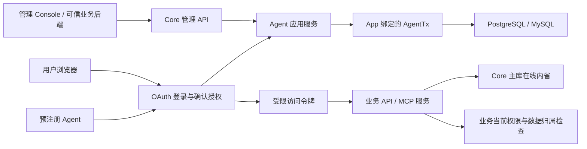
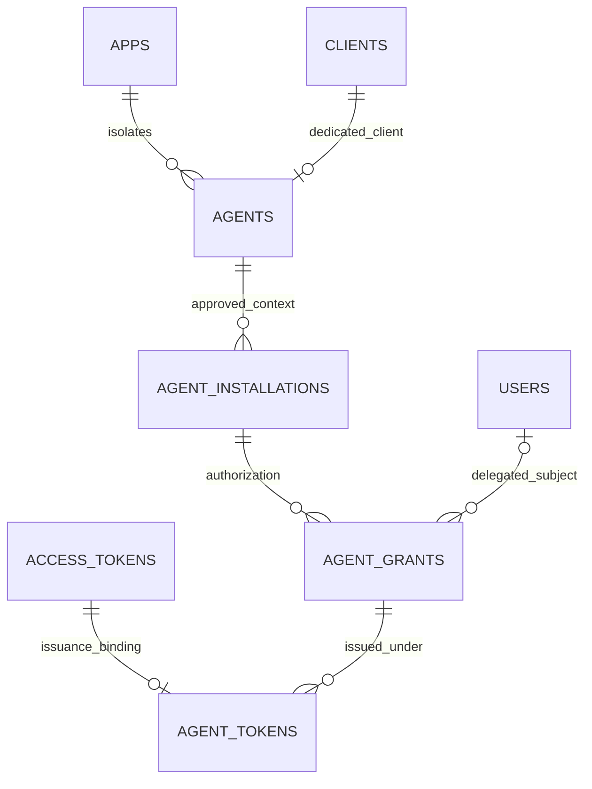
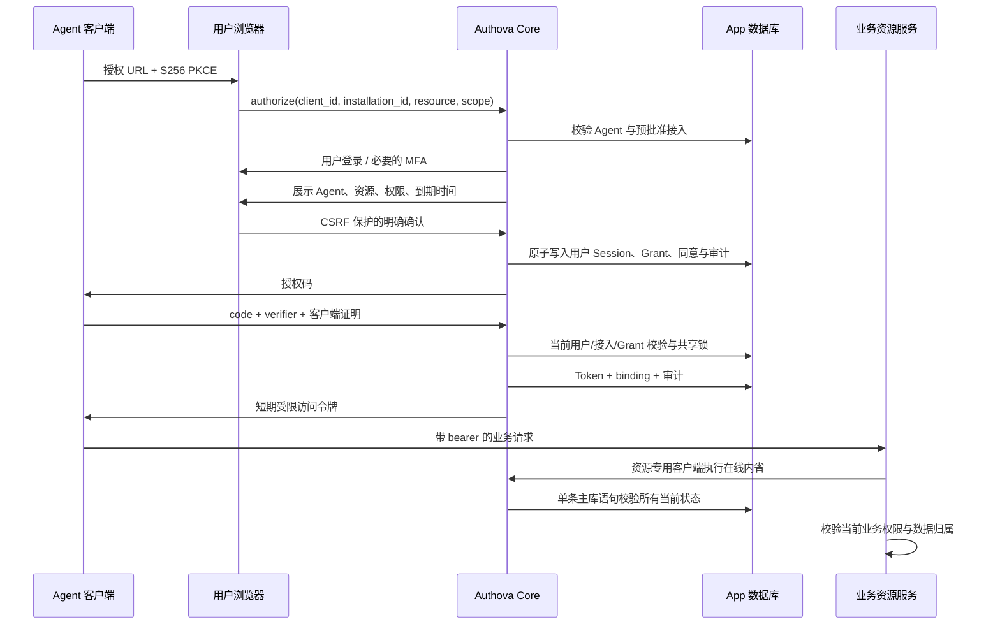

# Agent 身份、接入与委托授权

日期：2026-10-16。用户确认实施的增量范围。与人类登录共享 Core、App 事务、OAuth/OIDC、签名密钥和审计；没有模型调用依赖。本设计扩展 `13-v1-scope.md`，不恢复组织目录或业务权限引擎。

## 1. 产品边界

目标：业务系统能够允许某个 Agent 接入，让它以机器身份运行，或在用户明确确认后代表该用户操作。用户可以独立撤销一份授权。

- **App** 仍是独立业务系统的身份隔离单位。App1 的 Agent、接入、用户、会话和授权都不能用于 App2。
- **tenant_id** 是 App 内的外部业务租户标识。Authova 不维护租户组织树、成员关系和业务角色。
- **用户委托**：`sub` 是用户，`act.sub` 是实际执行的 Agent；权限来自客户端上限、接入上限、用户同意范围及业务服务当前权限的交集。
- **自主运行**：`sub` 是 Agent 的 OAuth Client ID，没有用户 `act`；责任人不会被当作被代理用户。
- Authova 证明身份、授予受限凭证并管理生命周期；业务 API/MCP 服务检查当前用户权限、资源归属和实际操作条件。

首版仅接收预注册 Agent。支持标准 authorization_code + S256 PKCE、refresh_token 和 client_credentials。使用标准 `act` 委托表达，但**没有实现 RFC 8693 Token Exchange 端点**。没有自动子 Agent 转授权、外部 Token Vault 或通用 Agent 执行器。

## 2. 对象与归属

| 对象 | 事实与约束 |
| --- | --- |
| Agent | App 内独立身份；专用 OAuth Client；名称/用途/运行方式/业务 scope 和资源 URI 上限；令牌/授权期限 |
| AgentInstallation | 某个上下文允许 Agent 接入：外部租户、可选绑定用户、责任人、一个目标资源、scope/mode 子集、到期时间 |
| AgentGrant | 一份真实用户同意或管理员机器授权；主体、执行者、接入、资源、scope、期限、撤销状态 |
| AgentTokenBinding | 每个访问令牌的签发快照；绑定 grant 和 Agent/installation/grant 配置版本 |
| OAuth Session / refresh family | 沿用现有模型；每次委托登录有自己的用户会话，撤销一个 Agent 授权不撤销用户的其他正常会话 |

一次临时任务不创建用户或 OAuth Client。需要独立凭证、撤销和生命周期的长期 Agent 才注册持久身份。普通运行通过业务追踪 ID 与令牌 `jti`、`grant_id` 关联。

### 外部租户的可信边界

租户级用户委托必须指定 `user_id`。该用户必须存在于同一个 App。管理员/可信业务后端负责先核实用户属于该业务租户，再配置接入。确认登录时再次校验登录用户与接入绑定一致。

这是**逐用户预批准**的首版模型，没有“输入一个租户 ID 就证明成员资格”的接口。租户管理员自助接入需要业务自己的 BFF 验证管理员资格；当前 Authova 管理接口仍要求平台或 App 的 owner，不直接提供外部租户管理员身份。

App 范围接入允许空 tenant_id；可为空 user_id，让各用户分别确认自己的授权。自主模式不会因为接入记录中有 user_id 而继承该用户权限。

### Agent 凭据的部署边界

一个机密 Agent 的 OAuth 客户端凭据属于该 Agent 的服务端运行方。接入记录是对这个身份的批准，不是另一份部署凭据。同一个托管 Agent 可选择它已获批的不同租户接入；签发出的每个令牌只绑定其中一个接入与租户。

不同租户各自运行、彼此不信任的 Agent，必须分别注册 Agent/客户端并使用独立密钥。不要把托管服务的全局 client_secret 分发给租户。浏览器或本地公共客户端使用 PKCE 和逐用户委托，不持有共享机密客户端密钥。Authova 没有用一个由调用者填写的 tenant_id 来证明调用者属于某个租户。

## 3. 模块与事务



- `domain/agent.go`：事实模型，独立于 SQL/HTTP。
- `ports/agents.go`：同一 AppTx 的存储能力，不允许传另一个 App ID。
- `application/agents.go`：注册、接入、用户同意、授权更新与撤销、签发收窄。
- `storage/sqlstore/agents.go`：两库适配、固定版本加密 DTO、CAS 与共享锁。
- `protocol/agents.go`：令牌身份表达和内省一致性校验。
- `transport/agent_management.go` / `agent_account.go`：管理及用户自助入口。
- Contracts `sdk/agent`：资源侧实时内省与业务权限回调。

锁顺序：已有用户凭证流程先锁 User，再读取 Agent → Installation → Grant。签发使用配置共享锁，允许同一 Agent 的并发签发；管理写使用相应对象的排他锁。撤销授权只共享锁定祖先，再排他锁定该授权，避免阻塞无关用户。签名与事务提交仍在同一有界请求事务内。

## 4. 数据库

迁移版本 **6**，旧迁移不变。MySQL 新表显式使用 `utf8mb4_bin`，避免继承数据库默认排序规则导致复合 FK 不兼容。PostgreSQL 四张表均启用 FORCE RLS，启动检查完整清单为 24 张 App 表。



| 表 | 主键与主要列 | 索引/约束 |
| --- | --- | --- |
| agents | `(app_id,id)`；client_id/status/config_version/payload | unique `(app_id,client_id)`，复合 FK 到 clients |
| agent_installations | `(app_id,id)`；agent_id/tenant_id/user_id/status/config_version/expires_at/payload | `(app_id,agent_id,id)`、`(app_id,tenant_id,id)`、`(app_id,user_id,id)`；复合 FK 到 Agent/User |
| agent_grants | `(app_id,id)`；agent_id/installation_id/user_id/status/config_version/expires_at/payload | Agent、installation、user 的 keyset 分页索引和 App/expiry 索引；复合 FK |
| agent_tokens | `(app_id,token_id)`；agent_id/installation_id/grant_id/tenant_id/mode/user_id/三个配置版本 | 复合 FK；access_token 删除时 cascade；grant 索引 |

名称、用途、责任人和完整授权事实使用独立冻结 DTO + AEAD 加密；AAD 包含 App、对象类别及行 ID。新增三类密文纳入主密钥 rewrap/校验/退役演练。token binding 只保存令牌上下文与版本，不保存 bearer token。

清理沿用有界 App 事务。过期 access_token 删除后级联移除 binding；过期委托与接入按照审计保留窗口清理，并要求没有 token 引用。可续期的自主接入保留其历史授权直到接入到期，避免删除当前自主授权回执后无法更新。`auditDays=0` 表示不做相关保留期清理。持久 Agent 身份不被静默删除。

## 5. 用户委托流程



授权最晚到期时间在发起流程时固定，确认页与实际 Grant 使用同一个截止时间。用户不确认或取消时不创建委托。公开客户端可以用 PKCE，不发 client_secret；自主模式仅允许机密客户端。

请求示例（占位值不是凭据）：

```text
GET /a/{app_key}/authorize?
 client_id={agent_client_id}&installation_id={installation_id}
 &resource=https%3A%2F%2Fservice.example%2Fmcp
 &response_type=code&scope=openid%20offline_access%20tickets%3Aread
 &redirect_uri={exact_registered_uri}&state={random_state}
 &code_challenge={S256_challenge}&code_challenge_method=S256
```

## 6. 自主运行流程

创建含 autonomous 的接入时建立独立机器授权。令牌请求必须给 installation_id，并携带 client_secret_basic；可给 resource，若给出必须与接入一致。

```text
POST /a/{app_key}/oauth/token
Authorization: Basic {client authentication}
Content-Type: application/x-www-form-urlencoded

grant_type=client_credentials&installation_id={id}
&resource={resource_uri}&scope=tickets%3Aread
```

授权期限与令牌期限独立。自主授权过期/撤销后不自动复活；owner 可通过 renew 明确创建替代授权，旧授权保持撤销。接入到期后不能通过 renew 延长接入期限，需要重新审批接入。

## 7. 令牌与撤销

- Agent 令牌仍是 `typ=at+jwt`、RS256；保留原 OAuth/OIDC 安全校验。
- 添加 `agent_id`、`installation_id`、`grant_id`、`agent_mode`，有业务租户时添加 `tenant_id`。
- 委托：`sub=user_id`、`act={sub:agent_id,client_id:oauth_client_id}`。
- 自主：`sub=oauth_client_id`、无 `act`；不是任何用户的身份。
- audience 只有接入批准的一个资源，scope 不能扩大；访问令牌 30–300 秒，授权最长 30 天。
- refresh 保留原 grant/installation；每次签发重新检查用户、MFA、epoch、客户端、接入、授权及有效期，不信任旧 allow 缓存。
- 在线内省在原主库语句中连接新事实，并校验三个配置版本和租户一致性；撤销提交后的新内省不再返回 active。
- 管理更新采用 config_version CAS。任何 Agent/接入版本更新都会使旧绑定的访问令牌在线失效；有效的原授权可在重新校验后刷新出新令牌。
- 离线 JWT 验签仍有最多 300 秒的窗口。**在线撤销不代表已经发出的离线 JWT 立刻失去密码学有效性**；已经通过检查的在途业务操作也不因后续撤销自动回滚。

审计包含 Agent 注册、接入、grant 创建/用户同意/撤销和令牌签发。grant 生命周期审计保存 Agent、用户、外部租户、接入及模式；签发通过 grant_id/jti 关联。下游业务动作须由业务服务记录，不能把签发日志当成业务动作完成证明。

## 8. 管理 API

前缀 `/api/v1/apps/{app_id}`；Console 使用同源 BFF。正式机器可读契约在 Contracts `openapi/v1/management.yaml`，Go/TS 均从契约生成。

| 路径 | 方法 | 行为 |
| --- | --- | --- |
| /agents | GET / POST | keyset 列表 / 注册专用 OAuth Agent |
| /agents/{id} | GET / PATCH | 读取 / 更新名称、说明、启停状态 |
| /agent-installations | GET / POST | 有界筛选 / 批准接入 |
| /agent-installations/{id} | GET / PATCH | 读取 / 启停 |
| /agent-installations/{id}/renew | POST | 明确替换自主授权 |
| /agent-grants | GET | 按 Agent、installation、用户、租户筛选 |
| /agent-grants/{id} | GET | 读取授权与撤销状态 |
| /agent-grants/{id}/revoke | POST | CAS 撤销授权 |
| /agent-operations/{operation_key} | GET | 创建者限定、不含密钥的创建回执 |

创建要求 Idempotency-Key，回执最多保留十分钟；同一 key 不接受不同 payload。注册 Agent 的密钥只在 POST 确认响应及创建者限定的幂等 replay 中返回；GET 回执只返回 kind/resource_id。网络中断/结果未知先读回，不自动重放。未收到的密钥通过现有 Client 轮换入口处置。

所有 Agent 变更只允许 owner；专用 Client 的原编辑和密钥轮换入口也执行 owner 检查并保留权限上限。admin 可读，平台 auditor 不得读取包含用户身份的接入/授权私有列表。用户可以在 `/a/{key}/ui/account/agents` 查看并撤销自己的授权：Cookie、同源 Origin、CSRF、确认框及版本全部校验，不接受别人的 grant ID。

App 管理 JWT 还必须来自该 App 的内置 Console 客户端，具有唯一的管理 audience 和显式 `authova.admin` scope，且与当前存储的用户、客户端、会话和到期时间一致。只有身份 scope 的 Console 令牌不能调用管理 API；业务或 Agent 令牌不能借用用户的运营角色。

## 9. 资源侧 Go 接入

Contracts 提供 `sdk/agent`，只有标准库依赖。配置 issuer、App ID、资源 URI 和资源专用内省 Client；资源凭据与 Agent 客户端凭据分开。

```go
verifier, err := agent.NewVerifier(agent.Config{
    Issuer: "https://identity.example/a/app-key",
    AppID: "app-id", Resource: "https://service.example/mcp",
    ClientID: resourceClientID, ClientSecret: resourceClientSecret,
})
// Handle err before serving.
handler := verifier.Middleware(
    []string{"tickets:read"},
    trustedTenantResolver,
    checkCurrentBusinessPermission,
    businessHandler,
)
```

SDK 每次访问在线内省，不缓存 allow；验证 issuer/App/audience/期限/Agent/grant/租户/actor，再运行必填的业务权限回调。依赖故障返回 503；无有效身份 401；缺权限或业务拒绝 403。禁止重定向，凭据不会跟随到其他主机。空 tenant 明确表示 App 范围，不会接受任意租户令牌。

内省必须明确报告与运行模式一致的 `principal_type`：委托为 user，自主为 client。SDK 拒绝缺失/冲突主体类型、非正签发时间、倒置或超过 300 秒的期限，以及非 JSON 响应。刷新参数或授权校验拒绝不会消耗尚未使用的有效刷新令牌；真正重用已成功轮换的令牌仍会撤销整个 family。

`ProtectedResourceMetadata` 提供资源发现。示例使用官方 MCP Go SDK v1.8.0 的 Stateless Streamable HTTP 和真实工具调用；**不声称已完成 ChatGPT/Claude/Cursor 的完整 OAuth 互操作认证**。当前用户授权需要预配置客户端和 installation_id；未提供 CIMD/DCR 自动注册。

## 10. 本地演示

```sh
# 三个仓库放在同一目录；需 Go（按各 go.mod）、Node/npm、Docker
# 首次安装 Console 依赖：npm --prefix ../authova-console/web ci
# Core 仓库；先启动开发依赖
docker compose -f deploy/compose.dev.yaml up -d
python3 scripts/agent-demo.py start
python3 scripts/agent-demo.py status
# 停止自有进程，保留独立数据库
python3 scripts/agent-demo.py stop
```

- Console：`http://localhost:18290`，App 内“Agent 访问”。
- 用户委托 RP：`http://localhost:18288`，选择“Agent 用户委托演示”，可真实邮箱注册、确认 Agent 授权并访问资源。
- MCP/REST 示例：`http://localhost:18289`，数据明确为 synthetic。
- 专用库 `authova_agent_demo`；不重置原有 Demo。私有管理员凭据在 `.dev/agent-demo/bootstrap.json`，0600。
- 自主 Agent：`.dev/agent-demo/agent-client -config .dev/agent-demo/agent-client.json -mode mcp`，可改 `-mode rest`。CLI 不输出访问令牌。
- 示例 RP 的浏览器绑定与 Core 授权流程都限制为十分钟；不要混用 localhost 与 127.0.0.1 的 Cookie 域。
- 注册、接入、刷新和撤销都访问真实 Core/数据库；示例工单是合成业务数据，不能视为真实客户业务集成。

原 Passkey 脚本入口不变；两个演示共用 `scripts/local_demo.py` 生命周期实现，各自使用独立端口、密钥和数据库。

## 11. 验收边界

覆盖真实 PG/MySQL、共享配置并发签发与排他撤销、租户/用户/App 绑定、过期授权、刷新不得复活撤销、公开客户端 PKCE、owner 角色、CAS/回执、保留期/主密钥轮换。另有 Contracts 资源 SDK 对真实 Core 的组合测试、官方 MCP 客户端协议测试、Console 异常/未知结果/撤销冲突交互和实际浏览器操作。

本模块没有重新证明持续 5000 QPS、千万 Agent 记录、跨地域撤销时延、外部 Agent 客户端互操作或独立安全审计通过。验收记录应区分单测、真实数据库、真实浏览器、官方 SDK 与真实外部厂商。

## 备份回退与恢复后的隔离

当前完整快照恢复使用 [身份生命周期恢复手册](../implementation/IDENTITY-REVIEW-REMEDIATION-2026-10-18.md)的 `quarantine-identities` 流程，同时隔离普通用户、operator、客户端、签名密钥与 Agent。以下说明 `quarantine-agents` 的模块内机制，不能代替完整身份恢复。

数据库完整恢复能保留快照时已经发生的撤销和 refresh used/family 状态，不能保留快照之后的事实。后续撤销、接入停用、密钥轮换可能随旧备份回退；仅验证 dump 成功和 schema clean 不足以开放 Agent 流量。

恢复目标必须先隔离流量、停止所有 Core/worker/维护写入者，使用正确主密钥和完整 keyring 验证数据，再执行本地主机维护命令 `authova quarantine-agents`。该命令需要 DB 凭据及加密密钥，没有 HTTP 入口；stdin 必须含 reason 和 `confirm=disable_all_agents`。

- 所有 Agent 与 installation 标记 disabled，并提升配置版本；清除机密 Agent 当前和 previous client secret 的摘要，保留审计归属。
- 将所有 active grant 撤销并记录撤销时间、版本和事务内审计，包含自主与逐用户委托；已经 revoked 的事实保留。
- 每个 Agent 先原子封禁身份并清除旧密钥，再按每页 100 条分别提交接入关闭、授权撤销及各自审计，避免百万 grant 累积成大事务。后续页失败不会回退已提交的封禁；保持流量隔离、核对审计后重跑，已完成部分为 no-op。用户表不批量改写；Agent 数量、接入及 grant 数量仍会影响维护窗口。
- 恢复使用前，可信 owner 根据业务权威来源重新核验成员/租户/资源/scope，设置新 secret（不保留旧 secret grace），逐项重新启用身份与接入。自主模式需创建替代 grant，委托模式需重新获取用户同意。单独重新启用配置不会复活旧 grant 或旧 secret。

单独的 `quarantine-agents` 不会重置普通用户密码、平台 operator 或业务组织目录，也不是跨库原子恢复。完整身份隔离通过当前恢复手册执行，业务成员关系仍需要部署方独立核验。离线 JWT 仍有既定最大 TTL 窗口，已经开始的业务操作不会被数据库恢复或撤销自动回滚。Agent 专项说明见 [OPERATIONS](../implementation/OPERATIONS.md#agent-备份恢复后的隔离)。
